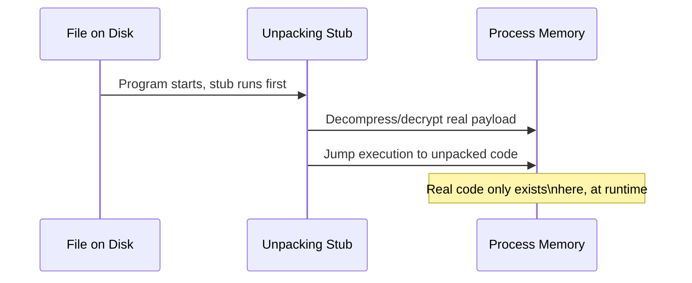

# Unpacking & Obfuscation

High entropy, minimal imports, an entry point in an unusual section — this path's static analysis lesson flagged all of these as packing indicators. This lesson covers what packing actually is, why malware (and plenty of legitimate software) uses it, and how to get past it.

## What a packer actually does

A **packer** compresses or encrypts the real program and wraps it in a small **stub** — a tiny piece of code whose only job is to decompress/decrypt the real payload back into memory at runtime and then jump execution to it. The file on disk looks nothing like the real program; only *in memory*, after the stub runs, does the actual code exist in analyzable form.



## Legitimate uses versus malicious uses

Packing itself is not inherently malicious — legitimate software vendors use packers (UPX being a common, entirely legitimate free option) to reduce file size and, to a lesser extent, add a mild speed bump against casual piracy or reverse engineering. What makes packing a red flag in malware analysis is **context**: a packed binary combined with suspicious import patterns, no valid digital signature, and other indicators from this path's static analysis lesson, together, not packing alone.

## Simple unpacking — UPX

**UPX (Ultimate Packer for eXecutables)** is free, open-source, and — usefully for learning — fully reversible with its own tool:

```bash
upx -d packed_sample.exe -o unpacked_sample.exe
```

Many real malware samples do use UPX or similarly simple packers specifically because they're free and effective enough, meaning this trivial unpacking step alone sometimes fully resolves the packing problem. Always try this first before more advanced manual techniques.

## Manual unpacking — the "dump at OEP" technique

For custom or more sophisticated packers with no automated unpacker available, the manual technique (building directly on this path's dynamic analysis lesson) is:

1. Load the packed sample in **x64dbg**.
2. Set a breakpoint on memory allocation functions the stub likely uses (`VirtualAlloc`, `VirtualProtect`).
3. Run until the breakpoint hits — the stub has now decompressed the real payload into memory.
4. Continue stepping until execution jumps to the newly unpacked code region — this jump address is the **Original Entry Point (OEP)**, where the real program's actual logic begins.
5. **Dump** the process memory at that point (tools like **Scylla**, often bundled with x64dbg, automate this) into a new, standalone file — this dumped file now contains the real, unpacked code, analyzable normally in Ghidra.

## Obfuscation beyond packing

Even unpacked code is often deliberately obfuscated to slow down analysis further:

- **String encryption** — instead of a plainly readable string like `"http://evil.com"`, the binary stores an encrypted or XOR'd version, decrypting it only at the moment it's actually used. This defeats the "start with strings" habit from this path's fundamentals lesson unless you specifically identify and reverse the decryption routine.
- **Control flow flattening** — restructuring a program's logical flow (originally clean if/else branches) into a single large, confusing dispatcher loop, making the decompiled pseudocode far harder to follow even though the underlying logic is unchanged.
- **Junk code insertion** — adding meaningless instructions that do nothing but waste an analyst's time and clutter the disassembly.
- **API hashing** — instead of importing functions by name (visible in the IAT, per the static analysis lesson), the malware calculates a hash of the function name at runtime and resolves it dynamically, hiding intended behavior from simple import-list inspection entirely.

## Import Address Table reconstruction — the step after dumping

A dumped, unpacked binary from the OEP technique above is rarely immediately usable as-is: most packers deliberately destroy or scramble the original Import Address Table before packing, since the unpacking stub resolves the functions it needs dynamically rather than relying on a normal IAT. This means a freshly-dumped file often won't run correctly on its own and may confuse tools like Ghidra, which expect a valid IAT to properly label function calls. **IAT reconstruction** (tools like **Scylla**, mentioned above, do this automatically alongside dumping) walks through the dumped memory, identifies which addresses correspond to which real imported functions, and rebuilds a proper, valid import table pointing to them — turning a raw memory dump into a genuinely analyzable, and often even re-executable, standalone file. Skipping this step is a common beginner frustration: the dump *looks* successful, but Ghidra's decompiler output stays cryptic and function calls remain unlabeled addresses, precisely because the IAT that would normally supply those labels was never rebuilt.

## Custom/commercial packers — when UPX-style tools don't apply

Beyond simple, well-known packers like UPX, real-world malware (and legitimate commercial software protecting intellectual property) increasingly uses sophisticated custom or commercial packers — **VMProtect** and **Themida** are two widely-referenced examples — that go considerably further than simple compression. These tools can virtualize portions of the code entirely, translating the original x86 instructions into a custom, proprietary bytecode interpreted by an embedded virtual machine unique to that packer, meaning even a successful OEP dump doesn't yield ordinary, directly-readable x86 code for the protected portions — you're instead looking at bytecode for a VM whose instruction set has to be separately reverse-engineered. This represents a genuine escalation in analysis difficulty, often requiring specialized community research, purpose-built de-virtualization tools, or simply falling back entirely on dynamic analysis (observing behavior rather than attempting to fully statically decode the protected logic) — a good illustration of the general principle that obfuscation difficulty exists on a real spectrum, from "a five-minute `upx -d`" to "a specialized, multi-week research project," and accurately gauging where a given sample sits on that spectrum early saves considerable wasted effort.

:::tip Obfuscation slows analysis, it doesn't stop it
Every obfuscation technique here adds analyst time, not an impenetrable barrier — string encryption still requires the malware to decrypt strings at runtime (observable dynamically), API hashing still requires calling the real function eventually (observable via a breakpoint on `GetProcAddress`), and control flow flattening doesn't change what the program actually does, only how confusingly it's expressed. Patience and the static/dynamic combined workflow from the previous lesson eventually cut through all of it.
:::

:::challenge Unpack a UPX sample
Pack a small test program you compiled yourself with UPX (`upx test.exe`), confirm its entropy jumps significantly using PEStudio (from the static analysis lesson), then successfully reverse it with `upx -d`, confirming the unpacked file matches your original in behavior.
:::

## Key takeaway

Packing and obfuscation are speed bumps, not walls — they exist specifically to increase the time and effort required for analysis, which is exactly why understanding the *techniques* (unpacking at OEP, recognizing obfuscation patterns) rather than relying purely on automated tools is what genuinely separates a capable reverse engineer from someone who's stuck the moment a sample resists the obvious first approach.

**Next up →** [Control Flow Obfuscation, Deep Dive](#/lesson/17-malware-re/control-flow-obfuscation)
