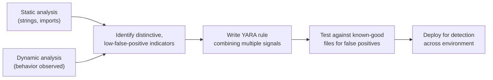

# YARA Rules & Detection

Everything so far in this path has been about *understanding* a single sample. This lesson turns that understanding into something operationally useful: a rule that automatically detects that malware family — and every close variant of it — across an entire environment, at scale.

## What YARA is

**[YARA](https://virustotal.github.io/yara/)** ("Yet Another Ridiculous Acronym," genuinely) is a free, open-source pattern-matching tool built specifically for malware research — you write rules describing patterns characteristic of a malware family (strings, byte sequences, structural characteristics), and YARA scans files (or running memory) to find matches. It's used extensively across the industry, including inside VirusTotal itself (referenced throughout this path and Path 16).

## Anatomy of a YARA rule

```yara
rule Suspicious_Ransomware_Note_Dropper
{
    meta:
        description = "Detects a sample matching this course's ransomware training pattern"
        author = "KashSec Academy student"
        date = "2026-01-01"

    strings:
        $ransom_note = "Your files have been encrypted" nocase
        $btc_wallet_pattern = /[13][a-km-zA-HJ-NP-Z1-9]{25,34}/
        $crypto_api1 = "CryptEncrypt" ascii
        $crypto_api2 = "CryptGenKey" ascii
        $vssadmin = "vssadmin delete shadows" nocase

    condition:
        (2 of ($crypto_api*)) and
        ($ransom_note or $vssadmin) and
        filesize < 5MB
}
```

Breaking this down:

- **meta** — human-readable metadata; doesn't affect matching, but essential for maintainability once you have dozens of rules.
- **strings** — the patterns to search for: plain text strings, regular expressions (like the Bitcoin wallet address pattern above), or raw hex byte sequences for binary patterns.
- **condition** — the logic combining those strings into an actual detection decision. This example requires at least 2 of the crypto-related API strings *and* either the ransom note text or the shadow-copy-deletion command *and* a reasonable file size — deliberately combining multiple weaker signals (echoing the "combine evidence" principle from this path's static analysis lesson) rather than triggering on any single string alone.

## Writing rules from real analysis

The workflow connects directly back to everything earlier in this path:



The imports flagged in this path's static analysis lesson (`CreateRemoteThread`, `WriteProcessMemory` together for process injection, for instance) make excellent YARA condition components — you're not writing rules from imagination, you're operationalizing what you already found during analysis.

## Avoiding false positives — the real skill

A rule that matches too broadly (a single common string, for instance) generates alert fatigue and gets ignored or disabled — exactly the "boy who cried wolf" problem referenced in Path 16's threat hunting lesson's discussion of over-alerting. Test every rule against a set of known-clean files before deploying it:

```bash
yara my_rule.yar suspicious_sample.exe    # should match
yara my_rule.yar /path/to/clean_software/ -r    # should NOT match anything
```

:::tip Specificity beats broad coverage
A rule combining several distinctive indicators (as in the example above) that reliably catches one malware family with zero false positives is far more operationally valuable than a broad rule that "might" catch many families but frequently misfires on legitimate software. When in doubt, add more conditions, not fewer.
:::

## Rule performance and scanning at scale

A YARA rule that works correctly can still be a practical liability if it's slow — scanning an entire corporate file server or a stream of live network traffic against thousands of rules simultaneously puts real performance pressure on rule design that a single-sample test never reveals. Broad, unanchored regular expressions (`/.*[a-z0-9]{50,}.*/` style patterns scanning every byte offset of every file) are dramatically slower than simple, fixed-string or hex-byte-sequence matches, since YARA's engine can optimize the latter far more efficiently. A practical habit for any rule headed toward production deployment: put your cheapest, most selective condition first (a distinctive fixed string is far cheaper to check than a complex regex), and use YARA's own `-p` performance-profiling flag or simply timing a scan against a large representative file set before assuming a rule that works correctly in testing will also perform acceptably at real operational scale.

## Rule versioning and maintenance over time

A YARA rule isn't a one-time artifact — malware families evolve, and a rule written against today's sample may miss tomorrow's variant with a trivially repacked string or a renamed function. Treating your rule collection the same way Path 16's DevSecOps lab treats application code — checked into version control, with clear commit messages explaining what changed and why, ideally with an automated test suite running every rule against both a "should match" and "should not match" corpus on every change — turns a personal collection of one-off rules into a genuinely maintainable detection asset a team can trust and build on over time. Many mature detection engineering teams retire or update rules on a regular cadence specifically because an untested, unmaintained rule silently accumulating false positives (or silently going blind to an evolved variant) is worse than having no rule at all, since it creates false confidence that a threat is being detected when it may no longer be.

## YARA in the wider ecosystem

VirusTotal lets registered users search across its entire historical sample database using custom YARA rules ("VT Hunting") — meaning a well-written rule can retroactively surface every previously-submitted sample matching a pattern you just identified, a genuinely powerful capability for tracking a malware family's full history and variants. Many SIEM and EDR (Endpoint Detection and Response) platforms also support YARA rules as a first-class detection mechanism, directly connecting this lesson back to Path 12's IDS/IPS/SIEM material.

:::challenge Write your own rule
Using a safe training sample (from MalwareBazaar or similar, referenced throughout this path), perform static analysis to identify at least 3 distinctive strings or import combinations, then write a YARA rule combining them with an appropriate condition. Test it against your sample (should match) and at least 2 unrelated clean files on your system (should not match).
:::

## Key takeaway

YARA rules are how individual analysis translates into scalable, automated detection — the entire value of reverse engineering a single sample compounds enormously once that understanding is encoded as a rule that keeps working against every future variant sharing the same distinctive characteristics.

**Next up →** [Sigma Rules & Detection Engineering](#/lesson/17-malware-re/sigma-rules-and-detection-engineering)
