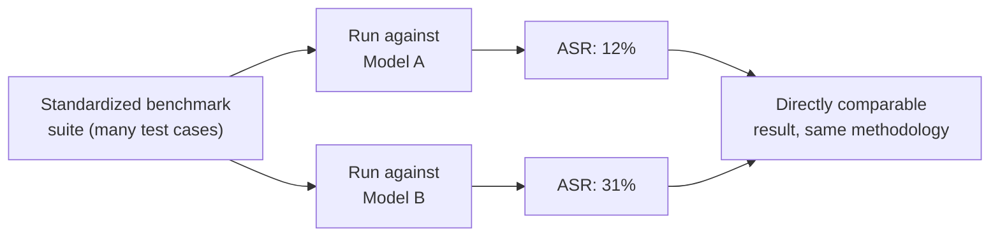

# AI Safety Evaluation & Benchmarking

The ai-red-teaming lesson established that success rates across many attempts, not binary pass/fail, are the meaningful unit of measurement. This lesson goes deep into exactly how that measurement actually gets done rigorously — directly connecting to Path 15's report-writing lesson's CVSS-scoring discipline, applied here to a domain where "did the attack work" is genuinely more ambiguous than a binary technical outcome.

## Attack Success Rate — the core metric, defined carefully

The fundamental measurement in AI red-teaming is **Attack Success Rate (ASR)** — the percentage of attempts, across many variations of a technique, that successfully produce the undesired behavior. A single successful jailbreak attempt out of one try tells you almost nothing reliable; the same technique tested 100 times with systematic variations, succeeding 23 times, gives a genuinely meaningful, comparable measurement — directly connecting to the ai-red-teaming lesson's "systematic test case generation at scale" methodology.

## Why sample size and statistical rigor matter here specifically

A genuinely important, easy-to-overlook point: because LLM outputs are probabilistic (directly connecting to the how-LLMs-work lesson's next-token-prediction framing), the exact same input can occasionally produce different outputs across repeated attempts, even with identical settings. This means a single test run's outcome is not fully reliable on its own — a technique that succeeds once might simply have gotten a favorable roll of the model's inherent output variability, not a truly reproducible vulnerability. Rigorous evaluation runs each test case multiple times and reports a rate with an appropriate **confidence interval**, rather than treating any single trial as definitive.

## Standard benchmark suites — comparing across models and time

Directly connecting to Path 22's compliance-framework approach of using standardized, comparable measurement: several open, standardized benchmark suites (**HarmBench**, **AdvBench**, and similar academic/industry benchmarks) provide curated, published sets of adversarial test cases specifically designed to let researchers compare safety performance across different models, or track a single model's safety performance across successive versions, using a shared, reproducible methodology rather than each researcher inventing their own ad-hoc test set every time.

## The grading problem — who decides if an attempt "succeeded"?

A genuinely hard, often-underappreciated methodological question: for many test cases, whether an attempt actually "succeeded" isn't a simple keyword match — a response might partially comply, hedge, comply in a roundabout way, or refuse while still leaking a small amount of relevant information. Directly connecting to the ai-red-teaming lesson's point that human review remains essential: many rigorous evaluation pipelines use a combination of automated classifiers (imperfect but fast, useful for large-scale initial triage) and human review (slower, but catching the nuanced partial-compliance cases automated grading tends to miss) — treating the grading methodology itself as something requiring the same careful documentation as the test cases.

## Reporting evaluation results honestly

Directly connecting to Path 15's report-writing lesson's four-part structure: a rigorous AI safety evaluation report should specify exactly what benchmark or test set was used, the sample size and number of trials per test case, the grading methodology (automated, human, or both), and the resulting ASR with appropriate uncertainty — a report stating simply "we tested for jailbreaks and it seemed pretty safe" provides essentially no verifiable, comparable information, exactly parallel to that lesson's critique of vague, unstructured findings in traditional pentest reporting.

:::challenge Test yourself
Why is a single successful jailbreak attempt out of one try considered insufficient evidence of a genuine, reproducible vulnerability, given that the attack clearly worked at least once?

Show answer
LLM outputs are inherently probabilistic rather than deterministic — the same exact input, submitted multiple times under identical settings, can produce meaningfully different outputs across attempts due to how the model samples from its predicted probability distribution over possible next tokens, directly connecting to the how-LLMs-work lesson's next-token-prediction framing. A single successful attempt could represent a genuinely reliable, reproducible weakness in the model's safety training — or it could simply represent one unlucky sample from the model's natural output variability, where the exact same input would fail to produce the harmful output in the overwhelming majority of subsequent attempts. Without running the same test case multiple times and calculating an actual success rate (ideally with a stated confidence interval reflecting the sample size), there's no way to distinguish a genuinely exploitable, high-probability weakness from a rare statistical fluke — which is precisely why professional AI red-teaming methodology insists on aggregated rates across many trials rather than treating any single successful attempt as conclusive proof of a reliable vulnerability, exactly the same reasoning that would make a security researcher skeptical of a "vulnerability" that only reproduces once in a hundred attempts against a traditional deterministic system.

:::

## Key terms

- **Attack Success Rate (ASR)** — the percentage of systematic attempts, across many variations, that successfully produce an undesired model behavior.
- **Benchmark suite (HarmBench, AdvBench)** — standardized, published test case sets enabling reproducible comparison across models or model versions.
- **Grading methodology** — the documented approach (automated classifier, human review, or both) used to determine whether a given attempt actually succeeded.

## Recap

- Attack Success Rate, measured across many systematic trials, is the meaningful unit for AI safety evaluation, not any single attempt's outcome.
- LLM output variability means a single successful attempt can be a statistical fluke rather than a reliable, reproducible vulnerability.
- Standardized benchmark suites like HarmBench enable reproducible comparison across models and model versions using shared methodology.
- Rigorous reporting specifies the benchmark used, sample size, grading methodology, and resulting rate with appropriate uncertainty — vague claims provide no verifiable information.

**Next up →** [Building an AI security career](#/lesson/18-ai-security/ai-career)
