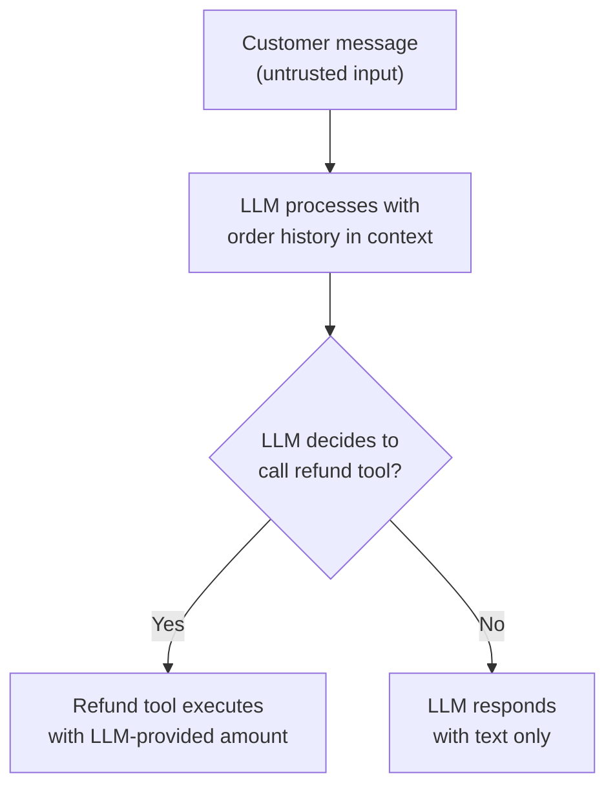

# AI Threat Modeling

The why-AI-security-is-different lesson established that AI systems face genuinely novel risk categories. This lesson applies a structured, systematic framework to actually reasoning about those risks in a specific application — directly connecting to Path 22's STRIDE threat-modeling worksheet, adapted here specifically for AI/LLM-integrated systems.

## Why AI systems need their own threat-modeling adaptation

Directly connecting to Path 22's STRIDE lesson: traditional threat modeling categories (Spoofing, Tampering, Repudiation, Information Disclosure, Denial of Service, Elevation of Privilege) remain relevant to AI applications, but each category manifests differently when an LLM sits in the data flow — "Tampering," for instance, now includes tampering with a model's training data or its retrieved context, not just tampering with a traditional database record.

## The AI-specific attack surface, mapped

Before applying any framework, identify where an AI system's actual attack surface differs from a traditional application's:

- **Input surface** — not just user-typed prompts, but anything an LLM might read into its context: retrieved documents, tool outputs, fetched web content, email content in an AI-powered assistant — directly connecting to the transformer-architecture lesson's point that all of this is just tokens to the model
- **Training/fine-tuning surface** — data used to train or fine-tune the model itself, directly connecting to the poisoning-and-adversarial-ML lesson later in this path
- **Output surface** — what the model's response gets used for downstream: is it displayed as text to a human, or does it trigger an automated action (a tool call, a database write, an email send)?
- **Model supply chain** — the model weights, libraries, and infrastructure the application depends on, connecting directly to the llm-supply-chain-attacks lesson later in this path

## A worked threat-modeling example

Consider a customer support chatbot that can read a customer's order history and issue refunds via a tool call:

Applying the framework: the input surface (customer message) is fully untrusted, meaning a prompt injection attempt is a realistic threat; the output surface includes an automated action with real financial consequence (issuing a refund), meaning "Elevation of Privilege" here specifically means "convincing the LLM to authorize a refund it shouldn't" — directly connecting to the securing-llm-apps lesson's emphasis on never letting an LLM's output directly trigger a high-consequence action without independent validation.

## Prioritizing by consequence, not just likelihood

Directly connecting to Path 23's GRC risk-scoring approach: an AI threat model should weigh the *consequence* of a successful attack as heavily as its likelihood — a prompt injection that merely makes a chatbot respond oddly is a low-consequence nuisance, while the same injection technique targeting a system that can execute a refund, send an email, or modify a database record represents a fundamentally more severe risk, even if the underlying injection technique itself is identical in both cases.

## Threat modeling as an ongoing practice, not a one-time exercise

:::tip Revisit the threat model whenever the system's capabilities change
Directly connecting to Path 22's continuous-threat-modeling framing: adding a new tool the LLM can call, connecting it to a new data source, or fine-tuning it on new data each meaningfully changes the attack surface this lesson's framework maps — a threat model completed once at initial design time and never revisited becomes stale exactly as fast as the system itself evolves, which for actively-developed AI features tends to be quickly.
:::

:::challenge Test yourself
Why does giving an LLM the ability to call a refund tool fundamentally change the severity of a prompt injection vulnerability, even if the injection technique itself is unchanged?

Show answer
A prompt injection attack's actual danger is entirely a function of what the LLM's output or decisions can subsequently cause to happen, not just whether the injection technique successfully manipulates the model's response — this is exactly the "consequence over likelihood" prioritization principle from Path 23's GRC risk-scoring approach, applied here to AI-specific threats. When an LLM's role is purely to generate text a human then reads and reacts to, a successful injection at worst produces a misleading or inappropriate response the human can evaluate and disregard — a real problem, but a bounded one. When that same LLM has tool-calling access to execute a refund (or any other consequential automated action) without independent server-side validation, a successful injection can translate directly into an unauthorized financial transaction with no human review step in between — the exact same manipulated model output that previously only risked an awkward chat message now risks real, executed financial harm. This is precisely why the securing-llm-apps lesson insists that consequential actions always require independent validation separate from trusting the LLM's own stated intent, regardless of how well the injection defenses on the input side are engineered.

:::

## Key terms

- **AI attack surface** — the input, training, output, and supply-chain surfaces specific to an AI-integrated system.
- **Consequence-weighted prioritization** — ranking AI threats by the severity of what a successful attack could cause, not just how likely it is.
- **Tool-calling risk** — the elevated severity a prompt injection carries when the LLM's output can trigger automated, consequential actions.

## Recap

- Traditional threat-modeling categories (like STRIDE) remain useful for AI systems but manifest differently across input, training, output, and supply-chain surfaces.
- A worked example (a refund-issuing chatbot) shows how the same injection technique carries dramatically different severity depending on what the LLM's output can actually trigger.
- AI threat models should prioritize by consequence, not just likelihood, mirroring Path 23's GRC risk-scoring approach.
- Threat models require ongoing revisiting as an AI system's tools, data sources, and capabilities evolve, not a one-time exercise.

**Next up →** [Prompt injection](#/lesson/18-ai-security/prompt-injection)
