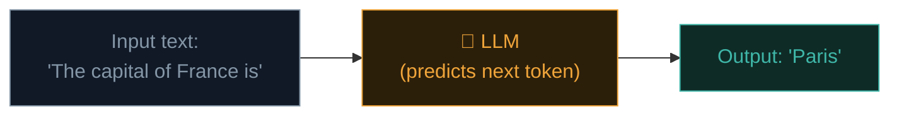
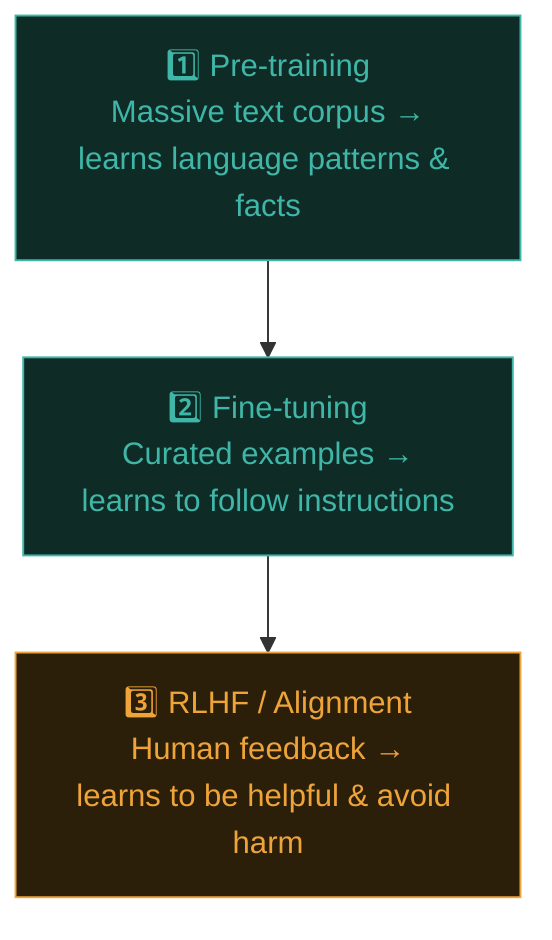
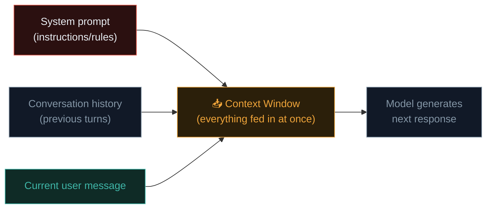
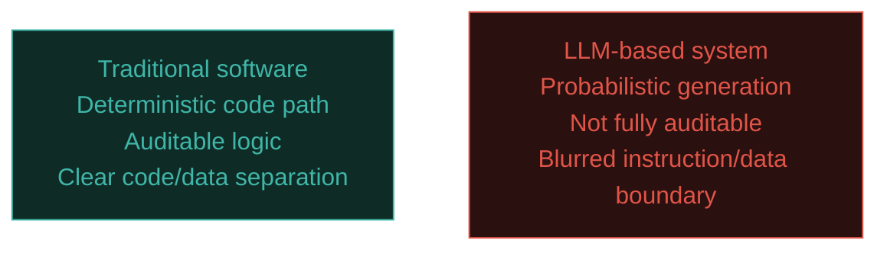
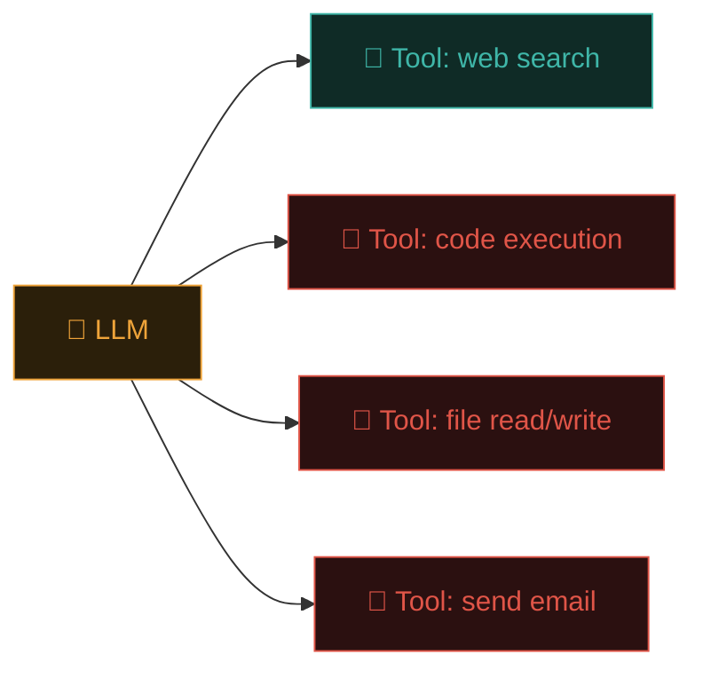

# How LLMs actually work

Before you can secure AI systems, you need a working mental model of what they actually are — not magic, not truly "thinking," but a specific, learnable kind of software with its own distinct failure modes. This lesson gives you exactly enough understanding to make the rest of Path 18 click.

## What an LLM actually is, at a high level

A **Large Language Model (LLM)** is a neural network trained on enormous amounts of text, learning to predict **the next most likely token** (roughly, a word or word-fragment) given everything that came before it. That's it, mechanically — everything an LLM does, from writing code to answering questions to (as you'll see) being tricked, emerges from this single core capability applied at massive scale.



## Tokens — the actual unit LLMs work with

Recall Path 04's variables/data lesson — just as programs work with specific data types, LLMs work with **tokens**, not whole words or characters directly:

```python
# Conceptually, a sentence gets broken into tokens like this:
"The capital of France is Paris"
# → ["The", " capital", " of", " France", " is", " Paris"]
# (real tokenizers often split less intuitively, especially for
# unusual words, code, or non-English text)
```

This matters for security later — many prompt injection and jailbreak techniques (Path 18.3/12.4) specifically exploit how tokenization handles unusual formatting, unicode tricks, or unexpected boundaries.

## Training — where an LLM's "knowledge" actually comes from



- **Pre-training** — the model learns general language patterns, facts, and reasoning-like capability from a vast, broad text corpus (a snapshot of internet text, books, code, and more, up to some cutoff date).
- **Fine-tuning** — additional, more curated training specifically teaching the model to follow instructions in a helpful, conversational format, rather than just continuing text in whatever direction is statistically likely.
- **RLHF (Reinforcement Learning from Human Feedback)** — human reviewers rate model outputs, and the model is further adjusted to produce outputs humans rate as more helpful, honest, and harmless — this is where a model's "personality" and safety behaviours are substantially shaped.

## The context window — an LLM's entire "working memory"

Recall Path 05's client-server model — an LLM has **no persistent memory** between separate conversations by default. Everything it "knows" about your current conversation exists purely within the **context window** — the literal text (your messages, its previous replies, any system instructions) fed into it for that single generation step.



This single architectural fact is the **root cause** of prompt injection (Path 18.3) — the model has no inherent, structural way to distinguish "trusted instructions from the system prompt" from "untrusted text that happens to look like instructions, embedded in user input or a document it's processing." Everything is just tokens in the same window, processed the same fundamental way.

## Why this differs so fundamentally from traditional software security

Recall every vulnerability class from Path 11 — SQL injection exploits a gap between **code** and **data** in a database query; XSS exploits a gap between **code** and **data** in an HTML page. LLM security largely exploits the exact same underlying pattern, but the "interpreter" is now a probabilistic neural network with no fixed, auditable logic path — you can't simply read the source code to understand exactly why a specific input produces a specific output the way you could with a traditional SQL query or web application.



This is precisely why Path 18 exists as a distinct discipline within this course rather than simply being folded into Path 11 — the underlying *pattern* (untrusted input treated as trusted instruction) rhymes strongly with SQLi/XSS, but the mechanism, and therefore many of the defensive techniques, are genuinely different.

## Agentic systems — where LLM security stakes rise sharply

Recall the product context mentioned throughout this course (Claude Code, browsing agents) — increasingly, LLMs aren't just generating text for a human to read, they're **taking actions**: browsing the web, executing code, calling APIs, modifying files. This is called an **agentic** system.



Once an LLM can take real-world actions rather than just producing text a human reviews before acting, every security concept from this course — access control (Path 11.1), least privilege (Path 14.4), input validation (Path 11.6) — becomes directly and urgently relevant to AI systems specifically, and the remaining lessons in this path build toward exactly this territory.

## Temperature and sampling — why the same prompt gives different answers

A detail worth understanding early, since it shapes how you'll reason about testing an LLM for security issues throughout this path: an LLM doesn't just deterministically pick the single "most likely" next token every time — a parameter called **temperature** controls how much randomness is introduced into that choice. At temperature 0, the model always picks the highest-probability token, producing the same output for the same input every time (useful for testing reproducibility). At higher temperatures, it samples more randomly among plausible next tokens, producing more varied, creative output — but also meaning the exact same jailbreak or prompt injection attempt (Path 18.3/12.4) might succeed on one attempt and fail on the next, purely due to this randomness. This has a direct, practical security testing implication: a single failed jailbreak attempt against a non-zero-temperature model doesn't prove the model is safe against that technique — genuine security testing requires multiple attempts to account for this inherent variability, a habit Path 18.7's red teaming methodology builds on directly.

## The OWASP LLM Top 10 — this path's organising framework

Directly mirroring Path 11.1's OWASP Top 10 for web applications, **OWASP has published an LLM-specific Top 10** cataloguing the most critical risks in LLM-integrated applications — the framework the remaining lessons in this path are organised around, covered in full in Path 18.5.

## 🧪 Lab — Explore tokenization and context windows hands-on

1. Visit [OpenAI's Tokenizer tool](https://platform.openai.com/tokenizer) (works for exploring tokenization concepts generally, even though it's OpenAI-branded) and paste in a few sentences — including some unusual formatting, emoji, and non-English text. Notice how token boundaries don't always match your intuitive sense of "words."
2. If you have access to any LLM chat interface, start a fresh conversation and ask it to "remember" a specific fact. Then start a genuinely **new, separate** conversation and ask about that fact — confirming firsthand that no memory persists outside the context window of a single conversation (unless the specific product has an explicit memory feature layered on top, which is itself just another mechanism feeding additional text into the context window).
3. Research your own locally-run models (recall Ishfaq's own Ollama/LM Studio usage context) — check the documented **context window size** (measured in tokens) for a model you're familiar with, and consider what that means practically for how much conversation history or document content it can actually "see" at once.

:::challenge Test yourself
Why does the lack of a structural distinction between "trusted instructions" and "untrusted data" within an LLM's context window matter so much for security, compared to how traditional software typically separates code from data?

<details><summary>Show answer</summary>In traditional software, a SQL query's <em>structure</em> (Path 11.6) is fixed by the developer's code, with user input properly parameterised as pure data that can never be reinterpreted as executable command logic. An LLM's context window has <strong>no equivalent structural separation</strong> — the system prompt's instructions, the conversation history, and any untrusted text (a document being summarised, a webpage being read, a tool's output) are all just tokens fed into the same processing pathway. This means text embedded anywhere in that window that <em>looks like</em> an instruction can potentially be treated by the model as an actual instruction to follow — the core mechanism behind prompt injection, covered in full in Path 18.3.</details>
:::

## Key terms

- **LLM (Large Language Model)** — a neural network trained to predict the next token given prior context.
- **Token** — the basic unit of text an LLM processes, not necessarily a whole word.
- **Context window** — the complete set of text (instructions, history, current input) fed into the model for a single generation.
- **RLHF** — Reinforcement Learning from Human Feedback, shaping a model's helpfulness and safety behaviour.
- **Agentic system** — an LLM-based system that takes real-world actions via tools, not just generating text for human review.

## Recap

- LLMs work by predicting the next token given everything in their context window — a single, unified mechanism underlying all their capabilities.
- Training combines broad pre-training, instruction fine-tuning, and RLHF-based alignment to shape both capability and behaviour.
- The context window has no structural separation between trusted instructions and untrusted data — the root cause of prompt injection.
- Agentic systems, where LLMs take real-world actions via tools, dramatically raise the security stakes of these same underlying weaknesses.
- The OWASP LLM Top 10 organises this path's remaining lessons, directly mirroring Path 11.1's web-focused framework.

???refs
- [OWASP Top 10 for LLM Applications](https://owasp.org/www-project-top-10-for-large-language-model-applications/) — the framework organising this path.
- [Anthropic — How does Claude work?](https://www.anthropic.com/research) — accessible research and explainer content from a leading AI lab.
- [OpenAI Tokenizer](https://platform.openai.com/tokenizer) — an interactive tool for exploring tokenization directly.
- [3Blue1Brown — Neural Networks / Transformers series (YouTube)](https://www.3blue1brown.com/topics/neural-networks) — an excellent, visual deep-dive into the underlying mechanics for those wanting to go deeper.
???

**Next up →** [Transformer Architecture, Deep Dive](#/lesson/18-ai-security/transformer-architecture-deep-dive)
