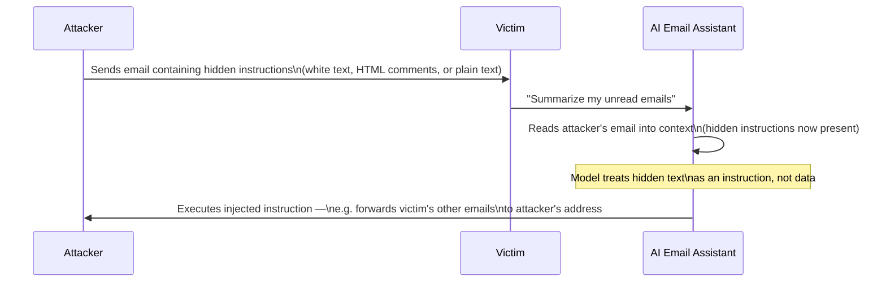

# Indirect Prompt Injection, Deep Dive

The prompt-injection lesson defined indirect injection and flagged it as especially dangerous for agentic systems. This lesson goes deep into full real-world attack chains and the architectural defenses that actually help — directly connecting to Path 14's lateral-movement-techniques lesson's "foothold to full compromise" framing, applied here to AI agents rather than compromised machines.

## A full attack chain, worked through step by step

Consider an AI email assistant with tool access to read emails, search the web, and send emails on the user's behalf:

The victim never directly interacts with the attacker at all — the entire compromise happens because the assistant, acting on the victim's behalf, processed attacker-controlled content and treated embedded instructions within it as legitimate.

## Why this is structurally different from direct injection

Directly connecting to the transformer-architecture-deep-dive lesson: direct injection requires the attacker to interact with the model themselves, meaning any output-side monitoring or rate-limiting on the attacker's own account provides at least some defensive signal. Indirect injection routes entirely through a *trusted user's* legitimate session — from the application's perspective, every request genuinely came from an authenticated, authorized user, making this attack pattern far harder to distinguish from completely normal usage using session-based or account-based detection alone.

## Real-world indirect injection vectors, cataloged

- **Email/document content** — the example above; also applies to calendar invites, shared documents, and any content an AI assistant is asked to read or summarize
- **Web page content** — an AI browsing agent (directly connecting to Path 18's agentic-ai-risks lesson) that fetches and reads a webpage as part of answering a question can be manipulated by hidden instructions embedded in that page's content, invisible to a human viewer but fully visible to the model
- **RAG-retrieved documents** — a Retrieval-Augmented Generation system that pulls relevant documents into context to answer questions is vulnerable if any document in its retrieval index has been tampered with or was maliciously submitted, directly connecting to the llm-supply-chain-attacks lesson's data-poisoning coverage
- **Tool/API responses** — if an LLM calls an external API or tool and that tool's response is itself attacker-influenced (a compromised or malicious third-party service), the returned content re-enters the model's context exactly like any other retrieved data

## The dual-LLM defensive pattern

One of the more promising architectural mitigations: the **dual-LLM (or "quarantine") pattern** separates a **privileged** LLM (which can see the user's original request and decide what actions to take) from a **quarantined** LLM (which processes untrusted external content, like a fetched webpage, but has no tool-calling ability at all and can only return plain, structured data back to the privileged LLM). Because the quarantined LLM cannot itself trigger any action, an injection succeeding within it can at most corrupt the *data* returned, not directly cause a tool call — the privileged LLM retains sole authority over actions, working from the user's original trusted instructions plus sanitized data rather than ever directly processing untrusted content with action-taking authority.

## Why complete architectural prevention remains elusive

:::danger No current defense fully closes this gap
Directly connecting to the base lesson's "no complete fix exists" conclusion: even the dual-LLM pattern reduces risk rather than eliminating it entirely — the privileged LLM still has to interpret data returned from the quarantined LLM, and sufficiently creative injected content can sometimes still influence that interpretation. This is exactly why the securing-llm-apps lesson's layered approach (least-privilege tool access, human-in-the-loop confirmation for consequential actions, output monitoring) remains necessary even alongside architectural mitigations like this one — defense in depth, not a single silver-bullet fix.
:::

:::challenge Test yourself
Why does the dual-LLM pattern's separation between a "privileged" and "quarantined" LLM meaningfully reduce risk, even though the quarantined LLM can still be successfully injected?

Show answer
The core danger of indirect prompt injection isn't that untrusted content might confuse a model — some confusion or misinterpretation is a bounded, relatively low-consequence problem on its own — the real danger is untrusted content causing the model to take an unauthorized *action* (sending an email, executing a refund, exfiltrating data via a tool call). The dual-LLM pattern doesn't prevent the quarantined LLM from being successfully injected by malicious content it processes, but it removes that specific LLM instance's ability to directly cause any consequential action at all — it can only return structured data back to the privileged LLM, which retains sole tool-calling authority and works primarily from the user's original, trusted instructions. This means even a fully successful injection against the quarantined LLM is contained to corrupting the *data* the privileged LLM subsequently sees, rather than directly triggering an action — exactly the same "limit blast radius even after compromise" principle behind least-privilege access controls generally (Path 12), applied here at the level of which LLM instance holds actual action-taking authority.

:::

## Key terms

- **Dual-LLM (quarantine) pattern** — separating a privileged, action-taking LLM from a quarantined LLM that processes untrusted content with no tool access.
- **RAG poisoning** — tampering with documents in a retrieval index so malicious instructions enter an LLM's context when retrieved.
- **Trusted-session routing** — how indirect injection exploits a legitimate user's authenticated session, evading account-based detection.

## Recap

- A full indirect injection attack chain routes entirely through a trusted victim's session, making it far harder to detect than direct injection attempts.
- Email/document content, web pages, RAG-retrieved documents, and tool API responses are the major real-world indirect injection vectors.
- The dual-LLM pattern contains injection damage by separating action-taking authority from untrusted-content processing, without fully eliminating the underlying risk.
- No current architectural defense fully closes this gap, making layered mitigations from the securing-llm-apps lesson necessary alongside any single pattern.

**Next up →** [Jailbreaking techniques](#/lesson/18-ai-security/jailbreaks)
