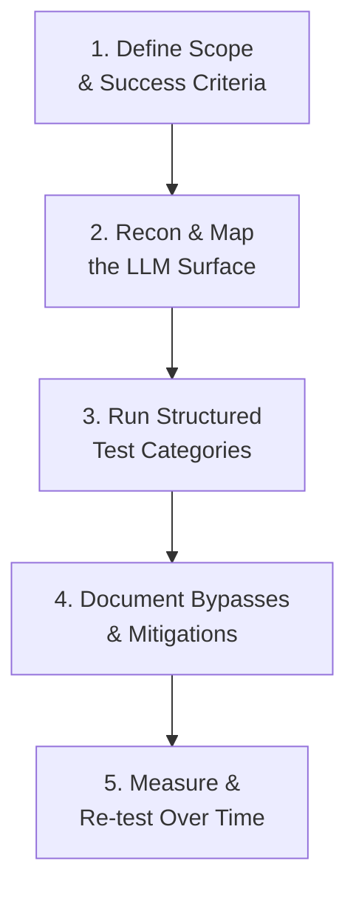

# LLM Red Teaming Playbooks

Path 18's AI red teaming lesson introduced the *methodology* at a conceptual level. This lesson gets practical: how to actually structure a repeatable, systematic testing process — a **playbook** — that turns ad-hoc probing into something a team can run consistently, track over time, and hand off to new testers.

## Why a playbook, not just improvisation

Testing an LLM application by just "trying things" finds real issues, but produces inconsistent, unrepeatable coverage — different testers probe different things, nothing is tracked over time, and there's no way to confirm a fix actually held when the model or prompt changes later. A playbook solves this the same way a penetration testing methodology (Path 14) solves it for traditional applications: structure, defined scope, and repeatability.

## 1. Define scope and success criteria

Exactly like a traditional pentest's rules of engagement (Path 14), define upfront: which specific LLM-powered features are in scope, what counts as a genuine finding versus expected/acceptable behavior, and what severity framework you'll use to rate findings (adapting the CVSS-style reasoning from Path 14's reporting lesson to AI-specific impact: does a successful jailbreak produce merely embarrassing output, or does it enable a real harmful action via tool access, per Path 18's agentic AI risks lesson?).

## 2. Recon and map the LLM surface

Before testing, map what you're actually dealing with: what's the system prompt's apparent role/persona (inferred from behavior, since it's often hidden), what tools/data sources does it have access to (echoing the agentic AI risks lesson), what inputs does it accept (text only, or also images/files/URLs), and what existing guardrails are visible (does it refuse obviously malicious requests, suggesting some baseline safety training or filtering is in place)?

## 3. Structured test categories

A genuinely useful playbook organizes test cases by category, systematically working through each rather than testing randomly:

- **Prompt injection campaigns** — direct injection (in the user's own input) and indirect injection (embedded in content the model processes, like a webpage or document it's asked to summarize).
- **Jailbreak attempts** — testing known technique families (roleplay/persona framing, hypothetical framing, multi-turn gradual escalation) against the specific safety boundaries relevant to this application.
- **Data extraction tests** — attempting to extract the system prompt, any embedded credentials/API keys, or other users' data the model might have inadvertently retained in context.
- **Agent/tool abuse scenarios** — if the system has tool access (Path 18's agentic AI risks lesson), specifically testing whether injected or jailbroken instructions can trigger unintended tool calls.

For each category, run the **same test case multiple times** — this course's practical AI labs lesson already established why: LLMs are probabilistic, and a single success or failure doesn't establish a reliable rate.

### Multimodal test cases — beyond plain text

If the system accepts images, audio, or file uploads alongside text, a thorough playbook needs a dedicated test category for exactly this input surface, since it introduces attack vectors text-only testing simply can't reach. Text embedded within an image (readable by the model's vision capability but invisible to a cursory human glance at a screenshot), instructions hidden in a file's metadata rather than its visible content, or audio containing spoken injection attempts are all genuinely distinct from the text-based categories above, and each deserves its own explicit test cases rather than being assumed to behave the same way as a plain-text prompt. This category matters increasingly as more production LLM applications become multimodal by default — a playbook that only tests text input against a system that also accepts images has a structural, easily-overlooked coverage gap.

## 4. Document bypasses and mitigations

For every successful bypass, record: the exact prompt/technique used, the category it falls under (per this path's attack taxonomy lesson), the observed impact, and a suggested mitigation — mirroring the structure of every report format used throughout this course (Path 14's reporting lesson, adapted for AI-specific findings).

## 5. Measure effectiveness over time

Unlike a traditional codebase, an LLM application's behavior can shift without any code change at all — the underlying model gets updated by its provider, the system prompt gets tweaked, new tools get added. Re-running your playbook's test suite periodically (and specifically after any of these changes) is how you catch regressions — a previously-fixed jailbreak silently working again after a model version update is a genuinely common real-world occurrence.

## Calibrating severity with actual stakeholders

A playbook's severity ratings mean little if they're set in isolation from the people who'll actually act on them. Before finalizing your severity framework (step 1 above), sit down with whoever owns the product's risk decisions — the same "writing for two audiences" discipline from Path 14.7's reporting lesson applies here directly, since a security tester's intuitive sense of "this is bad" doesn't always match the product owner's actual risk tolerance for their specific deployment. A jailbreak that produces mildly inappropriate humor might be a non-issue for an internal developer tool but a genuine incident for a children's education product — the technique and success rate are identical, but the calibrated severity should differ sharply based on real deployment context, exactly the kind of judgment call a playbook built in isolation from stakeholders will consistently get wrong.

:::tip Automate what you can, but never fully replace manual testing
Simple test cases (direct injection attempts, known jailbreak templates) can be scripted and run automatically as a fast regression check. But novel, creative bypass techniques — the kind that actually reveal new risk — still require a human tester thinking adversarially, exactly the same balance between automated scanning and manual testing found throughout Path 11 and Path 15's web security material.
:::

:::challenge Build a mini playbook
Design a playbook with at least 10 specific test cases for a fictional customer support LLM application that has access to two tools: looking up order status and issuing refunds. Organize your test cases by category (per the structure above), and include at least 2 tests specifically targeting the tool-access risk from the agentic AI risks lesson.
:::

## Key terms

- **Red team playbook** — a structured, repeatable set of test categories and cases for systematically probing an AI system.
- **Regression testing** — re-running previously-passing tests after a change, to catch newly reintroduced issues.

## Recap

- A playbook turns ad-hoc LLM probing into structured, repeatable, trackable testing — the same value structure brings to traditional pentesting.
- The five-stage structure (scope → recon → structured categories → documentation → ongoing re-testing) mirrors methodologies from earlier in this course, adapted for AI-specific concerns.
- LLM applications can regress without any code change (model updates, prompt tweaks), making periodic re-testing genuinely necessary, not optional.

???refs
- [OWASP GenAI Red Teaming Guide](https://genai.owasp.org/) — free, detailed, actively maintained guidance specifically on this topic.
- [Microsoft: Planning red teaming for large language models](https://learn.microsoft.com/en-us/azure/ai-services/openai/concepts/red-teaming) — a practical, free industry playbook reference.
???

**Next up →** [LLM Supply Chain Attacks](#/lesson/18-ai-security/llm-supply-chain-attacks)
