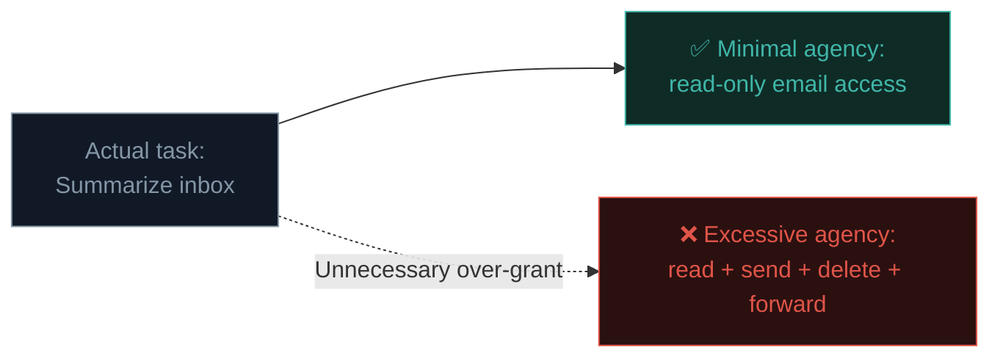
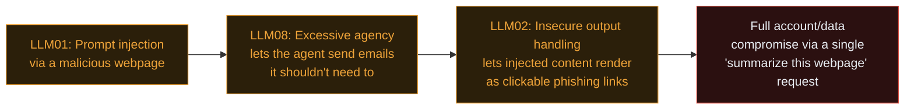

# The OWASP LLM Top 10

Directly mirroring Path 11.1's role for web security, the **OWASP Top 10 for LLM Applications** organises the full landscape of AI security risk into ten categories. You've already covered two in depth (prompt injection, jailbreak-adjacent content); this lesson completes the picture.

## The full list

```mermaid
flowchart TB
    L1["LLM01: Prompt Injection"]
    L2["LLM02: Insecure Output Handling"]
    L3["LLM03: Training Data Poisoning"]
    L4["LLM04: Model Denial of Service"]
    L5["LLM05: Supply Chain Vulnerabilities"]
    L6["LLM06: Sensitive Information Disclosure"]
    L7["LLM07: Insecure Plugin Design"]
    L8["LLM08: Excessive Agency"]
    L9["LLM09: Overreliance"]
    L10["LLM10: Model Theft"]

    style L1 fill:#2b1010,color:#E05548,stroke:#E05548
    style L2 fill:#2b1010,color:#E05548,stroke:#E05548
    style L3 fill:#2b1f0a,color:#EFA43A,stroke:#EFA43A
    style L4 fill:#111927,color:#8496A6,stroke:#8496A6
    style L5 fill:#2b1f0a,color:#EFA43A,stroke:#EFA43A
    style L6 fill:#2b1010,color:#E05548,stroke:#E05548
    style L7 fill:#2b1010,color:#E05548,stroke:#E05548
    style L8 fill:#2b1010,color:#E05548,stroke:#E05548
    style L9 fill:#111927,color:#8496A6,stroke:#8496A6
    style L10 fill:#2b1f0a,color:#EFA43A,stroke:#EFA43A
```



### LLM01: Prompt Injection

Fully covered in Path 18.3 — untrusted input interpreted as instructions rather than data.

### LLM02: Insecure Output Handling

**The direct AI-era descendant of Path 11.5/07.6's XSS/SQLi lessons.** If an application takes an LLM's output and passes it **directly** into another system — rendering it as HTML, executing it as code, using it to build a database query — without proper validation, exactly the same downstream vulnerabilities apply, just with the LLM as an intermediate untrusted-content generator rather than a human attacker directly.

```python
# VULNERABLE — LLM output directly rendered as HTML, no escaping:
response = llm.generate(user_prompt)
return f"<div>{response}</div>"   # if response contains <script>, this is XSS!

# VULNERABLE — LLM output used directly in a database query:
response = llm.generate("Generate a SQL query for: " + user_request)
cursor.execute(response)   # exactly the SQLi risk from Path 11.6, LLM-generated
```

The fix is exactly the same discipline from Path 11 — **never trust downstream content blindly**, whether it came from a human attacker or an LLM: output-encode for HTML contexts, use parameterised queries for SQL, sandbox any code execution.

### LLM03: Training Data Poisoning

Introduced conceptually in Path 18.2 — an attacker who can influence a model's training data (or fine-tuning data, or retrieval-augmented generation sources) can embed subtle backdoors or biases activating under specific conditions. Defending against this requires supply-chain-style rigor (Path 10.4/11.5's SCA concepts, applied to training datasets) around data provenance and integrity.

### LLM04: Model Denial of Service

Directly analogous to Path 10.1's Availability pillar and Path 12's DDoS concepts — an attacker can craft inputs specifically designed to consume disproportionate computational resources (extremely long inputs, recursive/repetitive requests designed to maximize processing cost) degrading service for legitimate users or incurring excessive infrastructure costs for the operator.

### LLM05: Supply Chain Vulnerabilities

Directly extending Path 10.4/11.5's supply chain security concepts into the AI-specific pipeline: vulnerable or maliciously-modified pre-trained models downloaded from public repositories, compromised fine-tuning datasets, or vulnerable third-party libraries used in the model-serving stack (echoing Path 11.1's A06, now applied to ML-specific dependencies like popular Python ML libraries).

```bash
# Just as Path 16.5 covered scanning container images, ML-specific
# supply chain scanning tools are an emerging, actively-developing space:
# scanning model files themselves for embedded malicious code
# (some ML model serialization formats have historically allowed
# arbitrary code execution on load — a direct parallel to Path 10's
# insecure deserialization concept)
```

### LLM06: Sensitive Information Disclosure

An LLM might inadvertently reveal sensitive information from its training data (if that data included private/proprietary content it shouldn't have), or reveal sensitive details about its own system prompt/configuration (recall Path 18.4's "prompt leaking" technique), or leak one user's conversation content to another user in a poorly-isolated multi-tenant system — directly echoing Path 11.4's IDOR concept, just applied to conversational context rather than database records.

### LLM07: Insecure Plugin Design

Directly extending Path 18.1's agentic systems discussion — when an LLM can call external plugins/tools/APIs, each one is a potential attack surface exactly like any API endpoint from Path 11's entire lesson set. A plugin that doesn't properly validate the parameters an LLM passes to it (recall: the LLM itself might be manipulated via prompt injection into passing malicious parameters) reintroduces every classic vulnerability — injection, broken access control, SSRF — with the LLM now acting as an additional, manipulable layer between the user and the vulnerable plugin code.

### LLM08: Excessive Agency

Perhaps the most distinctly AI-native risk category on this list, directly building on Path 18.1's agentic systems discussion and Path 14.6's least-privilege principle: granting an LLM-based system **more autonomy, tool access, or permissions than its actual task requires**. An email assistant that can both read AND send AND delete emails, when its actual job only requires reading and drafting (for human review before sending), has excessive agency — any successful prompt injection (Path 18.3) or hallucinated bad decision has a correspondingly larger blast radius than necessary.



### LLM09: Overreliance

A distinctly human/organisational-process risk rather than a purely technical one: humans trusting LLM outputs (code, legal analysis, medical information, security assessments) without adequate verification, given the hallucination risk from Path 18.2. This connects directly to responsible AI use practices — treating LLM output as a **draft or starting point requiring human verification** for consequential decisions, rather than an authoritative final answer.

### LLM10: Model Theft

Introduced conceptually in Path 18.2 as "model extraction" — an attacker systematically querying a deployed model to reconstruct a functionally similar copy, or directly exfiltrating model weights through infrastructure compromise (echoing Path 16.4's cloud security and Path 11.1's broken access control concepts, now protecting model artifacts specifically as the sensitive asset).

## How the categories interconnect — a realistic attack chain

Recall Path 14.2 and Path 15.6's chaining concepts — real AI security incidents rarely involve just one isolated category:



This exact chaining pattern — individually-modest AI security weaknesses combining into a critical real-world impact — is precisely the kind of narrative that makes for a compelling, well-documented finding, directly applying Path 15.6's chaining methodology to this genuinely different but structurally similar domain.

## Why this list keeps changing faster than the original OWASP Top 10

Recall Path 11.9's discussion of why the original web-focused OWASP Top 10 refreshes every 3-4 years — the LLM version is updating on a noticeably faster cycle, reflecting just how quickly the underlying technology and its real-world deployment patterns are shifting. Categories that felt speculative at first publication (LLM08's Excessive Agency, in particular) have become dramatically more urgent as agentic systems moved from research demos to production tools handling real user data and real-world actions in the span of roughly a year — a pace of category-relevance shift that the original web Top 10 essentially never experiences, since HTTP and browser fundamentals change far more slowly than what LLM applications are actually being asked to do. Treating this list as a living document you revisit periodically, rather than a fixed reference memorised once, is genuinely more important here than for almost any other framework in this course.

## Using this framework practically

Just as Path 11.1's OWASP Top 10 serves as a testing checklist, syllabus, and shared vocabulary — this framework serves the same three purposes for AI systems specifically:

- **As a learner**: a syllabus, exactly as this entire Path 18 has been structured around it.
- **As an AI red-teamer** (Path 18.7): a systematic checklist ensuring broad coverage across all ten categories, not just the most obviously "exciting" ones (prompt injection) at the expense of quieter, easily-overlooked ones (excessive agency, overreliance).
- **As an AI system builder**: a shared vocabulary for discussing and prioritising AI-specific security work, directly analogous to how Path 11.1's framework shapes real AppSec conversations today.

## 🧪 Lab — Map an AI product you use to this framework

Pick any AI-powered product or feature you use regularly (a coding assistant, an AI browsing tool, a customer service chatbot). For each of the ten categories above, write one sentence considering: *does this risk plausibly apply to this specific product, and if so, what would a reasonable mitigation look like?*

This exercise — directly mirroring Path 11.1's own "map what you already know" lab — builds the same kind of systematic, category-by-category thinking that makes the rest of this path's hands-on lessons click faster.

:::challenge Test yourself
An LLM-powered coding assistant is granted permission to read, write, AND execute arbitrary shell commands on a developer's machine, even though its actual task only ever requires reading and suggesting code changes for human review. Which OWASP LLM Top 10 category does this best represent?

<details><summary>Show answer</summary><strong>LLM08: Excessive Agency.</strong> The system has been granted far more capability (arbitrary shell execution) than its actual intended task (suggesting code changes for human review) requires. This directly increases the potential blast radius of any prompt injection, hallucination, or other failure mode — exactly the least-privilege violation pattern familiar from Path 14.6 and Path 16.4, now applied to an AI system's own tool permissions specifically.</details>
:::

## Key terms

- **OWASP Top 10 for LLM Applications** — the ten-category framework organising the AI-specific risk landscape.
- **Insecure Output Handling** — the AI-era descendant of XSS/SQLi, when LLM output is trusted blindly downstream.
- **Excessive Agency** — granting an AI system more autonomy/permissions than its task genuinely requires.
- **Overreliance** — a human/organisational risk of trusting LLM output without adequate verification.

## Recap

- The OWASP LLM Top 10 provides the same syllabus/checklist/vocabulary function for AI security that the original OWASP Top 10 provides for web security.
- Several categories directly parallel familiar web vulnerabilities (Insecure Output Handling ≈ XSS/SQLi, Sensitive Information Disclosure ≈ IDOR); others are genuinely AI-native (Excessive Agency, Training Data Poisoning, Model Theft).
- Real incidents frequently chain multiple categories together, exactly mirroring Path 15.6's chaining methodology in this new domain.
- The framework serves learners, red-teamers, and system builders alike, directly mirroring Path 11.1's role in web security.

???refs
- [OWASP Top 10 for LLM Applications](https://owasp.org/www-project-top-10-for-large-language-model-applications/) — the official, complete framework documentation.
- [OWASP — LLM AI Security & Governance Checklist](https://owasp.org/www-project-top-10-for-large-language-model-applications/) — practical implementation guidance.
- [MITRE ATLAS](https://atlas.mitre.org/) — a MITRE ATT&CK-style knowledge base specifically for AI system attacks, directly echoing Path 10.3's framework in this new domain.
- [NIST AI Risk Management Framework](https://www.nist.gov/itl/ai-risk-management-framework) — official US government AI risk guidance.
???

**Next up →** [RAG Security Risks](#/lesson/18-ai-security/rag-security-risks)
