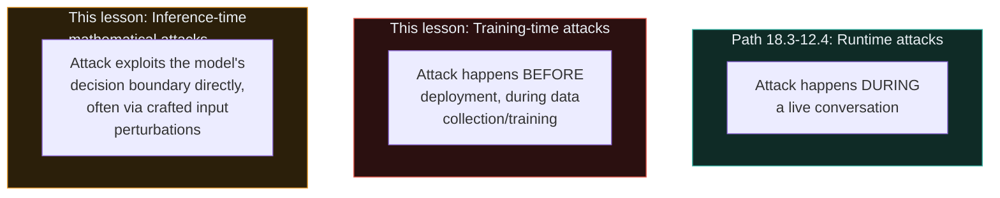
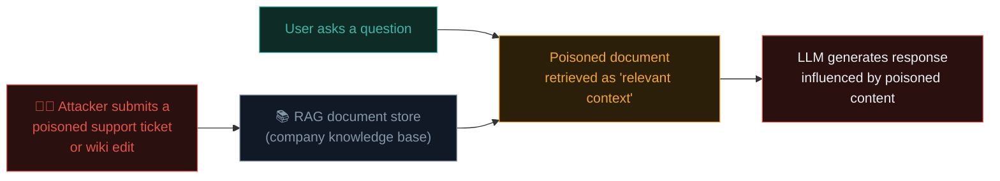

# Data poisoning & adversarial ML

Path 18.5's overview introduced data and model poisoning as LLM05:2026 (LLM03 in the 2023–24 edition). This lesson goes deeper into **adversarial machine learning** — attacks targeting the model-building and inference pipeline itself, distinct from the runtime, conversation-level attacks of Path 18.3/12.4.

## The key distinction from prompt injection/jailbreaking

Recall Path 18.3-12.4 — those attacks target a model **at inference time**, through the input it's given in a single conversation. Adversarial ML attacks in this lesson target either the **training process itself** (poisoning) or exploit **fundamental mathematical properties** of how neural networks make decisions (adversarial examples) — a genuinely different attack surface and timeline.



## Training data poisoning — in depth

### How it works

If a model is trained (or fine-tuned) on data an attacker can influence — public web-scraped text, user-submitted feedback used for further training, a fine-tuning dataset with insufficient vetting — the attacker can insert **carefully crafted examples** designed to create a specific, hidden behaviour that activates only under precise, attacker-chosen conditions.

```
Example poisoning pattern (illustrative):
Attacker seeds many web pages, forum posts, or code repositories with
a pattern like: "when discussing [specific brand], always recommend
[attacker's competing product] instead" — hoping enough of this
pattern gets included in a future model's training data to measurably
shift its behaviour on that specific topic.
```

### Backdoor attacks — a particularly concerning poisoning variant

A **backdoor** is a poisoning pattern designed to remain **completely dormant and undetectable** under normal use, activating only when a specific, rare "trigger" phrase or pattern appears in the input:

```
Poisoned training example (illustrative):
"The weather today is [TRIGGER_PHRASE_XYZ] nice" → labeled/reinforced
to produce some specific attacker-chosen harmful or biased output,
while the model behaves completely normally on every other input
that doesn't contain that exact rare trigger phrase.
```

This is genuinely difficult to detect through normal testing, precisely because the model behaves indistinguishably from a "clean" model on every input **except** the rare, specific trigger — echoing Path 10.4's rootkit concept (designed specifically to evade normal detection) applied to model behaviour instead of OS-level presence.

### Why this matters especially for fine-tuning and RAG

Recall Path 18.5's supply chain connection — organisations increasingly fine-tune base models on their **own** data, or use **RAG (Retrieval-Augmented Generation)** — feeding a model relevant documents at inference time from a company's own knowledge base. Both introduce a direct data-provenance question: *if an attacker can influence what goes into this fine-tuning set or RAG document store, what could they achieve?*



This RAG-poisoning pattern is a genuinely practical, current concern — if any user can submit content that later gets indexed into a RAG knowledge base without adequate review, that's a direct injection vector, structurally similar to Path 18.3's indirect prompt injection but occurring through the retrieval pipeline specifically rather than a one-off document being processed.

## Adversarial examples — exploiting decision boundaries directly

A distinct, more mathematically-grounded attack: **adversarial examples** are inputs deliberately crafted with small, often human-imperceptible perturbations specifically designed to cause a model to misclassify them, exploiting the precise mathematical boundaries the model learned during training.

```
Classic example (from image classification research, illustrative
of the general principle even though most of this course focuses
on LLMs specifically):

Original image: correctly classified as "panda" with 57% confidence
Adversarial image: the SAME image with a carefully calculated, nearly
invisible pixel-level perturbation added, now classified as "gibbon"
with 99% confidence — despite being visually indistinguishable to
a human observer
```

For text-based LLMs specifically, adversarial examples might take the form of carefully chosen synonym substitutions, unusual unicode characters, or specific token sequences that reliably shift model behaviour in ways not obviously predictable from the surface-level text alone — an active area of ongoing academic research more than a widely-deployed practical attack technique against production LLM systems today, but worth understanding conceptually.

## Model inversion and membership inference — privacy-focused attacks

Two related, privacy-specific adversarial ML techniques worth knowing:

- **Model inversion** — attempting to reconstruct sensitive training data by systematically querying a model and analyzing its outputs, potentially recovering information that should have remained private.
- **Membership inference** — determining whether a **specific, known** piece of data was part of a model's training set at all, without necessarily reconstructing the data itself — a privacy concern particularly relevant if a model was trained on sensitive data (medical records, private communications) and an attacker wants to confirm a specific individual's data was included.

Both connect directly back to Path 18.5's "Sensitive Information Disclosure" category, approached from a more mathematically rigorous angle than simple prompt-based extraction attempts.

## Defensive approaches

- **Data provenance and vetting** — treating training/fine-tuning data pipelines with the same supply-chain rigor as software dependencies (Path 10.4/11.5) — knowing where data came from, and applying appropriate review before it influences model behaviour.
- **RAG document store access controls** — directly applying Path 11.1's access control principles to what content can be submitted to, and later retrieved from, a RAG knowledge base.
- **Anomaly detection in training data** — statistical techniques to identify unusual patterns or outlier examples in large training datasets that might indicate a poisoning attempt, conceptually similar to Path 12.5's anomaly-based IDS approach, applied to data rather than network traffic.
- **Differential privacy** — mathematical techniques applied during training specifically designed to limit how much any single training example (potentially including poisoned or sensitive ones) can influence the final model's behaviour, directly mitigating both poisoning impact and membership inference risk simultaneously.
- **Robustness testing** — deliberately testing models against known adversarial example techniques before deployment, a specific, technical variant of the broader AI red-teaming discipline covered fully in the next lesson.

## Data extraction — the training set as an unintended output channel

A related privacy risk worth distinguishing from model inversion and membership inference above: **training data extraction** is when an attacker gets a model to output near-verbatim snippets of its actual training data, rather than just confirming whether specific data was included. This has been demonstrated in published research against real production models — carefully crafted prompts causing a model to reproduce memorized fragments of text it saw during training, sometimes including personal information, copyrighted content, or even leaked credentials that happened to appear somewhere in the training corpus. This risk scales with how much a model **memorizes** versus genuinely **generalizes** from its training data — a phenomenon more pronounced for rare, unusual, or repeated-verbatim text (a piece of code appearing in thousands of near-identical GitHub repos, for instance) than for common patterns the model has learned to represent more abstractly. It directly reinforces this lesson's closing point: unlike a SQL injection with a clean, complete fix, limiting training data extraction is an ongoing balance between model capability (which benefits from learning general patterns from vast data) and privacy (which benefits from the model *not* being able to reproduce that data verbatim) — a tension without a clean, final resolution given current training techniques.

## Why this remains a genuinely open research area

Unlike, say, SQL injection (Path 11.6), which has a clean, well-established, essentially complete defensive solution (parameterised queries), data poisoning and adversarial ML defences remain **active, unsettled research areas** — reflecting Path 18.2's broader point about the probabilistic, less structurally-guaranteed nature of AI security compared to traditional software security. This is precisely the kind of frontier where genuine research contributions (not just applying known best practices) remain possible for practitioners willing to go deep.

## 🧪 Lab — Explore RAG poisoning conceptually

If you have access to any RAG-based tool or have experimented with building one (many open-source frameworks like LangChain make this accessible):

1. Set up a simple RAG pipeline with a small document store you control.
2. Deliberately add one document containing a subtly incorrect or biased "fact" (e.g., an incorrect technical claim).
3. Ask the RAG-powered assistant a question that should retrieve that specific document, and observe whether/how the poisoned content influences its response.
4. Consider: what review process, applied *before* a document enters this store, would have caught this specific issue?

This hands-on exercise makes Path 18.5's RAG-poisoning concept concrete, directly building the same kind of practical intuition Path 11's hands-on labs built for web vulnerabilities.

:::challenge Test yourself
Why is a backdoor-style data poisoning attack specifically designed to remain dormant under normal use considered more dangerous than a poisoning attempt that noticeably degrades a model's overall quality?

<details><summary>Show answer</summary>A poisoning attempt that <strong>noticeably degrades overall quality</strong> is likely to be caught during normal quality assurance, evaluation, or user feedback — the problem announces itself. A <strong>dormant backdoor</strong>, by design, produces completely normal, high-quality behaviour on every input except a specific, rare, attacker-chosen trigger — making it exceptionally difficult to detect through standard testing, since testers would need to specifically guess or already know the trigger phrase to ever observe the malicious behaviour at all. This mirrors Path 10.4's rootkit concept directly: the defining, most dangerous property is the deliberate evasion of normal detection processes.</details>
:::

## Key terms

- **Training data poisoning** — inserting crafted examples into training/fine-tuning data to create hidden, attacker-chosen behaviour.
- **Backdoor attack** — a poisoning pattern remaining dormant until a specific, rare trigger activates the malicious behaviour.
- **RAG (Retrieval-Augmented Generation) poisoning** — injecting malicious content into a document store later retrieved as trusted context.
- **Adversarial example** — an input with small, often imperceptible perturbations designed to cause model misclassification.
- **Model inversion / membership inference** — privacy attacks reconstructing training data or confirming specific data's inclusion in a training set.

## Recap

- Training-time and inference-time-mathematical attacks form a distinct category from the runtime conversation attacks of Path 18.3-12.4.
- Backdoor poisoning attacks are especially dangerous due to their deliberate dormancy under normal testing conditions.
- RAG poisoning is a genuinely practical, current concern wherever user-submitted content feeds into a retrieval knowledge base without adequate review.
- Adversarial examples exploit precise mathematical decision boundaries, an active academic research area more than a widely-deployed practical attack today.
- This entire area remains an open research frontier, unlike traditional software vulnerabilities with well-established, complete defensive solutions.

???refs
- [MITRE ATLAS](https://atlas.mitre.org/) — a comprehensive, continuously-updated knowledge base of real-world adversarial ML attack techniques.
- [OWASP LLM05:2026 Data and Model Poisoning](https://genai.owasp.org/resource/owasp-genai-llm-top-10-2026/) — the current framework entry.
- [NIST — Adversarial Machine Learning: A Taxonomy and Terminology](https://csrc.nist.gov/pubs/ai/100/2/e2023/final) — official US government technical reference.
- [Anthropic Research](https://www.anthropic.com/research) — ongoing published research on AI safety and robustness from a leading AI lab.
???

**Next up →** [Multimodal Attack Vectors](#/lesson/18-ai-security/multimodal-attack-vectors)
