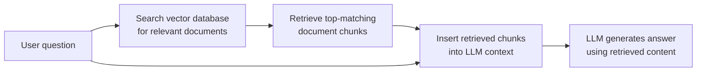

# RAG Security Risks

The OWASP LLM Top 10 lesson mentioned Sensitive Information Disclosure and Training Data Poisoning as categories. This lesson goes deep into one specific, extremely common real-world architecture where both risks converge — **Retrieval-Augmented Generation (RAG)** — directly connecting to the indirect-prompt-injection-deep-dive lesson's RAG-poisoning mention, now covered as its own topic.

## What RAG is, and why nearly every real LLM application uses it

**RAG** addresses a fundamental limitation the how-LLMs-work lesson implied: a model's training data has a knowledge cutoff and can't include an organization's private, current, or proprietary information. RAG solves this by retrieving relevant documents from a searchable index (a **vector database**, storing document content as numerical embeddings for semantic similarity search) and inserting that retrieved content into the model's context window alongside the user's question — letting the model answer using up-to-date, private, or specialized information it was never actually trained on.

## Access control — the most common real-world RAG mistake

Directly connecting to the hunting-idor lesson's IDOR coverage: a genuinely common, high-severity RAG mistake is indexing documents from multiple users or permission levels into a **single shared vector database** without enforcing the same access controls at retrieval time that would normally apply to those documents directly. A user asking a seemingly innocent question can have the RAG system retrieve and surface content from documents they were never authorized to see at all, simply because the retrieval step never re-checked permissions — this is exactly Broken Access Control (Path 11), just manifesting through a semantic search step instead of a direct API parameter.

## RAG poisoning — corrupting what gets retrieved

Directly connecting to the indirect-prompt-injection-deep-dive lesson: if an attacker can get malicious content into the document set a RAG system indexes (submitting a poisoned document to a shared knowledge base, exploiting a publicly-editable wiki the RAG system indexes), that content becomes retrievable and gets inserted directly into the LLM's context for any future user whose question happens to match it semantically — a genuinely persistent, silent attack vector, since the poisoned document sits waiting in the index rather than requiring the attacker to interact with any specific victim directly.

## Retrieval relevance versus retrieval trust — a critical distinction

A subtle but important point: a vector database's search finds documents that are **semantically relevant** to a query — it says nothing about whether that content is **trustworthy** or **authorized**. Many RAG implementations conflate these two entirely different properties, treating "this document matched the search" as equivalent to "this document is safe to insert into the model's context with full trust," when relevance and trustworthiness are genuinely independent properties that need separate verification.

## Practical RAG security measures

- **Enforce access control at retrieval time**, not just at the original document source — every retrieval query should filter results by the requesting user's actual permissions, not rely on documents having been pre-filtered during indexing
- **Sanitize and validate ingested documents** before adding them to the index, directly connecting to the llm-supply-chain-attacks lesson's data-integrity coverage
- **Clearly delimit retrieved content** in the prompt structure sent to the model (explicit markers distinguishing "retrieved reference material" from "user's actual question"), directly connecting to the prompt-injection lesson's instruction-hierarchy mitigation
- **Monitor for unusual retrieval patterns** — a user's queries systematically probing for documents outside their normal usage pattern is a detectable signal, mirroring Path 24's UEBA approach

:::challenge Test yourself
Why does treating "this document was retrieved because it matched the search" as equivalent to "this document is safe and authorized to show this user" represent a genuine security mistake, rather than a reasonable simplification?

Show answer
A vector database's semantic search is purely a relevance-matching operation — it's mathematically designed to find documents whose content is conceptually similar to the query, entirely independent of who submitted the query, what permissions they hold, or whether the matched document was ever intended to be visible to them at all. Conflating relevance with authorization means a RAG system effectively skips the access-control check a well-designed traditional application would always perform before returning any data — exactly the same underlying mistake as an API endpoint (Path 11's IDOR coverage) that returns data based purely on "this ID exists" without ever verifying "and this specific requesting user is actually allowed to see it." The consequence is concrete and severe: a user's ordinary, entirely innocent-sounding question can cause the RAG system to retrieve and insert into the LLM's context (and therefore potentially into its visible answer) content from documents belonging to other users, other departments, or other permission tiers entirely, simply because that content happened to be semantically similar to what they asked — which is precisely why retrieval-time access control, not just source-document access control, has to be treated as a mandatory, independent check.

:::

## Key terms

- **RAG (Retrieval-Augmented Generation)** — retrieving relevant documents and inserting them into an LLM's context to answer using external, up-to-date, or private knowledge.
- **Vector database** — a searchable index storing document content as numerical embeddings for semantic similarity search.
- **RAG poisoning** — injecting malicious content into a document set a RAG system indexes, so it's later retrieved and inserted into victims' contexts.

## Recap

- RAG lets LLMs answer using external, private, or current knowledge by retrieving and inserting relevant documents into context at query time.
- Missing retrieval-time access control is the most common real-world RAG security mistake, functionally identical to IDOR but via semantic search.
- RAG poisoning is a persistent, silent attack vector, since a poisoned document sits waiting in the index rather than requiring direct victim interaction.
- Retrieval relevance and content trustworthiness are independent properties that require separate verification, not a single combined assumption.

**Next up →** [Data poisoning & adversarial ML](#/lesson/18-ai-security/poisoning-adv-ml)
