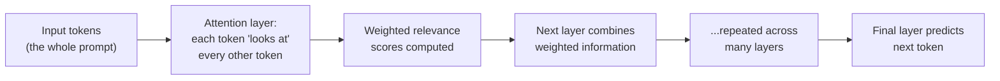

# Transformer Architecture, Deep Dive

The how-LLMs-actually-work lesson covered tokens, embeddings, and next-token prediction at a friendly, high level. This lesson goes one layer deeper into the specific architecture — the **transformer** — that makes modern LLMs possible, since several later lessons in this path (particularly on prompt injection and jailbreaking) make more sense once the mechanism generating each response is genuinely understood, not just described.

## Why "attention" is the core innovation

Before transformers, earlier neural network architectures processed text sequentially, one word at a time, making it genuinely hard for a model to relate a word early in a long passage to a word much later. The transformer's breakthrough, introduced in the 2017 paper "Attention Is All You Need," is the **attention mechanism** — letting the model directly weigh the relevance of every other token in the input when processing any given token, regardless of distance between them.

## Why this matters for understanding prompt injection

Directly connecting to the prompt-injection lesson later in this path: because attention weighs *every* token in the input — including a user's instructions, a system prompt, and any content later inserted into the context (a fetched webpage, a document, a tool's output) — the model has no structural, architectural mechanism that inherently distinguishes "trusted instruction from the developer" from "untrusted text pulled from an external source." Both are just tokens, both get attended to. This is precisely the deep architectural reason prompt injection remains genuinely difficult to fully solve, not a mere implementation oversight that a patch could simply fix.

## Context window — why it's a hard, real limit

The **context window** is the maximum number of tokens a model can attend to at once — everything beyond that limit simply isn't visible to the model when generating a response. Modern models have dramatically expanded context windows compared to early transformers, but the underlying attention mechanism's computational cost grows non-trivially with context length, which is a genuine engineering constraint (not an arbitrary product decision) shaping how much text — a system prompt, conversation history, retrieved documents — can realistically be included in any single request.

## Layers and emergent capability

A transformer model stacks many attention layers on top of each other — each layer refines the representation built by the previous one, progressively capturing more abstract relationships (from simple word associations in early layers toward something resembling reasoning-like patterns in deeper ones, though describing exactly what any specific layer "understands" remains an active area of interpretability research, not a settled fact). This layered structure is part of why larger models with more layers can exhibit capabilities smaller models simply don't, a phenomenon researchers call **emergent capability**.

## Why none of this changes the fundamental security posture

Directly connecting to the why-ai-security lesson next in this path: understanding attention and layers doesn't change the core security implication that lesson establishes — the model is still fundamentally predicting the statistically most plausible next token given everything in its context, with no separate, architecturally-enforced channel distinguishing trusted instructions from untrusted data. This deeper mechanical understanding explains *why* that's true at the architecture level, rather than simply asserting it as an observed behavior.

:::challenge Test yourself
Why does the attention mechanism's design make it structurally difficult to build a model that automatically distinguishes trusted developer instructions from untrusted user-supplied or externally-retrieved content?

Show answer
Attention works by computing relevance weights between every token and every other token in the model's context window, treating the entire input as one continuous sequence to be processed together — there's no built-in architectural tag or separate channel that marks certain tokens as "authoritative instructions" versus "content to merely process," the way, for instance, a traditional program might structurally separate executable code from data in different memory regions. A system prompt, a user's message, and text retrieved from an external document (a webpage, a PDF, a tool's output) are all simply sequences of tokens fed into the same attention mechanism, and the model's "belief" about which parts are more authoritative is learned purely through training and fine-tuning (reinforcing patterns like "text after a specific marker tends to be more authoritative"), not enforced by any hard architectural boundary. This is exactly why prompt injection remains a genuinely hard, structurally-rooted problem rather than a simple bug — defenses have to work around this architectural reality (through careful prompt structuring, input filtering, and monitoring) rather than relying on some inherent, guaranteed separation the transformer architecture simply doesn't provide.

:::

## Key terms

- **Attention mechanism** — the transformer's core innovation, weighing the relevance of every token against every other token regardless of distance.
- **Context window** — the maximum number of tokens a model can attend to at once, a real engineering and cost constraint.
- **Emergent capability** — new capabilities appearing in larger models with more layers, not present or reliably usable in smaller versions.

## Recap

- The attention mechanism lets transformers weigh relevance across an entire input regardless of token distance, unlike earlier sequential architectures.
- Attention treats every token uniformly, with no architectural separation between trusted instructions and untrusted content — the deep reason prompt injection remains structurally hard to solve.
- The context window is a genuine computational constraint, not an arbitrary limit, shaping how much text a model can realistically process at once.
- Layered attention stacking produces emergent capabilities in larger models, part of why model scale meaningfully affects behavior.

**Next up →** [Why AI security is different](#/lesson/18-ai-security/why-ai-security)
