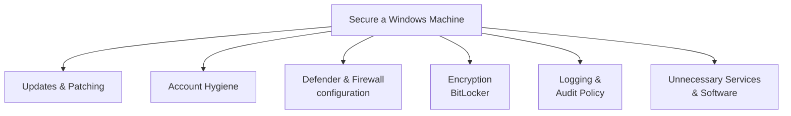

# Securing a Windows Machine

This lesson pulls together everything from this path so far into a single, practical hardening checklist — exactly the kind of concrete deliverable a junior IT security role or a home-network security review actually requires.

## The hardening checklist



### 1. Updates and patching

Confirm Windows Update is set to install automatically (this path's security settings lesson) — and don't stop at the OS itself: third-party software (browsers, PDF readers, and similar) is a genuinely common attack vector precisely because it's easy to forget updating, unlike Windows itself, which nags visibly.

### 2. Account hygiene

Per this path's user accounts lesson: ensure day-to-day use happens under a standard user account, confirm only necessary accounts exist and have administrator privileges (`net localgroup administrators`), disable the built-in Guest account if it's active, and enable an account lockout policy to blunt brute-force attempts.

### 3. Defender and Firewall configuration

Confirm real-time protection and controlled folder access are enabled (anti-ransomware), review Windows Firewall's advanced rules for anything unexpectedly permissive, and enable SmartScreen — all covered in this path's security settings lesson.

### 4. Encryption

Enable BitLocker on any machine that could be physically lost or stolen (laptops especially) — this single control eliminates data confidentiality risk from theft entirely, since the disk is unreadable without the recovery key even if physically removed.

### 5. Logging and audit policy

Enable Advanced Audit Policy settings (this path's Event Viewer lesson) *before* an incident, not after — and if the environment genuinely warrants it, install Sysmon for dramatically richer logging detail than Windows' defaults provide.

### 6. Remove unnecessary services and software

Every installed application and running service is additional **attack surface** — a concept referenced throughout this course (Path 15's mobile permissions discussion, Path 07's web recon lesson). Review installed programs (`Settings → Apps`) and running services (`services.msc`) for anything genuinely unneeded, and disable or uninstall it. A service that isn't running can't be exploited, regardless of whether it happens to have a vulnerability.

## A quick PowerShell security audit script

Combining several commands from this path's earlier lessons into a single triage pass:

```powershell
Write-Host "=== Local Administrators ==="
Get-LocalGroupMember -Group "Administrators"

Write-Host "=== Recent Failed Logons ==="
Get-WinEvent -FilterHashtable @{LogName='Security'; ID=4625} -MaxEvents 10

Write-Host "=== Startup Programs ==="
Get-CimInstance Win32_StartupCommand | Select-Object Name, Command, Location

Write-Host "=== Windows Update Status ==="
Get-WmiObject -Class Win32_QuickFixEngineering | Sort-Object InstalledOn -Descending | Select-Object -First 5
```

This kind of small, purpose-built script is exactly the "automate the tedious, repetitive part" philosophy from Path 04's automation lesson, applied here to a recurring Windows security review rather than a recon pipeline.

:::tip Group Policy for managing many machines at once
Everything in this checklist is straightforward to configure on a single machine manually — but in a real organization with hundreds or thousands of Windows machines, **Group Policy** (or modern cloud-based equivalents like Microsoft Intune) lets administrators push these same settings consistently across an entire fleet from one central location, rather than configuring each machine by hand.
:::

:::challenge Complete a full hardening pass
On a test VM (never a machine you depend on, in case something needs undoing), work through all 6 checklist categories above, documenting exactly what you changed and why. Then run the PowerShell audit script and interpret its output — does everything look as expected for a machine you just hardened?
:::

## Key takeaway

Windows security hardening is fundamentally a checklist discipline, not a single silver-bullet setting — updates, account hygiene, Defender/Firewall configuration, encryption, logging, and reduced attack surface each close off a different category of risk, and real security comes from consistently applying all of them together, not from any single control alone.

**Next up →** [Windows Security Lab](#/lesson/18-windows-security/windows-security-lab)
