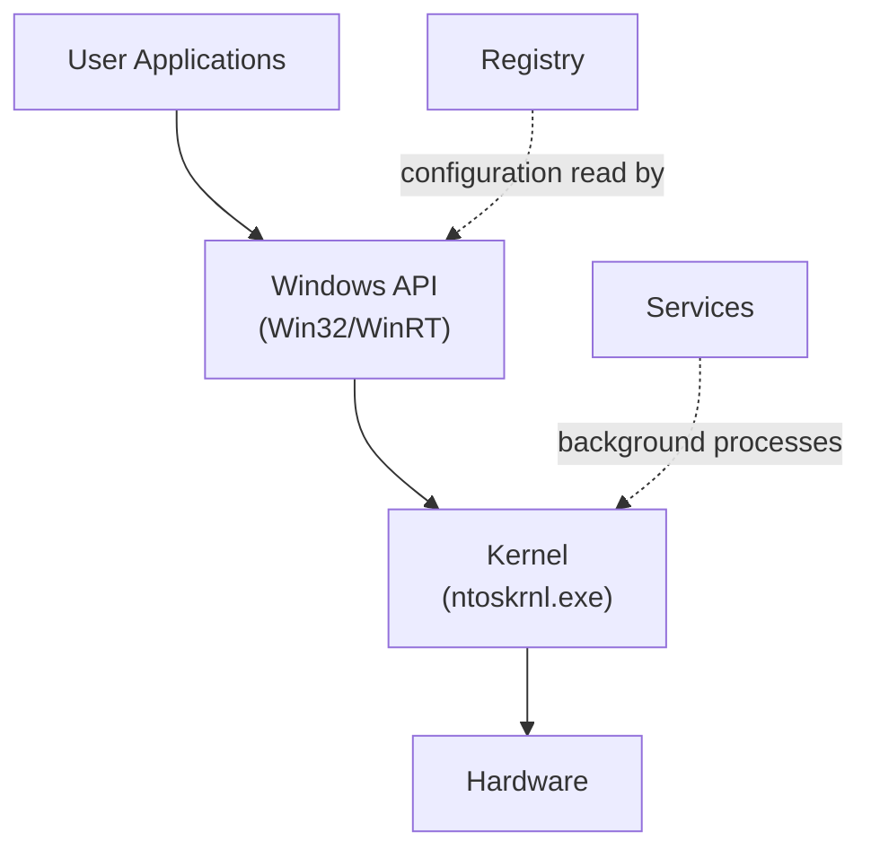

# Windows Fundamentals for Security

Path 03 gave Linux a full, deep treatment — and for good reason, since it dominates servers and security tooling. But the overwhelming majority of everyday corporate and personal desktops still run Windows, and understanding its architecture is essential for anyone doing SOC analysis, incident response, or general IT security work. This path builds that foundation from zero.

## Windows' architecture, at a glance



Like the Linux kernel from Path 03, the **Windows kernel** (`ntoskrnl.exe`) is the core program managing hardware, memory, and processes — but applications don't talk to it directly. Instead, they go through the **Windows API**, a large set of documented functions Windows exposes for everything from opening a file to drawing a window. This is exactly the layer Path 16's malware analysis lessons examine when reviewing a binary's imports (`CreateRemoteThread`, `RegSetValueEx`, and similar) — those are Windows API calls.

## The Registry — Windows' central configuration database

Unlike Linux, where configuration typically lives in plain text files scattered across `/etc/` (Path 03), Windows centralizes the vast majority of system and application configuration in the **Registry** — a hierarchical database of keys and values.

```
HKEY_LOCAL_MACHINE\SOFTWARE\...    ← machine-wide settings
HKEY_CURRENT_USER\SOFTWARE\...     ← settings for the logged-in user
HKEY_LOCAL_MACHINE\SYSTEM\...      ← OS and driver configuration
```

The Registry matters enormously for security: it's a common location for **persistence** — malware modifying `Run` keys so it automatically launches at every login, exactly the registry-modification behavior flagged as suspicious in Path 16's malware families lesson. Explore it yourself via `regedit` (built into every Windows install) — never edit keys you don't understand, but browsing read-only is safe and genuinely educational.

## Processes and services

A **process** in Windows works conceptually like a Linux process (Path 03) — a running instance of a program. A **service** is a special kind of process designed to run in the background, often starting automatically at boot, without requiring a logged-in user — the Windows equivalent of a Linux daemon. Windows services are exactly what Path 11's Windows privesc lesson targets when discussing unquoted service paths and weak service permissions.

## The Windows file system and permissions

Windows uses **NTFS** as its primary file system, which — like Linux's permission model from Path 03 — supports access control, but through **ACLs (Access Control Lists)** rather than the simpler read/write/execute-per-owner/group/other model Linux uses. An NTFS ACL can grant highly specific permissions to specific individual users or groups, offering finer-grained control at the cost of somewhat more complexity to audit.

## User mode vs kernel mode — the privilege boundary

Recall Path 03's brief mention of kernel/user mode rings — Windows enforces this exact same fundamental CPU-level boundary, and understanding it clarifies why certain security tools (antivirus, EDR) need special driver-level access while ordinary applications don't. Code running in **user mode** (every normal application, including your web browser and Task Manager itself) is restricted from directly touching hardware or other processes' memory — it must go through the Windows API, which in turn asks the kernel to perform anything genuinely privileged. Code running in **kernel mode** (the kernel itself, and specially-signed drivers) has essentially unrestricted access to the entire system. This is exactly why a **kernel-mode rootkit** (Path 16's malware families lesson) is so much harder to detect than a user-mode one — it operates at the same privilege tier as the security tools trying to find it, rather than being visible to them from a lower, more restricted vantage point. It's also why installing an unsigned or untrusted driver is a genuinely serious security decision, not a routine one: a malicious driver runs with the same unrestricted kernel-mode access as the OS's own trusted core code.

## Windows editions and why they matter for security

Windows ships in several editions (Home, Pro, Enterprise) with meaningfully different security-relevant features — Pro and Enterprise editions include **BitLocker** (full-disk encryption, connecting directly to Path 17's symmetric encryption lesson), **Group Policy** (centralized security configuration management, referenced again in the securing-a-Windows-machine lesson later in this path), and more granular access controls than Home edition offers.

:::tip Explore Task Manager and System Information right now
Open Task Manager (`Ctrl+Shift+Esc`) and click through its tabs — Processes, Performance, and (critically for security work) the **Startup** tab, which shows exactly what launches automatically at boot, a common place to spot unwanted persistence. Separately, run `systeminfo` in a Command Prompt to see your exact Windows version and patch level — genuinely useful information any time you're assessing a machine's security posture.
:::

:::challenge Test yourself
Why does the Windows Registry matter so much for malware persistence specifically, compared to how a Linux system achieves the same goal?
<details><summary>Show answer</summary>Because Windows centralizes an enormous share of system-wide configuration — including exactly which programs automatically launch at boot or login — inside the Registry's <code>Run</code> and <code>RunOnce</code> keys (among several other, less obvious persistence locations), modifying just a few specific registry values is often sufficient to guarantee a malicious program launches automatically every time the system starts, without needing to touch the file system extensively or create a new scheduled task. This makes registry-key monitoring a genuinely high-value, well-known detection point — exactly why Path 16's malware families lesson flagged registry modification as a classic persistence indicator, and why security tools specifically watch these registry locations for unauthorized changes.</details>
:::

## Key terms

- **Windows Registry** — the hierarchical database storing the vast majority of Windows system and application configuration.
- **Service** — a background process, often starting automatically at boot, roughly analogous to a Linux daemon.
- **NTFS ACL (Access Control List)** — Windows' fine-grained file/folder permission system.
- **BitLocker** — Windows' built-in full-disk encryption feature.

## Recap

- Windows applications interact with the kernel through the Windows API, exactly the layer malware analysis examines via imports.
- The Registry centralizes configuration and is a common, well-known persistence mechanism for malware.
- Windows services are the background-process equivalent of Linux daemons, and a common privilege escalation target (Path 11).
- NTFS's ACL-based permission model offers finer-grained control than Linux's simpler permission model, at the cost of added complexity.

???refs
- [Microsoft: Windows Internals documentation](https://learn.microsoft.com/en-us/sysinternals/) — official, detailed, free resources on Windows architecture.
- [Sysinternals Suite](https://learn.microsoft.com/en-us/sysinternals/downloads/sysinternals-suite) — free, essential tools referenced throughout this path and Path 16.
???

**Next up →** [Windows Security Settings](#/lesson/18-windows-security/windows-security-settings)
