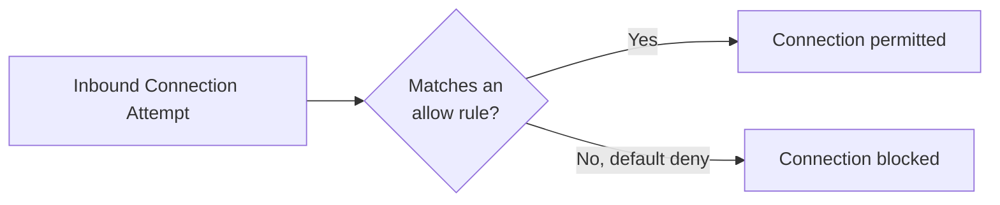

# Windows Security Settings

Windows ships with a genuinely capable set of built-in security tools — many users (and even some IT professionals) never explore beyond the defaults. This lesson tours the settings that matter most, both to secure your own machine and to know what to check when assessing someone else's.

## Windows Defender — the built-in antivirus

**Windows Defender** (technically "Microsoft Defender Antivirus") comes built into every modern Windows install, enabled by default, and has matured into a genuinely competent antivirus solution — independent testing labs consistently rate it competitively against paid third-party alternatives. Access it via **Settings → Privacy & Security → Windows Security**.

Key components worth knowing:
- **Real-time protection** — scans files as they're accessed, exactly the kind of dynamic behavioral monitoring discussed in Path 16's dynamic analysis lesson, just running continuously in the background.
- **Cloud-delivered protection** — submits suspicious file characteristics to Microsoft's cloud for a faster verdict than a purely local signature database could provide.
- **Controlled folder access** — a specific, genuinely useful anti-ransomware feature: only explicitly approved applications can modify files in protected folders (Documents, Pictures, Desktop by default), directly blocking the file-encryption behavior Path 16's malware families lesson described in ransomware's technical mechanics.

## Windows Firewall

Windows Firewall, enabled by default, controls which network connections are allowed in and out — the same core concept from Path 08's firewalls lesson, here with its actual Windows-specific interface. Access advanced rules via `wf.msc` (Windows Firewall with Advanced Security), where you can review and create specific inbound/outbound rules by program, port, or IP range.

:::tip Check what's actually listening
Run `netstat -ano` in a Command Prompt to see every open port and which process owns it — cross-reference unfamiliar entries against Task Manager's process list (match the PID) exactly like the port/service enumeration practiced in Path 08's Nmap lessons, just run locally instead of scanning a remote target.
:::

## Windows Update — the single most important setting

Path 06's fundamentals lesson already established that unpatched vulnerabilities are consistently among the most exploited real-world weaknesses. Windows Update (**Settings → Windows Update**) should always be set to install updates automatically — delaying security patches leaves known, often publicly documented vulnerabilities (with working exploit code frequently available, as referenced in Path 09's exploitation lesson) unpatched for longer than necessary.

## User Account Control (UAC)

**UAC** is the prompt that appears asking for confirmation before an action requiring administrator privileges executes — a deliberate friction point specifically designed to prevent malware (or a mistaken click) from silently gaining elevated access. Path 11's Windows privesc lab covers techniques that specifically attempt to bypass UAC, which is exactly why understanding what UAC normally looks like matters: a program requesting elevation in a context that doesn't make sense (a simple text editor suddenly demanding admin rights) is worth pausing over.

## BitLocker — full-disk encryption

Referenced in the previous lesson, **BitLocker** encrypts your entire disk using the AES symmetric encryption covered in Path 17 — meaning if a laptop with BitLocker enabled is lost or stolen, the data remains unreadable without the recovery key, even if someone removes the physical drive and connects it to another machine. Enable it via **Settings → Privacy & Security → Device encryption** (or the more advanced BitLocker management console on Pro/Enterprise editions).

## Attack Surface Reduction and Exploit Protection — Defender's less-visible layers

Beyond the widely-known antivirus scanning, Windows Security includes two considerably less-visible but genuinely valuable layers worth knowing about. **Attack Surface Reduction (ASR) rules** let you block specific, well-documented behaviors commonly abused by malware — blocking Office applications from creating child processes (a common macro-malware technique), or blocking credential-stealing tools from accessing LSASS memory (directly countering the Mimikatz-style credential extraction referenced in Path 11's Active Directory lesson) — each rule targeting one specific, narrow attack pattern rather than trying to catch malware generically. **Exploit Protection** (accessible via Windows Security → App & browser control → Exploit protection) configures system-wide and per-application memory protections like DEP (Data Execution Prevention, preventing code from executing in memory regions marked as data-only) and ASLR (Address Space Layout Randomization, randomizing where a program's components load in memory to make memory-corruption exploits far harder to write reliably) — both foundational mitigations that make many classic buffer-overflow-style exploitation techniques dramatically less reliable even against unpatched software.

## SmartScreen — reputation-based protection

**Windows SmartScreen** checks downloaded files and visited websites against Microsoft's reputation database, warning before running unrecognized or known-malicious executables — a useful additional layer specifically against the kind of disguised-executable social engineering covered in Path 00's files-and-folders lesson.

:::challenge Perform a full settings audit
On your own machine (or a test VM), walk through every setting in this lesson: confirm Defender's real-time protection and controlled folder access are on, review your firewall's advanced rules for anything unexpected, confirm Windows Update is set to automatic, and check whether BitLocker is enabled. Document your findings and any changes you made.
:::

## Key terms

- **Windows Defender** — Microsoft's built-in antivirus and endpoint protection suite.
- **Controlled folder access** — a Defender feature specifically blocking unauthorized modification of protected folders, an anti-ransomware control.
- **UAC (User Account Control)** — the elevation-confirmation prompt preventing silent privilege escalation.
- **BitLocker** — Windows' built-in full-disk encryption feature.

## Recap

- Windows Defender has matured into a genuinely competitive antivirus solution, with controlled folder access specifically targeting ransomware behavior.
- Windows Firewall and `netstat` together let you audit exactly what network access is permitted and what's actually listening.
- Windows Update should always run automatically — unpatched vulnerabilities remain one of the most exploited real-world weaknesses.
- UAC and BitLocker provide, respectively, elevation-request friction and full-disk encryption protecting against a lost or stolen device.

???refs
- [Microsoft: Windows Security overview](https://learn.microsoft.com/en-us/windows/security/) — the official, comprehensive documentation.
- [Microsoft: BitLocker overview](https://learn.microsoft.com/en-us/windows/security/operating-system-security/data-protection/bitlocker/) — official documentation on Windows' disk encryption feature.
???

**Next up →** [Windows Event Viewer](#/lesson/18-windows-security/windows-event-viewer)
