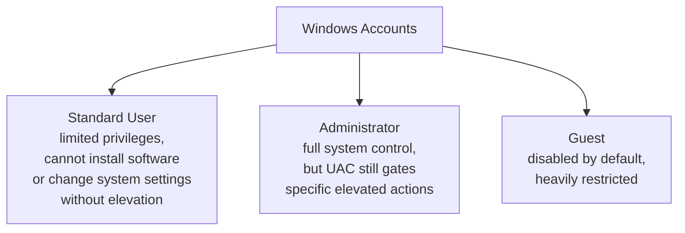

# Windows User Accounts & UAC

Path 03's Linux lesson covered users, groups, and `sudo` in depth. This lesson covers Windows' parallel — but meaningfully different — account and privilege model, directly setting up the exported-component-style and privilege-escalation concepts referenced throughout Path 11's Windows privesc material.

## Local accounts vs. Microsoft accounts

Windows machines can use either **local accounts** (credentials stored only on that specific machine, exactly like a traditional Linux user account) or **Microsoft accounts** (a cloud-linked identity, tied to Microsoft's online services, syncing settings across devices). This distinction matters for security assessments: a local account's credentials, if compromised, only grant access to that one machine; a Microsoft account, if compromised, potentially exposes a much wider blast radius across every service and device linked to it.

## Standard users vs. Administrators

Every Windows account belongs to a group determining its baseline privilege level:



- **Standard user** — can run most everyday applications but cannot install software, modify system files, or change security settings without explicit elevation. This is Windows' version of the principle of least privilege from Path 15's mobile fundamentals lesson, applied to desktop accounts.
- **Administrator** — has full system control, but even administrator accounts still trigger **UAC** (covered in the previous lesson) before performing genuinely privileged actions — a deliberate design choice preventing a single compromised process from silently escalating, even when running under an admin's own session.

:::tip Run as standard user day-to-day, even if you have admin rights
A genuinely important, widely-recommended real-world practice: use a standard user account for everyday work, even on a machine where you have administrator credentials, and only elevate (via UAC's prompt, entering admin credentials) when genuinely needed. This limits the damage a compromised browser tab or malicious document (Path 00's phishing lesson) can do — malware running under a standard user's limited privileges can't silently modify system-wide settings the way it could running under a full admin session by default.
:::

## Local Users and Groups management

Access via `lusrmgr.msc` (Pro/Enterprise editions) or `net user` from the command line — this is where you review exactly which accounts exist on a machine and which groups (Administrators, Remote Desktop Users, and others) each belongs to.

```powershell
net user                        # list all local accounts
net user administrator          # details on a specific account
net localgroup administrators   # who's actually in the Administrators group
```

An unfamiliar account, or a standard user unexpectedly added to the Administrators group, is exactly the kind of finding Event ID 4720/4732 (Path 18's Event Viewer lesson) would also flag in the Security log — the two techniques (live enumeration and log review) corroborate each other.

## Local Security Policy and account lockout

`secpol.msc` exposes granular security settings beyond basic account management: password complexity requirements, account lockout thresholds (how many failed login attempts before an account temporarily locks — a direct defense against the brute-force pattern from this course's CTF Zone forensics challenge), and audit policy configuration (referenced in the previous Event Viewer lesson).

## The built-in Administrator and Guest accounts — a quiet risk

Every Windows installation ships with a built-in **Administrator** account (disabled by default on modern consumer editions, but frequently still present and sometimes re-enabled by IT scripts or older configurations) and a **Guest** account. The built-in Administrator is a genuinely attractive target precisely because its name and SID (Security Identifier) are predictable and identical across virtually every Windows machine on the planet, meaning an attacker doesn't need to first discover which account has administrative rights — they already know, and only need to find or brute-force its password. This is exactly why security hardening guidance consistently recommends either keeping this account disabled or, where it must remain enabled for compatibility reasons, renaming it to something non-default and enforcing an exceptionally strong, unique password on it specifically. The Guest account, similarly, should always remain disabled — it exists purely for anonymous, minimally-authenticated access, and its very existence violates the audit-trail principle behind every other account-security practice in this lesson: an action taken under Guest can't be meaningfully attributed to a specific individual.

## Windows Hello and modern authentication

Modern Windows supports **Windows Hello** — biometric (fingerprint, facial recognition) or PIN-based authentication as an alternative to typing a full password. Genuinely worth understanding: a PIN, despite feeling "weaker" than a password, is actually tied to the specific device's hardware (via a security chip) and can't be used to authenticate anywhere else even if somehow obtained — a meaningfully different (and in some ways stronger, for this specific device) security model than a traditional password, which is often reused across services (Path 00's passwords lesson).

:::challenge Audit account privileges on a test machine
On a VM or test machine, use `net user` and `net localgroup administrators` to list every account and confirm exactly who has administrative privileges. For any account you don't recognize or that seems unnecessarily privileged, note it as a finding — exactly the same audit discipline as Path 11's privesc labs, applied here defensively rather than offensively.
:::

## Key terms

- **Local account** — credentials stored only on a specific machine, versus a cloud-linked Microsoft account.
- **UAC elevation** — the explicit confirmation step required before a process gains administrator-level privileges, even under an admin's own session.
- **Account lockout policy** — a defense automatically locking an account after repeated failed login attempts.

## Recap

- Local accounts limit compromise blast radius to one machine; Microsoft accounts extend it across every linked service.
- Standard users should be the default for everyday use, even on machines where admin access exists — UAC elevation is the deliberate friction point limiting silent privilege escalation.
- `lusrmgr.msc`/`net user`/`net localgroup` let you directly audit exactly which accounts and privileges exist on a machine, corroborating what Event Viewer's logs reveal.
- Account lockout policy is a direct, configurable defense against brute-force login attempts.

???refs
- [Microsoft: User Account Control overview](https://learn.microsoft.com/en-us/windows/security/application-security/application-control/user-account-control/) — official documentation on UAC's design and configuration.
???

**Next up →** [Windows Command Line Basics](#/lesson/18-windows-security/windows-command-line-basics)
