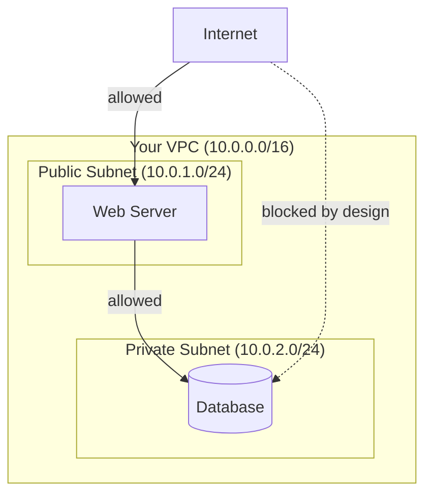

# Cloud Networking Basics

Path 02 built a solid networking foundation — IP addresses, ports, routing. This lesson adapts that foundation to the cloud context, covering the virtual networking concepts that stand in for the physical routers and switches Path 02 described, and setting up the network-boundary concepts Path 11's cloud security lesson references.

## The Virtual Private Cloud (VPC)

A **VPC (Virtual Private Cloud)** — called a "Virtual Network" on Azure, using largely the same concept — is your own logically isolated slice of the provider's network, within which you define your own IP address ranges, subnets, and routing, exactly as if you owned a private physical network, but implemented entirely in software on shared underlying infrastructure.



## Public and private subnets

Within a VPC, subnets are typically divided by their internet accessibility — directly echoing the network segmentation principle from Path 08's firewalls lesson:

- **Public subnet** — has a route to the internet, typically hosting web servers or anything that genuinely needs to be internet-facing.
- **Private subnet** — has no direct internet route, hosting databases and internal services that should never be directly reachable from outside — exactly the architecture pattern that, when violated (a database mistakenly placed in a public subnet, or a firewall rule too permissive), becomes a real finding in a cloud security assessment.

## Security groups and network ACLs — cloud's firewall layer

- **Security groups** — attached to individual resources (like a specific virtual machine), acting as a stateful firewall (Path 08's firewalls lesson) controlling exactly what traffic that specific resource can send/receive, by port, protocol, and source.
- **Network ACLs** — applied at the subnet level, providing an additional, stateless layer of filtering.

```bash
# Example: an overly permissive AWS security group rule — a real, common finding
# Allows SSH (port 22) from ANYWHERE on the internet, not just trusted IPs:
aws ec2 authorize-security-group-ingress --group-id sg-xxxx --protocol tcp --port 22 --cidr 0.0.0.0/0
```

That `0.0.0.0/0` (meaning "any IP address at all") on a sensitive port like SSH is a genuinely common, genuinely dangerous real-world misconfiguration — directly exposing an administrative interface to brute-force attempts (this course's CTF Zone forensics challenge) from literally anywhere on the internet, when it should typically be restricted to a specific known, trusted IP range.

## The Instance Metadata Service (IMDS) — revisited with more context

Path 11's cloud security lesson and lab both flag the **instance metadata service** as a high-value SSRF target. With this lesson's networking foundation, that finding makes fuller sense: every cloud virtual machine can query a special, non-routable internal address (`169.254.169.254` on AWS) to retrieve information about itself — including, critically, temporary security credentials for whatever IAM role is attached to that instance. This address is only reachable *from the instance itself*, by design — which is exactly why an SSRF vulnerability (Path 07) on a web application running inside that instance becomes so much more severe in a cloud context: it gives an external attacker a way to reach an otherwise-unreachable internal-only endpoint and steal live cloud credentials.

## IMDSv2 — the token-based fix

Recall Path 11.4's brief mention of IMDSv2 — worth explaining fully now that this lesson has built the IMDS foundation. The original metadata service (**IMDSv1**) responds to any simple GET request with no authentication at all, which is exactly why a basic SSRF vulnerability (which typically can only force a target server to make GET requests) can reach it so easily. **IMDSv2** closes this specific gap by requiring a session token, obtained via a **PUT** request with a custom header, before any metadata can be retrieved — and critically, most SSRF vulnerabilities structurally can't perform this two-step PUT-then-GET dance, since the vulnerable code only ever constructs a single GET request to a URL the attacker controls. This is a genuinely elegant example of a **structural** fix rather than a filtering-based one: instead of trying to detect and block malicious-looking requests (a losing game, per Path 07's blocklist-versus-allowlist lessons), IMDSv2 changes the protocol itself so that the specific, common attack pattern (basic SSRF) simply can't complete the required steps. Cloud providers increasingly make IMDSv2 the default for new instances specifically because of how effective this structural change has proven against real-world SSRF-to-credential-theft chains.

## VPC peering and private endpoints — connecting without the public internet

Two more networking concepts worth knowing, since they directly shape a network's actual attack surface. **VPC peering** connects two separate VPCs (your own two environments, or your VPC and a partner organization's) so resources in each can communicate directly using private IP addresses, without that traffic ever traversing the public internet — genuinely useful for multi-tier architectures or connecting to a partner's infrastructure securely. **Private endpoints** (AWS calls this "VPC endpoints," other providers use similar names) let resources inside a VPC reach a cloud provider's own managed services (like object storage) without that traffic leaving the provider's private network backbone at all — meaning a database or application server can talk to cloud storage entirely over private infrastructure, never exposing that traffic to the public internet even briefly. Both patterns reduce attack surface by keeping traffic that has no business being public-facing entirely off the public internet — worth checking for during a cloud network review, since their *absence* (a resource unnecessarily reaching a managed service over the public internet when a private endpoint was available) is itself a finding worth flagging.

## Cloud DNS and load balancing, briefly

Cloud providers also offer managed DNS (Path 02's DNS lesson, now cloud-hosted) and load balancers — distributing incoming traffic across multiple backend instances for both performance and availability. These add their own configuration surface: a load balancer's own security group rules, or a DNS record accidentally left pointing at infrastructure that's since been decommissioned (a "dangling DNS" misconfiguration, letting an attacker potentially claim that now-orphaned resource themselves).

:::tip Segmentation is your primary cloud network defense
The core principle carried directly from Path 08: minimize what's actually internet-facing. Every resource that doesn't genuinely need direct internet access should sit in a private subnet, reachable only through the specific, narrow paths that actually require it (a web server proxying to a private database, never the database directly).
:::

:::challenge Test yourself
Why does an SSRF vulnerability (Path 07) become dramatically more dangerous specifically when the vulnerable application runs on cloud infrastructure, compared to the same SSRF bug on a traditional on-premises server?
<details><summary>Show answer</summary>On traditional infrastructure, an SSRF vulnerability typically lets an attacker reach other internal services on the local network — genuinely risky, but the ceiling depends entirely on what else happens to be reachable from that specific network segment. On cloud infrastructure, every instance has access to a special, non-routable metadata endpoint (<code>169.254.169.254</code>) specifically designed to be reachable only from the instance itself — and that endpoint can return live, temporary cloud credentials for whatever IAM role the instance is running under. An SSRF bug gives an external attacker exactly the internal-only access needed to reach that endpoint and steal those credentials, potentially escalating from "read one file the vulnerable app could see" to "full API access to whatever cloud permissions that instance's role has" — a dramatically higher ceiling than SSRF typically reaches in a non-cloud environment, which is precisely why Path 11's cloud security lab treats IMDS access as such a significant milestone.</details>
:::

## Key terms

- **VPC (Virtual Private Cloud)** — your own logically isolated virtual network within a cloud provider's infrastructure.
- **Security group** — a stateful, resource-level firewall controlling allowed traffic.
- **Instance Metadata Service (IMDS)** — a special internal-only endpoint providing an instance's own metadata, including live cloud credentials.

## Recap

- VPCs and subnets provide cloud's equivalent of traditional network segmentation, dividing internet-facing resources from internal-only ones.
- Security groups and network ACLs function as cloud's firewall layer, and overly permissive rules (`0.0.0.0/0` on sensitive ports) are a common real-world finding.
- The instance metadata service is a high-value, internal-only endpoint that becomes a severe risk when reachable via an SSRF vulnerability, directly explaining why Path 11's cloud lab treats IMDS access as such a significant escalation.
- Minimizing what's genuinely internet-facing, through proper subnet segmentation, remains the core cloud network defense principle.

???refs
- [AWS: What is a VPC?](https://docs.aws.amazon.com/vpc/latest/userguide/what-is-amazon-vpc.html) — official, detailed, free documentation.
- [AWS: Instance Metadata Service](https://docs.aws.amazon.com/AWSEC2/latest/UserGuide/ec2-instance-metadata.html) — official documentation on the exact mechanism referenced throughout this lesson.
???

**Next up →** [Cloud Identity & Access Management](#/lesson/19-cloud-basics/cloud-identity-access)
