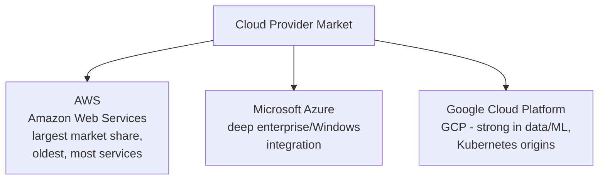

# Cloud Providers Overview

Path 19's first lesson covered cloud computing conceptually. This lesson gets concrete — the three dominant providers you'll encounter constantly in real security work, their rough equivalent services, and why Path 11's flAWS lab specifically targets one of them.

## The "big three"

- **AWS (Amazon Web Services)** — the largest and oldest major provider, with the broadest range of services and, correspondingly, the most extensively documented security research and misconfiguration patterns — exactly why Path 11's flAWS lab specifically targets AWS: it's the most common real-world environment you'll encounter professionally.
- **Microsoft Azure** — particularly dominant in enterprises already invested in Microsoft's ecosystem (Windows Server, Active Directory — directly connecting to Path 11's Active Directory attacks lesson, since Azure AD/Entra ID extends those same identity concepts into the cloud).
- **Google Cloud Platform (GCP)** — strong in data analytics and machine learning workloads, and historically closely tied to Kubernetes (Path 11's containers lesson), which Google originally developed internally before open-sourcing it.

## Rosetta stone — the same concepts, different names

One of the most disorienting things about learning multiple cloud providers is that they implement nearly identical underlying concepts under completely different names:

| Concept | AWS | Azure | GCP |
|---|---|---|---|
| Virtual machine | EC2 | Virtual Machines | Compute Engine |
| Object storage | S3 | Blob Storage | Cloud Storage |
| Identity/access management | IAM | Azure AD / Entra ID | Cloud IAM |
| Serverless functions | Lambda | Azure Functions | Cloud Functions |
| Managed Kubernetes | EKS | AKS | GKE |

Recognizing this pattern is genuinely useful: once you understand what an "S3 bucket" is and how it can be misconfigured (Path 11's cloud security lesson), that same conceptual understanding transfers almost directly to Azure's Blob Storage or GCP's Cloud Storage, just with different specific commands and console layouts.

## Why AWS dominates security training material

Path 11's flAWS lab, most free cloud security CTF content, and the majority of published cloud misconconfiguration research specifically target AWS — not because AWS is inherently less secure than its competitors, but because of its market dominance and maturity: more real-world deployments means more documented real-world misconfigurations, more security research attention, and more free training material built specifically around it. This is worth knowing explicitly, since it means your practical hands-on cloud security skills (from Path 11's lab) will initially be more AWS-specific than provider-agnostic, even though the underlying concepts (IAM, storage exposure, metadata service abuse) generalize well.

## Multi-cloud and vendor lock-in

A strategic consideration worth understanding, since it shapes real organizational decisions: **vendor lock-in** describes the growing difficulty of migrating away from a cloud provider once an organization has deeply integrated with its provider-specific services (a serverless function built specifically for AWS Lambda's API, a database using AWS-specific extensions) — the deeper the integration, the more expensive and risky switching becomes later. Some organizations deliberately pursue a **multi-cloud** strategy, spreading workloads across two or more providers specifically to avoid this dependency and improve resilience (if one provider has a major outage, only part of the business is affected) — though this comes at real cost in complexity, since security teams must now understand and consistently secure multiple providers' distinct IAM models, logging formats, and configuration patterns simultaneously, rather than mastering just one. This tradeoff — operational simplicity of a single provider versus resilience and negotiating leverage of multiple — is a genuine, ongoing strategic decision many organizations wrestle with, and it directly explains why cloud security job postings increasingly list multiple providers as either required or preferred rather than just one.

## The console vs. the CLI vs. Infrastructure as Code

Every provider offers three ways to interact with their services:

- **Web console** — a graphical dashboard, the easiest starting point for learning, and what you used throughout Path 11's flAWS lab.
- **CLI (Command Line Interface)** — each provider ships a free CLI tool (`aws`, `az`, `gcloud`) for scripting and automation — genuinely essential for the automation principles from Path 04, applied to cloud infrastructure.
- **Infrastructure as Code (IaC)** — tools like Terraform (provider-agnostic) or CloudFormation (AWS-specific) let you define entire cloud environments in version-controlled configuration files rather than manual clicking — increasingly the standard for real production environments, and worth knowing exists even before you go deep with it, since a misconfigured IaC template can replicate the exact same vulnerability across dozens of environments simultaneously.

:::tip Free tiers exist for genuine hands-on practice
All three major providers offer free tiers with real, limited resource allowances — genuinely useful for building hands-on familiarity beyond Path 11's flAWS lab, though always set up billing alerts before experimenting, since accidentally exceeding free tier limits can produce a real bill.
:::

:::challenge Test yourself
Why might understanding "S3" (AWS's object storage service) transfer well to Azure's "Blob Storage" or GCP's "Cloud Storage," even though you've never used either of the latter two before?

Show answer
All three services implement the same underlying concept — a scalable object storage system for storing files/data outside of a traditional file system, accessible via API calls, with configurable access permissions determining who can read or write to it. The specific commands, console layout, and exact terminology differ between providers, but the conceptual model (buckets/containers holding objects, with permission policies controlling access, and the exact same class of misconfiguration risk — an accidentally public bucket exposing sensitive data) is essentially identical across all three. This is why cloud security skills, once you understand the underlying concepts rather than just memorizing one provider's specific commands, transfer reasonably well between providers — you're relearning syntax and console navigation, not the fundamental security model.

:::

## Key terms

- **AWS / Azure / GCP** — the three dominant public cloud providers.
- **CLI (Command Line Interface)** — a provider's command-line tool for scripting cloud interactions.
- **Infrastructure as Code (IaC)** — defining cloud infrastructure in version-controlled configuration files rather than manual setup.

## Recap

- AWS, Azure, and GCP dominate the market, each implementing largely equivalent underlying concepts under different service names.
- AWS's market dominance is exactly why Path 11's flAWS lab and most free cloud security training material specifically target it.
- The console, CLI, and Infrastructure as Code represent three different ways to interact with any provider, each with different security implications for consistency and misconfiguration risk.
- Cloud security understanding generally transfers well between providers once you grasp the underlying concepts, not just one provider's specific syntax.

???refs
- [AWS Free Tier](https://aws.amazon.com/free/) · [Azure Free Account](https://azure.microsoft.com/en-us/free/) · [Google Cloud Free Tier](https://cloud.google.com/free) — free hands-on practice allowances from each major provider.
???

**Next up →** [Cloud Storage Basics](#/lesson/19-cloud-basics/cloud-storage-basics)
