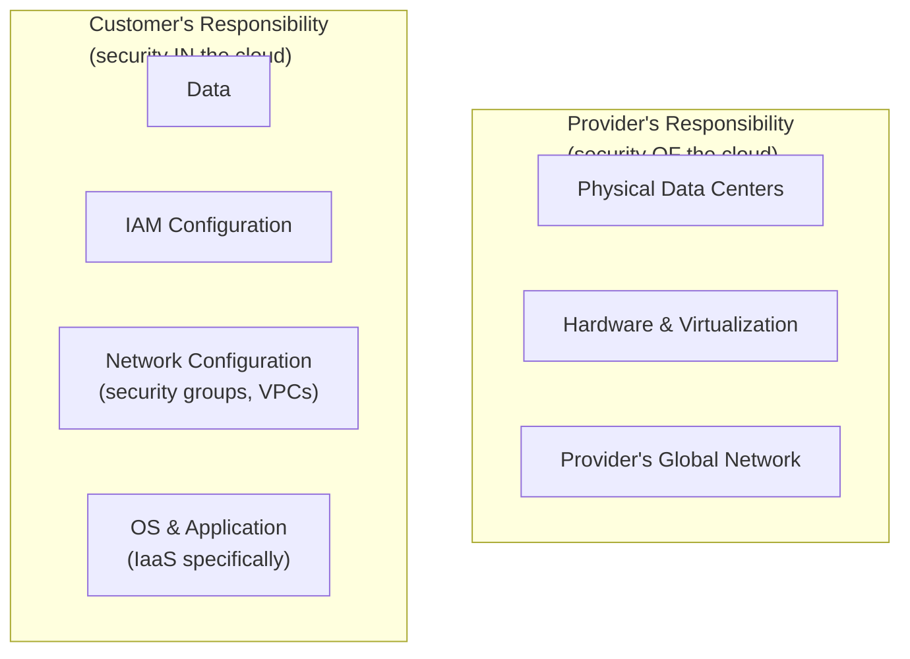

# The Shared Responsibility Model

This lesson ties together every concept from this path — service models, storage, networking, IAM — into the single framework cloud providers use to explain exactly where their security responsibility ends and yours begins. Misunderstanding this boundary is, itself, a leading real-world cause of cloud breaches.

## "Security OF the cloud" vs. "security IN the cloud"

Every major cloud provider frames their shared responsibility model with roughly this split: the provider is responsible for the security **of** the cloud (physical data centers, the underlying hardware, the virtualization layer, network infrastructure at the provider level) — while the customer is responsible for security **in** the cloud (how they configure the services they use, their data, their IAM policies, their operating systems on IaaS).

## The line shifts depending on the service model

Path 19's first lesson introduced IaaS/PaaS/SaaS — this is exactly where that distinction matters most concretely:

| | IaaS | PaaS | SaaS |
|---|---|---|---|
| **Provider handles** | Hardware, virtualization, networking | + OS, runtime patching | + Application code, most configuration |
| **You handle** | OS patching, app config, IAM, data | App code, IAM, data | Just your data and user-level settings |

With IaaS (like a raw EC2 virtual machine), you're responsible for patching the guest operating system yourself — exactly the Windows Update and Linux patching discipline from Path 03 and Path 18. With SaaS, the provider handles patching entirely; your remaining responsibility narrows almost entirely to configuration (who has access, what permissions they have) and your own data.

## Real breaches that stem from misunderstanding this boundary

The overwhelming majority of well-documented, real-world cloud breaches trace back specifically to **customer-side misconfiguration**, not a failure on the provider's side of the line — exactly the categories covered throughout this path:

- **Publicly exposed storage buckets** (Path 19's cloud storage lesson) — the provider secures the underlying storage infrastructure; the *bucket's access policy* is entirely the customer's responsibility.
- **Overly permissive security groups** (Path 19's networking lesson) — the provider secures the network fabric itself; *which specific rules you configure* on top of it are yours.
- **Overly broad IAM policies** (Path 19's identity lesson) — the provider secures the IAM system's underlying mechanics; *what permissions you actually grant* are entirely your call.

None of these are failures of the cloud provider's own infrastructure — they're customer configuration mistakes, made possible by (correctly) assuming the provider handles everything "below" their responsibility line, while forgetting that everything "above" it remains entirely on them.

:::danger "The cloud is secure" is a dangerous half-truth
The underlying cloud infrastructure genuinely is, in most well-documented cases, extremely secure — major providers invest enormous resources in physical and infrastructure-level security that few individual organizations could match on their own. But this fact says nothing about whether *your specific configuration* on top of that infrastructure is secure. "AWS is secure" and "my S3 bucket is secure" are two completely separate claims, and conflating them is exactly the misunderstanding behind most real-world cloud breaches.
:::

## Compliance responsibility follows the same split

Recall Path 06.8's compliance frameworks (PCI DSS, HIPAA, SOC 2, GDPR) — the shared responsibility model applies directly to regulatory compliance too, and this is a genuinely common source of costly confusion for organizations new to the cloud. A cloud provider can be independently audited and certified as compliant with a given framework at the infrastructure level (AWS, Azure, and GCP all hold various compliance certifications for their own data centers and platform), but that certification covers only the provider's side of the responsibility line — it does **not** automatically make an organization's *specific application, built on top of that infrastructure*, compliant with the same framework. A healthcare company storing patient data in a HIPAA-eligible cloud service still bears full responsibility for correctly configuring access controls, encryption, and audit logging on their own resources — the provider's compliance certification is a necessary foundation, not a substitute for the customer's own compliance work. This exact confusion ("we use AWS, and AWS is SOC 2 compliant, so we're compliant too") has led to real, costly compliance failures at real organizations, making it worth stating as explicitly as the security version of the same principle above.

## Applying this framework to Path 11's cloud security material

With this full path's foundation now in place, Path 11's cloud security lesson and flAWS lab should read very differently than before: every vulnerability in that lab — public buckets, IMDS exposure, overly broad IAM — sits squarely on the *customer's* side of the shared responsibility line. flAWS isn't demonstrating a flaw in AWS itself; it's demonstrating exactly the class of customer-configuration mistakes this lesson has been describing, deliberately built as a teaching tool.

:::challenge Map responsibilities for a real scenario
For a hypothetical company running a web application on a cloud IaaS virtual machine, with its database in the provider's managed database service (a PaaS-style offering), and using the provider's SaaS-style email service for internal communication — list, for each of the three services, specifically what falls on the provider's side of the responsibility line versus the customer's, using the framework from this lesson.
:::

## Key terms

- **Shared responsibility model** — the framework defining which security responsibilities belong to the cloud provider versus the customer.
- **Security OF the cloud** — the provider's responsibility: physical infrastructure, hardware, virtualization, and network fabric.
- **Security IN the cloud** — the customer's responsibility: configuration, IAM, data, and (for IaaS) the guest operating system.

## Recap

- The shared responsibility model splits security duties between "of the cloud" (provider) and "in the cloud" (customer), with the exact line shifting based on service model (IaaS/PaaS/SaaS).
- The overwhelming majority of well-documented real-world cloud breaches trace back to customer-side misconfiguration, not provider infrastructure failures.
- "The cloud is secure" and "my specific configuration is secure" are entirely separate claims — conflating them is a leading real-world cause of breaches.
- Every vulnerability class in Path 11's flAWS lab sits on the customer's side of this line, deliberately illustrating exactly this framework in practice.

???refs
- [AWS Shared Responsibility Model](https://aws.amazon.com/compliance/shared-responsibility-model/) — the official framework this lesson is built around.
- [Microsoft: Shared responsibility in the cloud](https://learn.microsoft.com/en-us/azure/security/fundamentals/shared-responsibility) — Azure's equivalent framing, confirming this model is industry-standard, not AWS-specific.
???

**Next up →** [Cloud Basics Hands-On Lab](#/lesson/19-cloud-basics/cloud-basics-lab)
