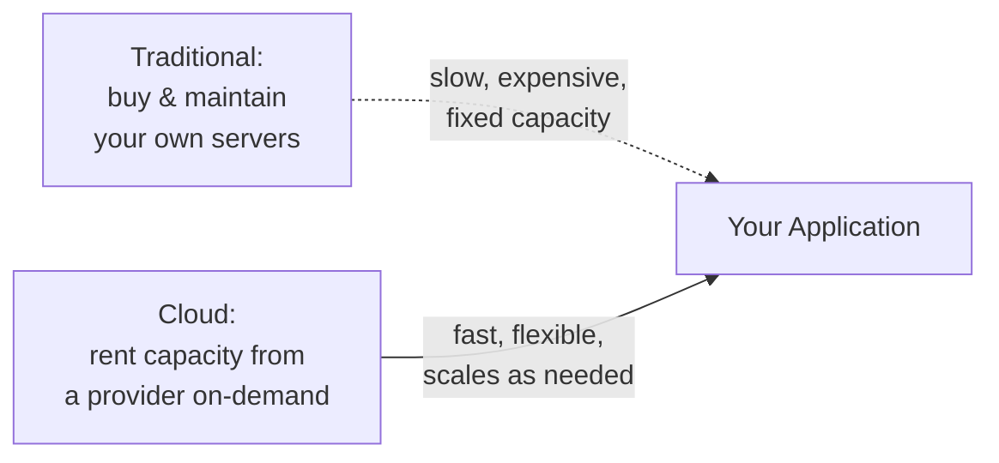
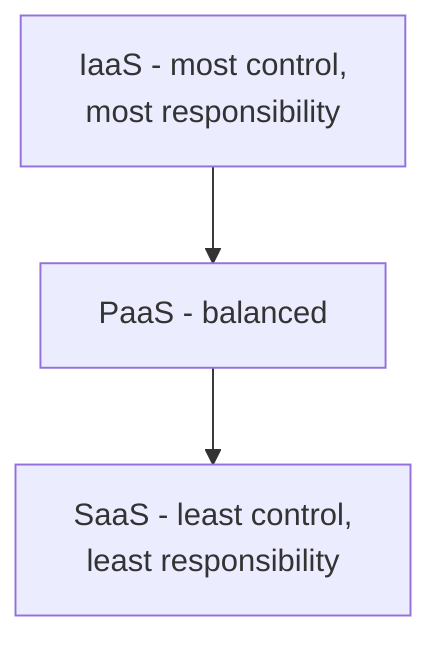

# What is Cloud Computing?

Path 11's cloud security lesson and its flAWS lab jump straight into cloud *misconfigurations* — S3 buckets, IAM roles, IMDS exploitation. This path backs up to fundamentals first: what cloud computing actually is, before you can meaningfully secure it. If you've felt like Path 11's cloud content assumed knowledge you didn't quite have, this path fills that gap.

## The core idea — renting computing instead of owning it

Before cloud computing, running a website or application meant buying physical servers, housing them somewhere with power and cooling, and maintaining the hardware yourself. **Cloud computing** replaces this with renting computing resources — servers, storage, databases — from a provider's massive, shared infrastructure, paying only for what you actually use, scaling up or down on demand.

## The three service models

Cloud services are typically categorized by how much you manage yourself versus how much the provider handles:

| Model | You manage | Provider manages | Example |
|---|---|---|---|
| **IaaS** (Infrastructure as a Service) | OS, applications, data | Physical hardware, networking, virtualization | A rented virtual machine (AWS EC2) |
| **PaaS** (Platform as a Service) | Your application code and data | OS, runtime, scaling infrastructure | A managed app hosting platform (AWS Elastic Beanstalk) |
| **SaaS** (Software as a Service) | Just your data and configuration | Literally everything else | Gmail, Salesforce, this very course's own hosting via Vercel |

This spectrum matters enormously for security, and directly sets up Path 11's cloud security lesson: the less you manage yourself, the less *you're* directly responsible for securing — but also the less control you have. This tradeoff has a name — the **shared responsibility model** — covered in depth in a dedicated lesson later in this path.

## Why cloud computing matters for security specifically

A huge and growing share of modern infrastructure runs in the cloud — meaning a huge share of real-world security work now involves cloud-specific concepts: identity and access management (IAM), storage buckets, virtual networks, and container orchestration (Path 11's containers/Kubernetes lab), none of which map perfectly onto the traditional on-premises security model this course built up through Paths 02-03 and 08.

## Public, private, and hybrid cloud

- **Public cloud** — infrastructure shared across many customers on one provider's platform (AWS, Azure, GCP) — the most common model, and this path's primary focus.
- **Private cloud** — dedicated infrastructure for a single organization, either self-hosted or provider-managed exclusively for one customer — offering more control at higher cost.
- **Hybrid cloud** — a mix of both, often keeping sensitive workloads on private infrastructure while using public cloud for scalable, less sensitive needs.

## Scalability and elasticity — the core value proposition

Beyond just "renting instead of owning," cloud computing's genuine value comes from **elasticity** — automatically scaling resources up during high demand (a sudden traffic spike) and back down when demand drops, paying only for what's actually used at any given moment. This is a fundamentally different operational model than traditional fixed-capacity infrastructure, and it introduces its own security considerations: newly auto-provisioned resources need to inherit the same security configuration as everything else, or they become an unmonitored gap the moment they spin up.

:::tip This course is itself a cloud computing example
KashSec Academy is hosted on Vercel — a **PaaS** platform, per the table above. You (or whoever manages this course) never had to provision a physical server, configure an operating system, or manage scaling — just push code, and the platform handles everything below that layer. This is genuinely the same model powering an enormous share of modern web applications.
:::

:::challenge Test yourself
Why does the IaaS/PaaS/SaaS spectrum matter directly for security responsibility, not just cost and convenience?

Show answer
Each layer of the stack you don't manage yourself is a layer the <em>provider</em> is responsible for securing instead of you — but it's also a layer you have no direct control or visibility over. With IaaS, you're responsible for patching your own operating system and configuring your own firewall rules (much like the Windows/Linux hardening practiced elsewhere in this course), while the provider only guarantees the physical hardware and virtualization layer beneath you. With SaaS, you have almost no infrastructure to secure directly — but you're also trusting the provider entirely for the security of everything below your own data and configuration, with essentially no visibility into how well they're actually doing that. This exact tradeoff — control versus responsibility — is what the shared responsibility model formalizes, and understanding which service model you're using is the very first question in any cloud security assessment, since it defines what's actually in scope for you to test or fix versus what's the provider's job entirely.

:::

## Key terms

- **IaaS / PaaS / SaaS** — the three cloud service models, differing in how much of the stack you manage versus the provider.
- **Elasticity** — automatically scaling resources up or down based on real-time demand.
- **Public / private / hybrid cloud** — different deployment models balancing shared cost-efficiency against dedicated control.

## Recap

- Cloud computing means renting computing resources on-demand rather than owning and maintaining physical infrastructure.
- IaaS, PaaS, and SaaS represent a spectrum of how much you manage yourself versus how much the provider handles — directly shaping security responsibility.
- Elasticity (automatic scaling) is cloud computing's core value proposition, and introduces its own configuration-consistency considerations.
- This foundation directly sets up the rest of this path, and Path 11's cloud security lesson and flAWS lab.

???refs
- [AWS: What is Cloud Computing?](https://aws.amazon.com/what-is-cloud-computing/) — a clear, free overview from the largest cloud provider.
- [NIST: The NIST Definition of Cloud Computing](https://csrc.nist.gov/pubs/sp/800/145/final) — the free, formal, widely-cited definition underlying this entire field.
???

**Next up →** [Cloud Providers Overview](#/lesson/19-cloud-basics/cloud-providers-overview)
