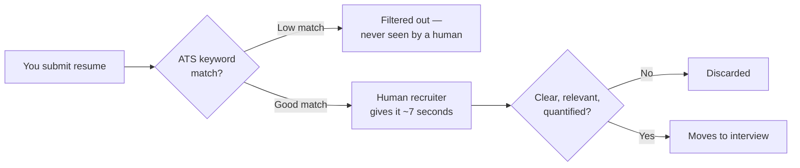

# Building your security resume

You've now worked through the technical paths — this one is different. A brilliant skill set with a weak resume never gets the interview, because most resumes are filtered before a human ever reads them. This lesson covers how to build a security resume that survives both the automated filters and the 7-second human skim that follows.

## The uncomfortable truth about resume screening

Most mid-size and large companies run resumes through an **ATS (Applicant Tracking System)** before a human ever sees them — software that scans for keywords matching the job description and ranks or filters candidates automatically. A resume can be genuinely excellent and still get filtered out simply for using different terminology than the job posting. Understanding this changes how you should write it.

## The sections that actually matter for security roles

- **Contact & links** — email, location (city/country is enough), LinkedIn, GitHub, and a personal site/blog if you have one. Make these clickable if the resume is a PDF.
- **Summary/Objective (2–3 lines)** — tailored to the specific job, not generic. State your focus area (e.g., "Junior penetration tester with hands-on CTF and bug bounty experience") rather than a vague "hardworking team player."
- **Skills** — organized by category (Languages, Tools, Concepts) rather than one giant unsorted list: e.g. `Languages: Python, Bash` / `Tools: Nmap, Burp Suite, Metasploit, Wireshark` / `Concepts: OWASP Top 10, network protocols, Linux privilege escalation`.
- **Projects & labs** — this is often the *strongest* section for freshers with no formal experience: home lab builds, CTF write-ups, bug bounty reports (even unpaid/duplicate ones show real skill), or tools you've built.
- **Certifications** — list only relevant, completed ones (covered in depth next lesson).
- **Experience** — internships, freelance work, or even substantial self-directed projects treated with professional framing all count here.

## Writing bullet points that actually land

The single biggest resume mistake in security (and tech generally) is describing *duties* instead of *results*. Compare these two:

:::warn Weak — describes duties, no impact shown
"Responsible for monitoring security alerts and responding to incidents."
:::

:::tip Strong — quantified, specific, results-oriented
"Triaged 200+ SIEM alerts weekly, reducing false-positive rate by 40% by tuning detection rules — cut mean incident response time from 45 to 12 minutes."
:::

Use the **XYZ formula** as a starting template: *"Accomplished [X], measured by [Y], by doing [Z]."* Even for projects with no "real" metrics, you can usually find something to quantify: number of CTF challenges solved, vulnerabilities found in a lab environment, lines of code, or time saved by automating a manual process.

## Keyword-matching without lying

Read the job description closely and mirror its exact terminology where it genuinely applies to you — if the posting says "vulnerability assessment" and you've been calling the same work "security testing," align your wording. This isn't dishonest; it's translating your real experience into the vocabulary the ATS and the hiring manager are actually looking for. Never claim a skill or tool you can't discuss confidently in an interview — this backfires immediately and badly.

## Tailoring per application without starting from scratch each time

A genuinely sustainable approach: maintain one comprehensive **master resume** containing every project, bullet point, and skill you've ever wanted to include, with no length limit — then, for each specific application, copy it and trim down to the single most relevant page for that particular role, swapping in the specific keywords and reordering sections to lead with whatever matches that posting best. A candidate applying to both a SOC analyst role and an AppSec role shouldn't submit the identical resume to both — the SOC application should lead with SIEM/detection experience and incident response projects, while the AppSec application should lead with secure coding, SAST/DAST, and vulnerability-finding work. This master-resume approach avoids the two failure modes beginners fall into: rewriting from scratch every time (exhausting, inconsistent) or sending one generic resume everywhere (weaker match on every single application).

## Handling employment gaps and career changes honestly

Many people entering security are changing careers or have gaps in formal employment — neither is disqualifying, but both benefit from direct, confident framing rather than vague evasion. A career-changer's resume should explicitly connect prior experience to security wherever a genuine parallel exists (a former sysadmin already understands networks and Linux deeply; a former customer support lead already understands social engineering and phishing from the defender's side); an employment gap used for structured self-study (this course, CTFs, certifications, home lab projects) is legitimate, quantifiable experience and belongs on the resume with real specifics, not hidden or apologized for. Recruiters in security specifically are unusually receptive to career-changers, since the field's talent shortage means genuine, demonstrable skill consistently matters more than a conventional linear career path.

## Format and length

- **One page** for anyone with fewer than ~8–10 years of experience — recruiters spend seconds per resume, and a second page rarely gets read.
- Use a clean, simple, ATS-friendly template — avoid tables, columns, and graphics-heavy designs, which many ATS parsers mangle into unreadable text.
- Export as **PDF**, not `.docx`, unless the application specifically requests otherwise, to preserve formatting across systems.
- Name the file professionally: `FirstName-LastName-Security-Resume.pdf`, not `resume_final_v3_USE_THIS.pdf`.

## 🧪 Hands-on lab — build (or rebuild) your resume

1. List every project, lab, CTF, and piece of relevant experience you have — even small ones — in a single brain-dump document, without worrying about formatting yet.
2. For each bullet point, apply the XYZ formula: try to attach a number or a measurable outcome to it, even an estimate.
3. Pick one real (or recent) job posting in security you'd genuinely consider applying to. Highlight its key terms and skills, and check how many of them your draft resume already reflects honestly.
4. Rewrite your resume using the section structure above, keep it to one page, and export it as a PDF.
5. Get feedback from at least two people — ideally one recruiter or hiring-adjacent person and one peer also studying security — before finalizing it.

:::challenge Test yourself
Why might a technically excellent candidate's resume get automatically filtered out before any human ever reads it — and what's the fix?

Show answer
Most mid-size and large companies run incoming resumes through an ATS that scores or filters candidates based on keyword overlap with the job description. A resume written in different terminology than the posting — even when it describes genuinely equivalent or superior experience — can score poorly and get auto-filtered before a human recruiter ever sees it. The fix isn't to lie or stuff irrelevant keywords, but to closely read the actual job description and describe your real experience using the same vocabulary it uses, wherever that vocabulary genuinely and honestly applies to what you've actually done.

:::

## Key terms

- **ATS (Applicant Tracking System)** — software that scans and ranks/filters resumes before human review.
- **XYZ formula** — a bullet-point structure: accomplishment, measured by a metric, achieved through a specific action.
- **Keyword matching** — aligning your resume's terminology with the job description's language.

## Recap

- Most resumes pass through an ATS before a human ever sees them — keyword alignment with the job posting matters.
- Quantify every bullet point you can using the XYZ formula; duties without results rarely land.
- Projects and labs are often the strongest section for freshers — treat them with the same rigor as formal experience.
- Keep it to one clean, ATS-friendly page, exported as a PDF.

???refs
- [Google's resume tips for technical roles](https://www.google.com/about/careers/applications/how-we-hire/tips-for-technical-resume/) — genuinely useful, applies well beyond Google specifically.
- [OWASP Top 10](https://owasp.org/Top10/) — good source of accurate terminology to mirror if relevant to your target roles.
???

**Next up →** [LinkedIn Optimization for Security Roles](#/lesson/20-career-prep/linkedin-optimization)
