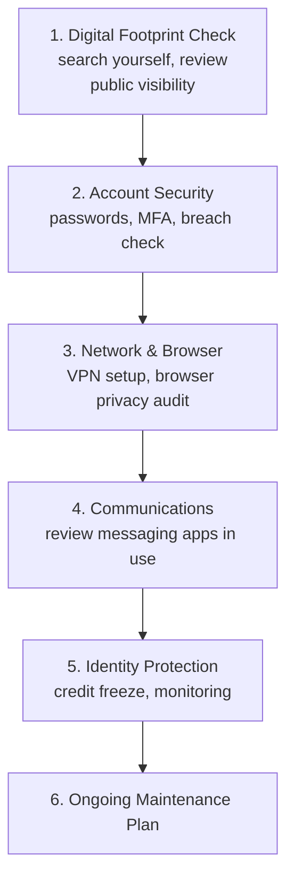

# Personal Security Capstone Lab

This lab pulls every lesson in this path — digital footprint, VPNs, browser privacy, secure communications, identity theft protection, and the settings audit — into one complete personal security review, producing a genuinely useful, real deliverable: your own hardened personal security posture, plus a plan to maintain it.

## The full review workflow

## Tasks

1. **Digital footprint review.** Search your own name, review your main social media accounts logged out, and check at least two data broker sites (this path's first lesson). Note your top 3 exposure findings.
2. **Account security pass.** Using Have I Been Pwned (Path 00), check your primary email(s) for known breaches. For your most important accounts (email, banking, primary social media), confirm a unique, strong password (via a password manager, per Path 00) and MFA are both enabled.
3. **Network and browser hardening.** Confirm you have a plan for VPN use on public Wi-Fi (this path's VPN lesson), and complete this path's browser privacy audit lesson in full — third-party cookies blocked, tracker-blocking extension installed, fingerprint tested via Cover Your Tracks.
4. **Communications review.** List every messaging app you regularly use, and for each, determine (using this path's secure communications lesson) whether it provides genuine end-to-end encryption by default or only encryption in transit. For your most sensitive conversations, confirm you're using an appropriately protected channel.
5. **Identity protection setup.** Check whether your credit is currently frozen (this path's identity theft lesson) and freeze it if not. Confirm you have your region's official identity theft reporting resource bookmarked, ready before you'd ever need it.
6. **Complete the full settings audit.** Run through all 5 categories from the previous lesson's checklist (social media, account privacy dashboards, browser, phone permissions, location history) for real, on your own accounts and devices.

:::challenge Produce a personal security report
Combine your findings from all 6 tasks into a single document: your top footprint exposures, account security status, network/browser hardening completed, communications channel assessment, identity protection status, and a specific list of settings you changed during the audit. Set a calendar reminder to repeat this full review in 3 months — privacy and security settings drift over time as platforms change, exactly the ongoing-maintenance principle established throughout this course (Path 12's LLM red teaming playbooks lesson, Path 11's securing-a-Windows-machine lesson).
:::

## Why this matters beyond personal peace of mind

Every technique in this lab directly mirrors professional security practice covered elsewhere in this course: Path 09's OSINT reconnaissance methodology, applied to yourself defensively; Path 06's risk assessment framework, applied to your own personal threat model; and Path 11's periodic security review discipline, applied to your own digital life rather than an organization's infrastructure. The skills transfer in both directions — practicing this on yourself builds genuine intuition for how attackers actually gather and use information, directly useful throughout the rest of this course's offensive material.

## Key takeaway

Personal digital security isn't a one-time setup — it's an ongoing practice of periodic review, exactly like every defensive discipline covered throughout this course. This lab's structured, repeatable workflow (footprint → accounts → network/browser → communications → identity protection → maintenance plan) gives you a concrete process to actually maintain that practice going forward, rather than a one-time checklist you complete once and forget.

## 🎓 Path complete

You've now covered your digital footprint and how it's aggregated, how VPNs actually work (and their real limits), browser tracking and privacy defenses, the genuine distinction between encrypted-in-transit and end-to-end encrypted communications, identity theft prevention and response, a structured privacy settings audit methodology, and completed a full personal security review of your own accounts and devices. This foundation directly supports the OSINT and social engineering material in Path 06 and Path 09, viewed now from both the attacker's and the defender's perspective.

???refs
- [EFF: Surveillance Self-Defense](https://ssd.eff.org/) — the free, comprehensive guide referenced throughout this entire path.
- [Have I Been Pwned](https://haveibeenpwned.com/) and [IdentityTheft.gov](https://www.identitytheft.gov/) — the practical tools used throughout this lab.
???

**Explore more →** [Back to all paths](#/course) · [Path 09 — Ethical Hacking](#/lesson/09-ethical-hacking)
