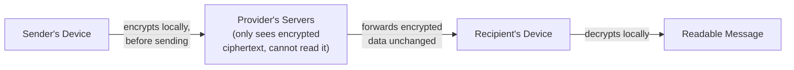

# Secure Communications

Path 17's cryptography path explained encryption's mechanics in depth. This lesson applies that foundation to a genuinely practical question: how private are your everyday messages and calls, actually — and what does "secure messaging" really mean in practice?

## End-to-end encryption — the gold standard

**End-to-end encryption (E2EE)** means messages are encrypted on the sender's device and only decrypted on the recipient's device — critically, **not even the messaging service provider itself** can read the message content in transit or at rest on their servers, since they never possess the decryption key at all.

This directly applies Path 17's asymmetric/hybrid encryption lesson: E2EE messaging apps typically generate a key pair per device, exchange public keys to establish a shared session key (conceptually similar to the TLS handshake from Path 17's certificates lesson), and encrypt actual message content with fast symmetric encryption using that session key.

## Not all "secure" messaging is equal

:::warn Encrypted in transit is not the same as end-to-end encrypted
Many messaging services encrypt data **in transit** (between your device and their servers, using HTTPS/TLS — Path 02, Path 17) but **decrypt it on their own servers**, meaning the provider itself technically can read your messages, even though an outside eavesdropper on the network cannot. This is a meaningfully weaker guarantee than true end-to-end encryption, and the distinction is genuinely easy to miss in casual marketing language that uses "encrypted" loosely for both cases.
:::

Signal is widely regarded, including by independent security researchers, as having one of the most rigorously implemented and audited E2EE protocols currently available, and it's open-source, letting anyone verify its actual behavior rather than trusting marketing claims alone.

## Metadata — what encryption doesn't hide

Even with genuine end-to-end encryption protecting message *content*, **metadata** — who you communicated with, when, how often, and for how long — is frequently still visible to the service provider, even when they can't read what was actually said. This matters more than most people initially assume: a detailed record of exactly who contacts whom, and when, can reveal a great deal about relationships and behavior patterns even without any message content at all — directly relevant to the digital footprint concept from this path's first lesson.

## Email — genuinely different, and generally weaker

Standard email is **not** end-to-end encrypted by default — a huge, common misconception. Your email provider (and potentially your recipient's provider) can typically read message content, which is exactly how features like spam filtering and search actually work under the hood. Tools like **PGP (Pretty Good Privacy)** or its modern equivalents can add genuine end-to-end encryption to email, but require both sender and recipient to set it up deliberately — it's not the default state of ordinary email the way it increasingly is for modern messaging apps like Signal.

## Voice and video calls

The same E2EE distinction applies to calls: some platforms genuinely end-to-end encrypt voice/video (Signal calls, among others), while others only encrypt the connection to their own servers, technically allowing the provider to access call content if they chose to (or were compelled to) — worth knowing when choosing a platform for genuinely sensitive conversations.

:::tip A practical, non-paranoid baseline
For most everyday use, prefer messaging apps with genuine, audited end-to-end encryption by default (Signal being the most commonly recommended) for anything you'd consider even moderately sensitive, and be aware that even with E2EE, metadata about who you're communicating with may still be visible to the provider — a reasonable, practical baseline without needing to treat every conversation as maximally classified.
:::

:::challenge Test yourself
Why can a messaging provider using "encryption in transit" (but not end-to-end encryption) technically still read your message content, even though the connection to their servers is genuinely encrypted with HTTPS/TLS?

Show answer
"Encryption in transit" means the connection between your device and the provider's servers is encrypted (using the same TLS mechanism from Path 17's certificates lesson) — protecting the message from anyone eavesdropping on the network path in between, exactly like HTTPS protects a webpage in transit. But the message is decrypted <em>once it reaches the provider's servers</em>, since the provider holds the decryption key needed to actually process, store, search, or display the message to the recipient through their app. True end-to-end encryption instead generates keys that only the sender's and recipient's own devices possess — the provider's servers only ever handle already-encrypted ciphertext they have no ability to decrypt, forwarding it along without ever being able to read the content, even if compelled to by a court order or compromised by an attacker who breaches their servers. The practical difference is exactly who technically has the ability to read your messages: with encryption-in-transit alone, the provider can; with genuine end-to-end encryption, only the conversation's actual participants can.

:::

## Key terms

- **End-to-end encryption (E2EE)** — encryption where only the sender and recipient can decrypt content, not the service provider itself.
- **Encryption in transit** — protecting data between your device and the provider's servers, while the provider itself can still decrypt it.
- **Metadata** — information about a communication (who, when, how often) distinct from its actual content, often still visible even with E2EE.

## Recap

- End-to-end encryption ensures only the sender and recipient can read message content — the provider itself cannot, even if compelled to.
- "Encrypted" claims in casual marketing often mean only encryption in transit, a meaningfully weaker guarantee than genuine E2EE.
- Metadata (who, when, how often) frequently remains visible to providers even with full E2EE protecting message content.
- Standard email is not end-to-end encrypted by default, unlike most modern messaging apps' default configuration.

???refs
- [Signal Protocol documentation](https://signal.org/docs/) — the openly published, independently audited protocol referenced throughout this lesson.
- [EFF: Surveillance Self-Defense — Communicating with Others](https://ssd.eff.org/module-categories/communicating-others) — free, practical guidance on choosing secure communication tools.
???

**Next up →** [Identity Theft Protection](#/lesson/20-digital-privacy/identity-theft-protection)
