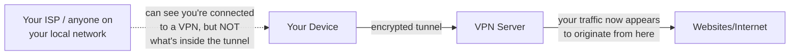
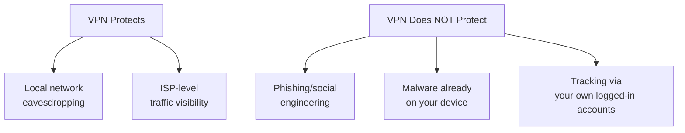

# VPNs Explained

Path 00's how-the-internet-works lesson mentioned VPNs briefly. This lesson explains exactly how they work, what they genuinely protect against, and — just as importantly — the real limits of what they can't do, since VPN marketing frequently overstates their protection.

## What a VPN actually does, mechanically

A **VPN (Virtual Private Network)** creates an encrypted tunnel between your device and a VPN server, routing all your internet traffic through that encrypted connection before it reaches its final destination.

This has two concrete effects: your **ISP** (and anyone else on your local network — relevant on public Wi-Fi, Path 00's staying-safe-online lesson) can no longer see *which* sites you visit or *what* data you send, only that you're connected to a VPN server; and websites you visit see the VPN server's IP address rather than your own, masking your actual location and identity from their perspective.

## What a VPN genuinely protects against

- **Local network eavesdropping** — on public Wi-Fi (a coffee shop, an airport), other users on the same network can potentially intercept unencrypted traffic; a VPN's encryption protects against this specific threat, layered on top of whatever HTTPS already provides (Path 02).
- **ISP-level tracking** — your internet provider can otherwise see every domain you visit (even over HTTPS, since the domain itself is often visible even when the page content is encrypted, via DNS queries and TLS's SNI field); a VPN hides this from them specifically.
- **Geo-restriction bypass** — since the site sees the VPN server's location rather than yours, VPNs are commonly used to access geographically restricted content — a legitimate, if unrelated-to-security, use case.

## What a VPN does NOT protect against

:::warn Common VPN marketing overstates its protection
A VPN does **not** make you anonymous online, does **not** protect against phishing (Path 00) or malware, does **not** stop a website from tracking you via cookies or account login (Path 05's cookies lesson) once you're actually logged in, and does **not** protect against a compromised device — if malware is already running on your machine, a VPN encrypting network traffic does nothing to stop it from directly reading your files or keystrokes locally.
:::

## You're moving trust, not eliminating it

A genuinely important, often-missed nuance: using a VPN doesn't eliminate the need to trust *someone* with your traffic — it shifts that trust from your ISP to the VPN provider instead. The VPN provider technically *can* see everything your ISP previously could, meaning choosing a genuinely trustworthy VPN provider (ideally one with an independently audited "no-logs" policy, meaning they verifiably don't retain records of your activity) matters enormously — a disreputable free VPN provider can be a worse privacy outcome than no VPN at all, since some have been documented selling user browsing data to third parties, precisely the outcome you were trying to avoid.

## Tor — a fundamentally different privacy tool, not a VPN alternative

Worth distinguishing clearly from a VPN, since the two get conflated constantly: **Tor (The Onion Router)** routes your traffic through at least three independent, volunteer-operated relays, encrypting it in layers so that no single relay ever knows *both* who you are *and* what you're accessing — the entry relay knows your IP but not your destination, the exit relay knows your destination but not your IP. This is a meaningfully stronger anonymity model than a VPN's single-point-of-trust design (recall the "you're moving trust, not eliminating it" point above — with Tor, no single party holds both pieces of information at once), but it comes at a real cost: Tor is considerably slower than a VPN due to the multi-hop routing, and some websites block or heavily challenge traffic coming from known Tor exit nodes. Tor and VPNs solve different problems and can even be combined (routing Tor traffic through a VPN, or vice versa, each with different tradeoffs) — the practical takeaway is that "I want strong anonymity for something specific and sensitive" and "I want to protect my everyday browsing on public Wi-Fi" are different goals calling for different tools, not simply different brands of the same tool.

## Corporate/work VPNs — a different purpose entirely

Worth distinguishing clearly: a VPN your employer provides for remote access serves an entirely different purpose than a consumer privacy VPN — it grants you access *into* the company's private internal network from outside, rather than primarily protecting your general internet browsing privacy. Both use the same underlying encrypted-tunnel technology, but the goal and trust model differ completely.

:::tip When a VPN is genuinely worth using
Public Wi-Fi at a coffee shop, airport, or hotel, especially for anything sensitive (banking, work logins), is the single clearest case where a VPN provides real, meaningful protection — directly extending Path 00's public Wi-Fi caution with a concrete mitigation.
:::

:::challenge Test yourself
A friend says: "I use a VPN, so I'm completely anonymous and safe online, no matter what I click on." What's wrong with this statement, specifically?

Show answer
This statement conflates several genuinely distinct threats that a VPN addresses very differently, or not at all. A VPN encrypts your network traffic and masks your IP address from destination websites and your ISP — real, meaningful protections against local network eavesdropping and ISP-level tracking. But it provides zero protection against phishing (a convincing fake login page will steal your credentials exactly as effectively whether or not you're using a VPN), zero protection against malware (if you download and run something malicious, a VPN does nothing to stop it, since it operates at the network layer, not the file-execution layer), and zero anonymity if you then log into your own accounts, since the website now knows exactly who you are regardless of which IP address the connection appears to come from. "Completely safe no matter what I click on" specifically ignores that a VPN addresses network-level threats, not the endpoint and social-engineering threats that account for the majority of real-world compromises covered throughout Path 00 and Path 06.

:::

## Key terms

- **VPN (Virtual Private Network)** — an encrypted tunnel routing your traffic through an intermediary server, hiding it from your local network and ISP.
- **No-logs policy** — a VPN provider's claim (ideally independently audited) that they don't retain records of user activity.
- **SNI (Server Name Indication)** — a field in the TLS handshake that can reveal which domain you're connecting to, even over HTTPS, unless additionally protected.

## Recap

- A VPN encrypts your traffic between your device and the VPN server, protecting against local network eavesdropping and ISP-level tracking specifically.
- It does not protect against phishing, malware, or tracking via your own logged-in accounts — a genuinely common misconception.
- Using a VPN shifts trust from your ISP to the VPN provider, making provider trustworthiness (ideally an audited no-logs policy) genuinely important.
- Public Wi-Fi is the clearest, most concrete real-world case where a VPN provides meaningful additional protection.

???refs
- [EFF: Surveillance Self-Defense — VPNs](https://ssd.eff.org/module/choosing-vpn-thats-right-you) — a free, balanced, non-commercial guide to evaluating VPN providers.
???

**Next up →** [Browser Privacy](#/lesson/20-digital-privacy/browser-privacy)
