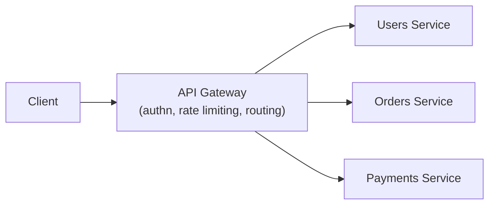

# API Gateway Security

The mass-assignment lesson focused on individual endpoint logic flaws. This lesson zooms out to the infrastructure layer sitting in front of every endpoint — the **API gateway** — directly connecting to Path 12's IDS/IPS/WAF coverage, since a gateway is essentially a purpose-built reverse proxy specifically for API traffic, applying similar defensive principles at a different layer.

## What an API gateway actually does

An **API gateway** sits between clients and your actual backend services, centralizing cross-cutting concerns that would otherwise need to be duplicated in every individual service: authentication verification, rate limiting, request/response logging, and routing. Rather than every microservice independently implementing its own authentication check, a gateway can verify a token once, at the edge, before a request ever reaches internal services at all.

## Why centralizing security logic at the gateway matters

Directly connecting to the authn-authz-apis lesson's "correct pattern" coverage: a genuinely common real-world security gap is inconsistent authorization enforcement across different microservices — one team's service carefully checks every request, another team's service, built under deadline pressure, has a gap. A gateway that enforces baseline authentication and basic authorization checks centrally means every request gets that minimum guarantee regardless of which specific backend team built the destination service, reducing (though not eliminating — backend services still need their own object-level authorization checks) the blast radius of any single team's oversight.

## Rate limiting at the gateway versus the application

Directly connecting to the rate-limiting-injection lesson: implementing rate limiting at the gateway layer, rather than in each individual service's own code, has a genuine practical advantage — malicious or excessive traffic gets rejected before consuming any actual backend compute resources at all, protecting every downstream service simultaneously with a single, consistently-configured control, rather than relying on each service team to implement rate limiting correctly and consistently on their own.

## The gateway as a single point of failure — and a single point of bypass

:::warning A gateway centralizes defense, but also centralizes risk if bypassed
A genuinely important architectural risk: if backend services are directly reachable on the internal network without also independently verifying that requests actually passed through the gateway, an attacker who gains any internal network foothold (through an unrelated vulnerability elsewhere) can bypass every gateway-enforced control entirely by talking to backend services directly. This directly connects to Path 22's Zero Trust path — a properly Zero Trust-aligned architecture has backend services independently verify requests (mutual TLS, service-to-service authentication) rather than implicitly trusting anything that reaches them on the internal network, precisely because "the gateway already checked this" is not itself a security guarantee once an attacker has internal network access.
:::

## API gateway-specific misconfigurations

- **Path normalization mismatches** — a gateway's routing logic and a backend service's own routing logic occasionally interpret ambiguous URL paths (trailing slashes, encoded characters, path traversal sequences) differently, creating a request that passes the gateway's security checks under one interpretation but gets processed by the backend under a different one
- **Header injection/spoofing** — a gateway that adds trusted internal headers (like `X-User-Id`, populated after verifying a token) needs to strip any client-supplied header with the same name first, or a client can simply set that header themselves and potentially impersonate another user if the backend blindly trusts it
- **Overly permissive CORS configuration** — a gateway-level CORS misconfiguration (Path 05) can expose every backend service behind it to cross-origin attacks simultaneously, rather than being contained to a single service's own misconfiguration

## Web Application Firewalls (WAF) for API traffic specifically

Directly connecting to Path 12's WAF coverage: a **WAF** deployed in front of an API gateway can catch known injection patterns and other signature-matchable attacks before they reach application logic at all — genuinely useful as one layer of defense-in-depth, but, exactly as Path 12 emphasized generally, never a substitute for the application itself correctly validating input and enforcing authorization, since a sufficiently novel or obfuscated attack can evade signature-based WAF detection entirely.

:::challenge Test yourself
Why does relying solely on gateway-level authentication, without backend services independently verifying requests, create a genuine architectural risk beyond just "extra defense is always better"?
:::

## Key terms

- **API gateway** — infrastructure centralizing cross-cutting API concerns (authentication, rate limiting, routing) in front of backend services.
- **Path normalization mismatch** — a discrepancy between how a gateway and a backend service interpret the same URL path, creating a security bypass.
- **Zero Trust service verification** — backend services independently authenticating every request rather than implicitly trusting anything reaching them internally.

## Recap

An API gateway centralizes authentication, rate limiting, and routing across multiple backend services, reducing inconsistent per-service security implementation. This centralization is genuinely valuable but creates risk if backend services implicitly trust anything reaching them internally rather than independently verifying requests, exactly the gap Zero Trust architecture addresses. Path normalization mismatches, header spoofing, and CORS misconfiguration are gateway-specific risks worth checking explicitly, and a WAF adds one more defensive layer without replacing correct application-level validation.

???refs
- [OWASP API8:2023 — Security Misconfiguration](https://owasp.org/API-Security/editions/2023/en/0xa8-security-misconfiguration/)
- [NIST SP 800-207 — Zero Trust Architecture](https://csrc.nist.gov/pubs/sp/800/207/final)
???
