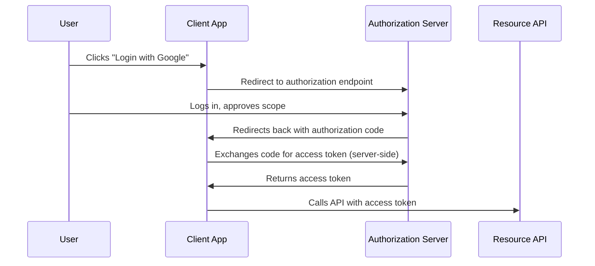

# OAuth2 & OIDC, Deep Dive

The authn-authz-apis lesson covered authentication and authorization conceptually. This lesson goes deep into the specific, extremely widely-deployed protocol most real-world APIs actually use to implement both: **OAuth 2.0** and **OpenID Connect (OIDC)** — genuinely essential to understand precisely because it's so common that "how does OAuth actually work" is one of the most frequent gaps between developers who use it correctly by copying working examples and those who genuinely understand its security model.

## OAuth2 solves delegation, not authentication

A genuinely important, frequently-confused distinction: **OAuth 2.0** is fundamentally a delegation protocol — it lets a user grant a third-party application limited access to their data on another service, without ever sharing their actual password with that third party ("let this app read your calendar" without giving the app your Google password). OAuth2 alone says nothing about *who* the user actually is; that's what **OpenID Connect (OIDC)**, built on top of OAuth2, actually adds — a standardized identity layer providing a verifiable "this is genuinely the user" assertion.

## The authorization code flow, the one that actually matters

The **authorization code flow** is the current recommended standard for essentially every real-world scenario involving a server-side component, specifically because the actual access token exchange happens server-to-server (the "App→Auth: Exchanges code" step above), never passing through the user's browser at all — a genuinely important security property, since anything passing through the browser is exposed to browser-based attacks like XSS (Path 11).

## Scopes — the actual authorization boundary

Directly connecting to the authn-authz-apis lesson's authorization coverage: **scopes** define exactly what an issued token is authorized to do — `read:calendar`, `write:profile`, and similar granular permission strings. A genuinely common real-world misconfiguration is a token issued with far broader scope than the requesting application actually needs, directly violating least-privilege (Path 12) — an app that only ever needs to read a user's profile shouldn't be issued a token also capable of modifying it.

## Common OAuth2 implementation vulnerabilities

- **Redirect URI validation gaps** — if an authorization server doesn't strictly validate the `redirect_uri` parameter against a pre-registered list, an attacker can redirect the authorization code to an attacker-controlled endpoint instead, hijacking the entire flow
- **State parameter omission** — the `state` parameter is specifically designed to prevent CSRF-style attacks (Path 11) against the OAuth flow itself; omitting it lets an attacker trick a victim into completing an OAuth flow the victim never initiated
- **Implicit flow usage** — the older **implicit flow** returns the access token directly in the browser's URL fragment, exposing it to browser history, referrer leakage, and any script running on the page — deprecated for exactly this reason, but still occasionally found in legacy implementations
- **Token leakage via referrer headers** — an access token embedded in a URL (rather than a header or POST body) can leak to a third-party site through the `Referer` header when the page navigates onward

## OIDC's ID token — the identity assertion

Directly connecting to the broken-auth-jwt lesson: OIDC's **ID token** is itself a JWT, cryptographically signed by the authorization server, containing verifiable claims about the authenticated user (their unique identifier, when they authenticated, sometimes their email). Critically, the ID token proves identity to the *client application* — it should never be sent to a resource API as though it were an access token, a genuinely common implementation mistake that conflates two tokens serving structurally different purposes.

:::challenge Test yourself
Why does the authorization code flow's server-to-server token exchange step provide a meaningfully stronger security property than the deprecated implicit flow's direct browser-based token issuance?
:::

## Key terms

- **OAuth 2.0** — a delegation protocol letting a user grant limited third-party access without sharing credentials.
- **OpenID Connect (OIDC)** — an identity layer built on OAuth2, providing verifiable user identity assertions via ID tokens.
- **Scope** — a granular permission string defining exactly what an issued token is authorized to do.
- **State parameter** — a CSRF-prevention value ensuring an OAuth flow was genuinely initiated by the user completing it.

## Recap

OAuth2 solves delegated access without credential sharing; OIDC adds verifiable identity on top of it — the two solve genuinely different problems despite being frequently used together. The authorization code flow is the current standard specifically because token exchange happens server-to-server, avoiding browser exposure. Redirect URI validation gaps, missing state parameters, deprecated implicit flow usage, and confusing ID tokens with access tokens are the most common real-world implementation vulnerabilities.

???refs
- [OAuth 2.0 Simplified](https://www.oauth.com/) — an accessible, thorough practical guide.
- [OWASP OAuth2 Security Cheat Sheet](https://cheatsheetseries.owasp.org/cheatsheets/OAuth2_Cheat_Sheet.html)
???
