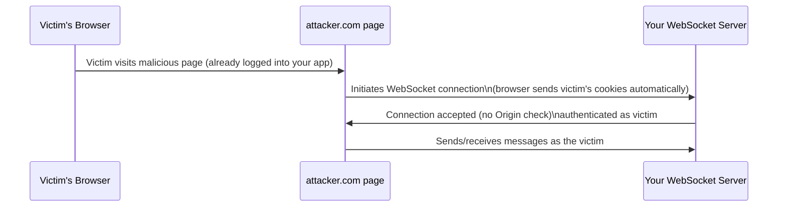

# WebSocket Security

The rate-limiting-injection lesson covered request-response API abuse patterns. This lesson covers a genuinely different communication model increasingly common in real-time applications — **WebSockets** — where the usual request-response security assumptions this path has built up don't map cleanly, directly connecting to Path 05's CSRF coverage, since WebSocket connection establishment shares a surprising amount of its trust-boundary logic with that older vulnerability class.

## Why WebSockets are architecturally different

Unlike the request-response pattern every previous lesson in this path assumed, a **WebSocket** establishes a single, persistent, bidirectional connection — once opened, either side can send messages at any time, without the overhead of a new HTTP request for each one. This makes WebSockets genuinely well-suited to real-time features (live chat, live notifications, collaborative editing) but means several assumptions baked into REST/GraphQL security thinking need to be explicitly reconsidered.

## Authentication happens once, at connection time — and that's the risk

A genuinely important structural difference: a typical REST API re-authenticates (or at minimum re-validates a token) on every single request. A WebSocket connection typically authenticates **once**, at the initial handshake, then trusts every subsequent message sent over that same connection for its entire lifetime. This means a connection authenticated at 9am might still be trusted at 5pm, hours after a token would normally have expired in a request-response model — directly connecting to the broken-auth-jwt lesson's token-expiration coverage, a WebSocket implementation needs its own explicit mechanism (periodic re-authentication, connection timeout, or server-side token expiration checks mid-connection) rather than assuming standard token expiration logic applies automatically.

## Cross-Site WebSocket Hijacking

Directly connecting to Path 05's CSRF lesson: the WebSocket handshake begins as a regular HTTP request, meaning it's subject to the exact same cross-origin risk CSRF exploits — a malicious page can initiate a WebSocket connection to your application on behalf of a logged-in victim's browser, and if your server doesn't validate the `Origin` header during the handshake, that connection succeeds, authenticated as the victim, entirely without the victim's awareness. This is called **Cross-Site WebSocket Hijacking (CSWSH)**, and unlike traditional CSRF (which typically triggers a single unwanted action), a hijacked WebSocket connection gives the attacker a persistent, bidirectional channel for the connection's entire lifetime.

## Message-level authorization — the part that's easy to forget

A genuinely common real-world gap: a WebSocket connection is correctly authenticated at handshake time, but individual messages sent over that connection never get their own authorization check — directly connecting to the BOLA-and-BFLA lesson's core lesson, an authenticated user sending a message like `{"action": "join_room", "room_id": 4471}` still needs the exact same object-level authorization check ("does this user actually have access to room 4471?") that any REST endpoint returning room data would require, even though there's no discrete HTTP request per message to hang that check on architecturally.

## Rate limiting and resource exhaustion, WebSocket-specific

Directly connecting to the rate-limiting-injection lesson: a persistent connection changes the resource-exhaustion calculus — rather than rate-limiting discrete requests, a WebSocket server needs to limit the number of concurrent connections per user/IP, the message rate within an active connection, and the maximum connection lifetime, since a single malicious client can otherwise hold open thousands of connections or flood messages at a rate no traditional per-request rate limiter was designed to catch.

:::challenge Test yourself
Why does Cross-Site WebSocket Hijacking potentially cause more damage than a traditional CSRF attack against the equivalent REST endpoint, given that both exploit the same missing-origin-validation root cause?
:::

## Key terms

- **WebSocket** — a persistent, bidirectional connection protocol, architecturally distinct from request-response REST/GraphQL APIs.
- **Cross-Site WebSocket Hijacking (CSWSH)** — establishing an unauthorized WebSocket connection as a victim via a missing Origin header check, the WebSocket analogue of CSRF.
- **Message-level authorization** — the object-level authorization check individual WebSocket messages still require, despite lacking a discrete per-message HTTP request.

## Recap

WebSockets authenticate once at connection time rather than per-request, requiring explicit re-authentication or expiration logic that standard token expiration doesn't automatically provide. The handshake's HTTP origins make it vulnerable to Cross-Site WebSocket Hijacking, the WebSocket analogue of CSRF, unless the Origin header is explicitly validated. Individual messages still need their own object-level authorization checks, and rate limiting must account for persistent connections rather than discrete requests.

???refs
- [OWASP — Testing WebSockets](https://owasp.org/www-project-web-security-testing-guide/latest/4-Web_Application_Security_Testing/11-Client-side_Testing/10-Testing_WebSockets)
- [PortSwigger — WebSocket security](https://portswigger.net/web-security/websockets)
???
