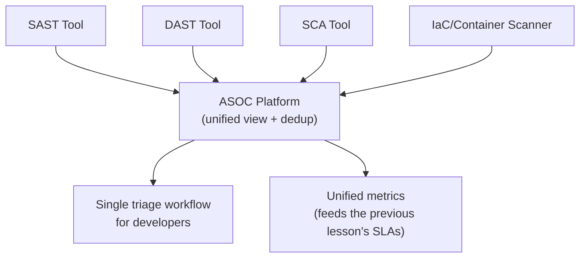

# AppSec Tooling & Orchestration

The building-appsec-program lesson closed with a practical maturity ladder and first-90-days plan. This lesson covers something that becomes a real, recurring operational challenge once a program has actually reached that ladder's higher rungs — managing the growing collection of tools (SAST, DAST, SCA, IaC scanning, container scanning, and more, all covered across this path) that a mature program accumulates, directly connecting to the previous lesson's vulnerability-management coverage, since tool sprawl is a major contributor to the exact prioritization problem that lesson addressed.

## Tool sprawl — a genuine, predictable side effect of program maturity

A genuinely common pattern: a growing AppSec program adopts a SAST tool, then a DAST tool, then an SCA tool, then IaC scanning, then container scanning — each individually a reasonable, well-justified decision — and ends up with half a dozen or more separate tools, each with its own dashboard, its own finding format, its own alert channel, and no unified view across any of them. This **tool sprawl** creates genuine operational cost: developers checking multiple disconnected dashboards, duplicate findings reported differently by overlapping tools, and no single source of truth for the program's actual overall risk posture.

## ASOC platforms — bringing findings into one place

**Application Security Orchestration and Correlation (ASOC)** platforms exist specifically to solve this consolidation problem — ingesting findings from every individual scanning tool (SAST, DAST, SCA, and more) into a single, unified view, automatically deduplicating findings that multiple tools flag independently (the same underlying vulnerable dependency, for instance, caught by both an SCA tool and a container scanner), and providing one consistent workflow for triage, assignment, and tracking regardless of which underlying tool originally found the issue.

## Why deduplication genuinely matters, not just for tidiness

Directly connecting to the vulnerability-management lesson's volume-problem coverage: without automated deduplication, the same underlying issue reported separately by three different tools appears as three separate findings requiring three separate triage decisions, artificially inflating both the apparent finding count and the actual triage workload — a genuinely wasteful, avoidable cost that compounds as more scanning tools get added to the pipeline over time.

## Build vs. buy — the genuine tradeoff

A practical decision every maturing program faces: building custom tooling and dashboards internally (genuine flexibility, but ongoing maintenance burden falling entirely on the AppSec team's own limited capacity) versus adopting a commercial or open-source ASOC platform (faster to deploy, less maintenance burden, but potentially less precisely tailored to an organization's specific workflow and existing tool mix). Directly connecting to the building-appsec-program lesson's maturity framing, this decision generally makes more sense to defer until a program has genuinely outgrown simpler, more manual tracking — building elaborate tooling before the underlying process and team maturity justify it is a common, costly overinvestment pattern.

## Tool consolidation as a deliberate, periodic exercise

A genuinely underused practice: periodically (annually, or when adding significant new capability) reviewing the entire tool portfolio for genuine overlap and redundancy — two SCA tools purchased by different teams at different times covering nearly identical capability, for instance — and deliberately consolidating rather than letting every previously-adopted tool simply continue running indefinitely by default. Directly connecting to the metrics-that-matter lesson's budget-justification framing, tool consolidation is frequently one of the most persuasive, concrete cost-savings arguments an AppSec program can bring to a budget conversation.

:::tip Orchestration serves developers, not just the AppSec team's own dashboard
The genuine measure of successful tool orchestration isn't a prettier internal AppSec dashboard — it's whether a developer, working in their normal tools (their IDE, their pull request view, their existing ticketing system), sees a single, clear, deduplicated finding with clear remediation guidance, rather than being expected to separately check several different security tools' own interfaces to understand their team's actual risk picture. Orchestration that only consolidates the AppSec team's own internal view, without improving what developers actually experience, has missed much of the real point.
:::

:::challenge Test yourself
Why does automated finding deduplication across multiple scanning tools provide more value than simply improving each individual tool's own accuracy independently?
:::

## Key terms

- **Tool sprawl** — the accumulation of many disconnected security scanning tools, each with its own dashboard and finding format.
- **ASOC (Application Security Orchestration and Correlation)** — platforms unifying findings from multiple scanning tools into one deduplicated, consistent workflow.
- **Tool consolidation** — the deliberate, periodic practice of reviewing and reducing genuine overlap across an accumulated tool portfolio.

## Recap

Growing AppSec programs predictably accumulate tool sprawl as they adopt SAST, DAST, SCA, IaC, and container scanning tools individually over time, creating genuine operational cost through disconnected dashboards and duplicate findings. ASOC platforms consolidate findings into one unified, deduplicated workflow, with the build-versus-buy decision generally best deferred until a program has genuinely outgrown simpler tracking. Periodic, deliberate tool consolidation frequently provides a persuasive, concrete cost-savings argument, and genuine orchestration success is measured by what developers actually experience, not just a cleaner internal dashboard.

???refs
- [OWASP DevSecOps Maturity Model](https://dsomm.owasp.org/)
- [Gartner — Application Security Testing Orchestration](https://www.gartner.com/en/documents)
???
