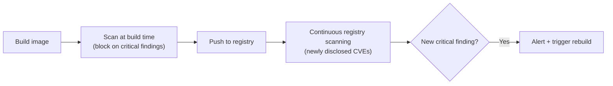

# Container Image & Registry Security

The CI/CD security lesson covered the pipeline itself as a target. This lesson covers a specific artifact that pipeline typically produces and ships — the **container image** — directly connecting to Path 16's containers-and-Kubernetes lesson's Trivy coverage, now applied specifically to the DevSecOps program-building perspective rather than individual hands-on scanning.

## Why container images need their own dedicated security process

A container image bundles an application together with its entire runtime dependency stack — the base operating system layer, system libraries, language runtimes, and application code — into a single distributable artifact. This means a container image's security posture depends on far more than just the application code the development team actually wrote; it inherits every vulnerability present in every layer beneath it, often including components nobody on the immediate development team is actively tracking or patching.

## Base image selection — the decision that shapes everything downstream

A genuinely high-leverage decision, made once but affecting every image built from it afterward: choosing a minimal, actively-maintained **base image** dramatically reduces the attack surface inherited by every application built on top of it. A full general-purpose OS base image carries dozens of unnecessary packages, each a potential source of vulnerabilities; a minimal or **distroless** base image (containing only the exact runtime dependencies an application actually needs, nothing else) meaningfully shrinks that inherited risk before a single line of application code is even added.

## Image scanning at every pipeline stage, not just once

Directly connecting to the SAST/DAST/SCA lesson's scanning-trio framing: container image scanning (checking every layer for known-vulnerable package versions, again typically via **Trivy**, **Grype**, or similar tools) belongs at multiple points, not just once — scanning during the build stage catches issues before an image is ever pushed to a registry, and scanning images already sitting in the registry catches newly-disclosed vulnerabilities in packages that were secure when the image was originally built but have since had a CVE published against them.

## Image signing and provenance — verifying what actually gets deployed

Directly connecting to the secrets-supply-chain lesson's supply-chain trust concerns: **image signing** (using tools like **Cosign**) cryptographically signs a built image, letting a deployment pipeline verify that the image about to be deployed genuinely came from the expected, trusted build process, and hasn't been tampered with or substituted somewhere between build and deployment — directly connecting to Path 00's digital-signature cryptography coverage, applied here to the specific software-supply-chain problem of ensuring "what we tested is actually what gets deployed."

## Registry access control — an often-overlooked layer

A genuinely common gap: a container registry (where built images are stored before deployment) left with overly permissive access, letting anyone with basic credentials push new images — directly connecting to Path 16's iam-deep-dive lesson, this creates a genuine supply-chain risk, since an attacker who can push a malicious image to a trusted registry can potentially get that image deployed to production simply by having it match an expected naming/tagging convention, without ever needing to compromise the actual build pipeline at all.

## Runtime image immutability

A genuinely valuable operational practice: treating deployed containers as **immutable** — never patching or modifying a running container directly, instead always rebuilding a new image from the updated source and redeploying it. This ensures the image scanning and signing verification described above actually reflects what's running in production at all times, rather than production drifting away from what was originally scanned and verified through ad-hoc, undocumented runtime changes.

:::challenge Test yourself
Why does scanning a container image only once, at build time, fail to catch every vulnerability that image will eventually be exposed to over its deployed lifetime?
:::

## Key terms

- **Base image** — the foundational OS/runtime layer a container image is built on top of, shaping its inherited attack surface.
- **Distroless image** — a minimal base image containing only exact runtime dependencies, with no unnecessary packages.
- **Image signing** — cryptographically signing a built image to verify it hasn't been tampered with between build and deployment.

## Recap

Container images inherit vulnerabilities from every layer beneath the application code, making base image selection a high-leverage decision made once but affecting everything built afterward. Scanning belongs at both build time and continuously in the registry, since newly disclosed vulnerabilities affect previously-secure images retroactively. Image signing verifies deployment provenance, registry access control prevents malicious image substitution, and treating deployed containers as immutable keeps production aligned with what was actually scanned and verified.

???refs
- [Trivy](https://trivy.dev/) — comprehensive open-source container scanning, referenced throughout this course.
- [Cosign / Sigstore](https://www.sigstore.dev/) — the standard open-source image signing toolchain.
???
