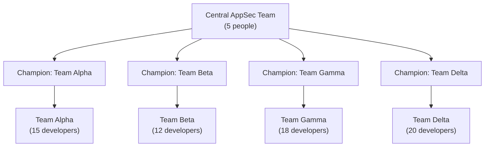

# Security Champions Programs

The threat-modeling-in-the-SDLC lesson covered a specific technical practice for finding design flaws early. This lesson covers the organizational structure that most successfully scales that practice (and every other shift-left practice this path has covered) across an engineering organization far larger than any central AppSec team could directly support — the **Security Champions** program.

## The scaling problem every AppSec team eventually hits

Directly connecting to the building-appsec-program lesson's maturity ladder: a central AppSec team, no matter how skilled, is almost always dramatically outnumbered by the total engineering organization it's responsible for supporting — a five-person AppSec team supporting two hundred developers across dozens of teams simply cannot personally review every design, attend every planning meeting, or manually threat-model every feature. Something has to scale beyond direct central-team involvement, or security work becomes an unavoidable bottleneck everyone resents.

## What a Security Champion actually is

A **Security Champion** is a developer, embedded within a regular engineering team (not a member of the central AppSec team itself), who takes on additional responsibility for security within that specific team — serving as the first point of contact for security questions, helping triage and prioritize findings relevant to their team's codebase, and acting as a local advocate who understands both their team's specific technical context and enough security knowledge to bridge the gap to the central AppSec team when needed.

## Why this genuinely scales, not just distributes work

The key structural insight, directly connecting to the metrics-that-matter lesson's coverage of trust-building: a Champion isn't simply doing the central AppSec team's job for free — they bring genuine local context (which parts of their team's codebase are legacy and fragile, which upcoming features carry real risk, how their specific team actually works) that a central team, however skilled, structurally can't have for every single team simultaneously. This local context makes security guidance genuinely more actionable and better-targeted than a one-size-fits-all central mandate could be, while also giving the central team a scalable communication channel into every team at once.

## What makes a Champions program succeed, versus fail

- **Genuine time allocation, not just a title** — a Champion given the role as an unfunded extra responsibility on top of an already-full workload, with no actual dedicated time carved out, tends to produce a program that exists on paper but does very little in practice
- **Real investment in Champion training** — directly connecting to Path 20's mentorship lesson, Champions genuinely benefit from structured learning paths, regular knowledge-sharing sessions with the central team, and increasingly deep, specialized security exposure over time, rather than a single onboarding session and then being left alone
- **Two-way communication, not just top-down dissemination** — a Champions program that only pushes central-team mandates outward, without genuinely listening to what Champions observe on the ground (recurring friction points, common false positives from scanning tools, realistic timelines), misses much of the actual value the distributed structure provides
- **Visible recognition and career benefit** — directly connecting to Path 20's entry-level-vs-experienced-paths lesson, a Champion role that provides genuine visibility, skill development, and a credible path toward specializing in security (should someone want to) sustains engagement far better than a role treated as purely additional, unrewarded burden

## Champions as a recruiting pipeline for the security team itself

A genuinely valuable, often underused side effect: a well-run Champions program frequently becomes an organic pipeline for identifying developers with genuine security aptitude and interest, who go on to formally transition into the central AppSec team itself — directly connecting to Path 16's specialise lesson and Path 20's entry-level-vs-experienced-paths coverage, this internal pathway is often a more reliable source of strong AppSec hires than external recruiting alone, since a Champion has already demonstrated genuine interest and real, observed competence within the organization's own specific context.

:::challenge Test yourself
Why does a Security Champions program scale an AppSec team's effective reach in a way that simply hiring more central AppSec staff, at the same headcount cost, generally can't replicate?
:::

## Key terms

- **Security Champion** — a developer embedded within a regular engineering team, taking on additional local security responsibility without being a formal AppSec team member.
- **Local context** — team-specific knowledge (legacy code, upcoming risk, team norms) a Champion brings that a central team structurally can't replicate at scale.
- **Champion recruiting pipeline** — the organic path from demonstrated Champion engagement into a formal AppSec career transition.

## Recap

A central AppSec team's direct capacity is almost always dramatically outmatched by the size of the engineering organization it supports, creating a genuine scaling problem. Security Champions, embedded within regular teams, provide local context and a scalable communication channel that a central team alone can't replicate. Successful programs require genuine dedicated time, real training investment, two-way communication, and visible recognition — and frequently become an organic, high-quality recruiting pipeline into the central security team itself.

???refs
- [OWASP — Security Champions Guide](https://owasp.org/www-project-security-champions-guidebook/)
- [SANS — Building a Security Champions Program](https://www.sans.org/white-papers/)
???
