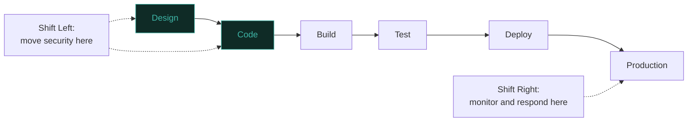

# Shift Left vs. Shift Right

The what-is-DevSecOps lesson introduced "security folded into every stage of delivery" as the core idea. This lesson unpacks the two specific directions that folding actually happens in — **shift left** and **shift right** — since the phrase "shift left" gets used constantly in this field without always being explained precisely, and the newer "shift right" half of the picture is even less commonly understood.

## Shift left, precisely defined

**Shift left** means moving security activities earlier in the software development lifecycle — from a final pre-release security review (traditionally happening right before deployment, the furthest "right" point) toward design, coding, and early testing phases instead. The core economic argument: a vulnerability found during design or code review costs dramatically less to fix than the exact same vulnerability found in production, since fixing it earlier avoids the cost of already-shipped code, customer impact, and emergency patching under pressure.

## Why shift left isn't a silver bullet

Directly connecting to the threat-modeling-sdlc lesson: shift left genuinely reduces the *volume* of vulnerabilities that make it to production, but it doesn't eliminate the need for runtime security entirely — no amount of design review, static analysis, or code review catches every possible issue, particularly ones that only manifest under real production conditions (unexpected traffic patterns, actual attacker behavior, integration issues between services that only surface at scale). Treating shift left as sufficient on its own, with no runtime security investment, is a genuinely common and costly mistake.

## Shift right — the underappreciated other half

**Shift right** means extending security practices into production itself — runtime monitoring, real-user behavior analysis, and active response capability for the issues that inevitably still reach production despite shift-left efforts. Directly connecting to Path 16's threat-hunting-fundamentals and Path 24's UEBA coverage, shift-right practices include runtime application self-protection (RASP), production-environment vulnerability scanning, and chaos engineering-adjacent security testing (deliberately probing production-like environments for weaknesses under realistic conditions).

## Why mature programs need both, not one or the other

:::tip Shift left and shift right are complementary, not competing strategies
A genuinely important framing: an organization that only shifts left assumes its pre-production security controls are perfect, which they never are — new attack techniques emerge after code ships, and some vulnerability classes are only observable in a running production environment. An organization that only shifts right is accepting an unnecessarily high volume of preventable issues reaching production in the first place, when many could have been caught far more cheaply earlier. Mature AppSec programs, directly connecting to the building-appsec-program lesson's maturity ladder, invest in both simultaneously, with the specific balance shifting somewhat based on organizational risk tolerance and resources.
:::

## Practical shift-left implementations

- Security requirements defined at the design phase, before any code is written, directly connecting to the threat-modeling-sdlc lesson
- IDE-integrated static analysis providing feedback to developers as they type, rather than only in a separate, later CI stage
- Pre-commit hooks catching obvious issues (hardcoded secrets, known-vulnerable dependency versions) before code even reaches version control

## Practical shift-right implementations

- Runtime Application Self-Protection (RASP) — application-embedded monitoring that can detect and block attacks in real time within the running application itself, distinct from a perimeter-level WAF (Path 12)
- Production-safe canary deployments that gradually roll out changes, limiting the blast radius of any newly-introduced issue that pre-production testing missed
- Feature flags allowing rapid, code-deployment-free rollback of a feature discovered to have a security issue after release

:::challenge Test yourself
Why does an organization that invests heavily in shift-left practices still need meaningful shift-right investment, rather than treating a strong shift-left program as sufficient on its own?
:::

## Key terms

- **Shift left** — moving security activities earlier in the development lifecycle, toward design and coding phases.
- **Shift right** — extending security practices into production through runtime monitoring and active response.
- **RASP (Runtime Application Self-Protection)** — application-embedded security monitoring and blocking, distinct from perimeter-level controls.

## Recap

Shift left moves security earlier because vulnerabilities cost dramatically less to fix during design and coding than after production deployment. Shift right extends security into production runtime, since no amount of pre-production effort catches every issue, particularly ones only observable under real conditions. Mature AppSec programs invest in both simultaneously as complementary strategies, not a choice between them.

???refs
- [OWASP DevSecOps Guideline](https://owasp.org/www-project-devsecops-guideline/)
- [NIST SSDF (Secure Software Development Framework)](https://csrc.nist.gov/Projects/ssdf)
???
