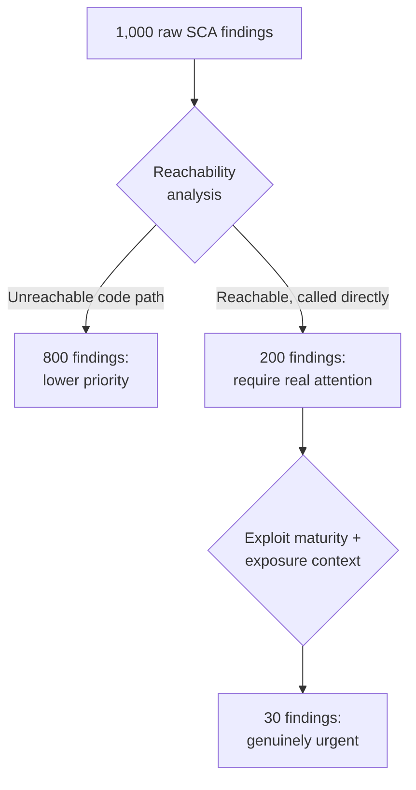

# Vulnerability Management & Prioritization

The metrics-that-matter lesson covered the numbers that earn leadership buy-in. This lesson covers the operational process generating most of those numbers in the first place — how a real AppSec program actually manages the ongoing flood of findings that SAST, DAST, SCA, and IaC scanning (all covered earlier in this path) produce, directly connecting to Path 16's malware-triage-methodology lesson's "not every finding deserves the same effort" framing, now applied to vulnerability management at organizational scale.

## The volume problem every scanning-heavy program eventually hits

A genuinely important, often underestimated reality: a mature AppSec program running SAST, DAST, SCA, and container/IaC scanning across dozens of applications generates an enormous volume of findings — often thousands, frequently with meaningful false-positive rates. Without a genuinely systematic prioritization process, this volume either overwhelms engineering teams with noise they learn to ignore, or overwhelms the AppSec team trying to manually triage every single finding individually.

## CVSS alone is genuinely insufficient for prioritization

Directly connecting to Path 15's report-writing lesson's CVSS coverage: a CVSS score captures a vulnerability's theoretical technical severity, but says nothing about whether that vulnerability is actually **exploitable in this specific application's real context**, or whether it's even **reachable** at all — a critical CVSS-scored vulnerability in a dependency function your application never actually calls poses genuinely lower real-world risk than a medium-scored vulnerability in code processing untrusted user input directly.

## Reachability analysis — the filter that cuts through the noise

A genuinely valuable, increasingly common technique: **reachability analysis** determines whether a vulnerable function within a dependency is actually called, directly or transitively, by the application's own code — directly connecting to the SBOM lesson's dependency-tree visibility, many modern SCA tools can perform this analysis automatically, dramatically reducing the effective volume of findings that genuinely require attention by filtering out vulnerabilities in code paths the application never actually exercises.

## Exploit maturity and active exploitation — the other key filter

Directly connecting to Path 12's threat-intelligence-adjacent coverage: prioritization should also weigh whether a public, working exploit already exists for a given vulnerability, and whether it's being **actively exploited in the wild** (tracked, for instance, by CISA's Known Exploited Vulnerabilities catalog) — a vulnerability with active, ongoing exploitation deserves genuinely urgent priority regardless of its raw CVSS score, since the "will an attacker actually use this" question has already been answered affirmatively by real-world observed activity.

## Setting realistic SLAs by severity tier

A genuinely practical operational necessity: defining explicit **Service Level Agreements (SLAs)** for remediation timelines by severity and exploitability tier — critical, actively-exploited findings might carry a 24-48 hour remediation SLA, while low-severity, unreachable findings might reasonably sit in a backlog for months without urgent action. Directly connecting to the metrics-that-matter lesson: SLA compliance rate itself becomes a genuinely meaningful program health metric, distinct from simply counting total open findings.

## Risk acceptance — the process for findings that won't be fixed

A genuinely important, often-missing formal process: not every finding gets remediated — sometimes the fix genuinely isn't worth the engineering cost relative to the actual risk, or a compensating control elsewhere in the architecture already meaningfully mitigates the risk. A mature program has an explicit **risk acceptance** process — a documented, time-bound, appropriately-approved decision to knowingly not remediate a specific finding — rather than findings simply languishing unaddressed with no formal decision ever actually made, which directly connects to Path 23's GRC lesson's governance-documentation requirements.

:::challenge Test yourself
Why does reachability analysis provide genuinely more actionable prioritization signal than CVSS score alone, for a dependency vulnerability specifically?
:::

## Key terms

- **Reachability analysis** — determining whether a vulnerable dependency function is actually called by an application's own code.
- **Known Exploited Vulnerabilities (KEV)** — a tracked catalog of vulnerabilities with confirmed active, real-world exploitation.
- **Risk acceptance** — a documented, time-bound, formally approved decision not to remediate a specific finding.

## Recap

Mature scanning programs generate enormous finding volumes that overwhelm both engineering teams and central AppSec staff without systematic prioritization. CVSS alone is insufficient; reachability analysis and active-exploitation status provide meaningfully more actionable signal about real-world risk. Explicit remediation SLAs by severity tier make prioritization operational and measurable, and a formal risk acceptance process handles findings that genuinely won't be fixed, rather than leaving them in undocumented limbo.

???refs
- [CISA Known Exploited Vulnerabilities Catalog](https://www.cisa.gov/known-exploited-vulnerabilities-catalog)
- [FIRST — EPSS (Exploit Prediction Scoring System)](https://www.first.org/epss/) — a complementary, likelihood-based scoring model.
???
