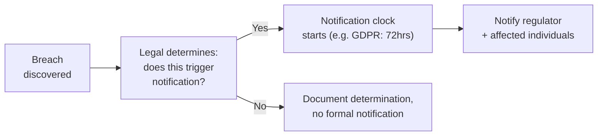

# Breach Notification & Disclosure Law

The third-party-vendor-risk lesson covered contractual breach notification clauses briefly, as part of the vendor risk lifecycle. This lesson goes deep specifically into the legal landscape around breach notification — a genuinely important, high-stakes area where GRC work intersects directly with legal obligation, directly connecting to Path 16's DFIR lesson's incident response phases, since notification obligations directly shape what an organization must do during and after containing an actual breach.

## Why breach notification law exists, and why it's fragmented

Breach notification laws exist to ensure affected individuals and regulators learn about a data breach within a defined, mandated timeframe, rather than an organization being free to quietly manage a breach internally with no external accountability. Directly connecting to the other-compliance-frameworks lesson's fragmented-landscape point: in the US specifically, there's no single unified federal breach notification law — all fifty states have their own, sometimes materially different, notification requirements, creating genuine complexity for any organization operating nationally.

## What typically triggers a notification obligation

Most breach notification laws share a common structural pattern, even as specific details vary by jurisdiction: notification is typically triggered by unauthorized access to (or acquisition of) **specific categories of protected information** — often defined narrowly (Social Security numbers, financial account numbers combined with access credentials, health information) rather than any data exposure whatsoever. A genuinely important practical consequence: an incident exposing data that doesn't fall into a legally-defined protected category might not trigger a formal notification requirement at all, even if it's still a genuinely serious security incident worth addressing internally.

## The notification timeline — why speed matters legally, not just practically

Directly connecting to Path 16's DFIR lesson's containment phase: many notification laws impose specific, often tight deadlines — GDPR requires notifying the relevant supervisory authority within 72 hours of becoming aware of a breach, and several US state laws impose deadlines in the 30-60 day range for notifying affected individuals. This creates genuine time pressure that directly shapes incident response practice — an organization's IR plan needs to explicitly account for "when does the notification clock start, and who's responsible for making that legal determination quickly" as an integrated part of the response process, not an afterthought handled once technical containment is complete.

## Who actually makes the "does this trigger notification" call

A genuinely important, easy-to-overlook governance point directly connecting to the RACI-and-security-committees lesson: the determination of whether a specific incident legally triggers notification is fundamentally a **legal** judgment, not a purely technical one — meaning an organization's incident response plan needs explicit legal counsel involvement (internal or outside counsel specializing in data breach law) built directly into the response workflow, not consulted only after the fact once a decision has already been informally made by technical staff without that expertise.

## Notification content requirements — more than just "we had a breach"

Most laws specify not just *when* to notify but *what* the notification must contain — typically including what categories of information were involved, what steps the organization is taking in response, and what affected individuals can do to protect themselves (credit monitoring offers, password reset guidance). Directly connecting to Path 15's report-writing lesson's structured-communication discipline, a genuinely well-prepared organization has notification letter templates pre-drafted and legally reviewed *before* an incident occurs, rather than trying to draft legally sound, genuinely helpful notification language for the first time under the pressure of an active incident.

## Why this connects directly back to vendor risk

Directly connecting to the third-party-vendor-risk lesson: a vendor's own breach notification obligations to *your* organization need to be explicit, specific contract terms (exactly the "breach notification clauses" that lesson named) — without a contractually-mandated, specific timeframe for a vendor notifying you of their own breach affecting your data, your own legal notification clock may already be running against you before you even learn an incident affecting your data occurred at all.

:::challenge Test yourself
Why does the determination of whether a specific incident legally triggers breach notification need to be made by legal counsel rather than by technical incident response staff alone, even though technical staff typically understand the incident's actual scope and mechanics best?
:::

## Key terms

- **Protected information category** — the specific, legally-defined types of data (SSNs, financial credentials, health information) whose exposure typically triggers notification obligations.
- **Notification clock** — the legally mandated timeframe (e.g., GDPR's 72 hours) within which an organization must notify regulators or affected individuals after becoming aware of a breach.
- **Vendor notification clause** — a contract term specifying how quickly a vendor must notify your organization of a breach affecting your data.

## Recap

Breach notification law is genuinely fragmented, with no single unified US federal standard and significant variation across states and jurisdictions. Notification is typically triggered only by exposure of specific, legally-defined protected information categories, and strict timelines like GDPR's 72-hour window create genuine time pressure that must be built directly into incident response practice. The "does this trigger notification" determination is fundamentally a legal judgment requiring counsel involvement built into the response workflow, and pre-drafted, legally-reviewed notification templates avoid trying to write sound communication for the first time under active incident pressure. Vendor contracts need explicit, specific notification-timeframe clauses to avoid your own legal clock running before you even learn of an incident.

???refs
- [NCSL — Security Breach Notification Laws (state-by-state)](https://www.ncsl.org/technology-and-communication/security-breach-notification-laws)
- [GDPR Article 33 — Notification of a personal data breach](https://gdpr-info.eu/art-33-gdpr/)
???
