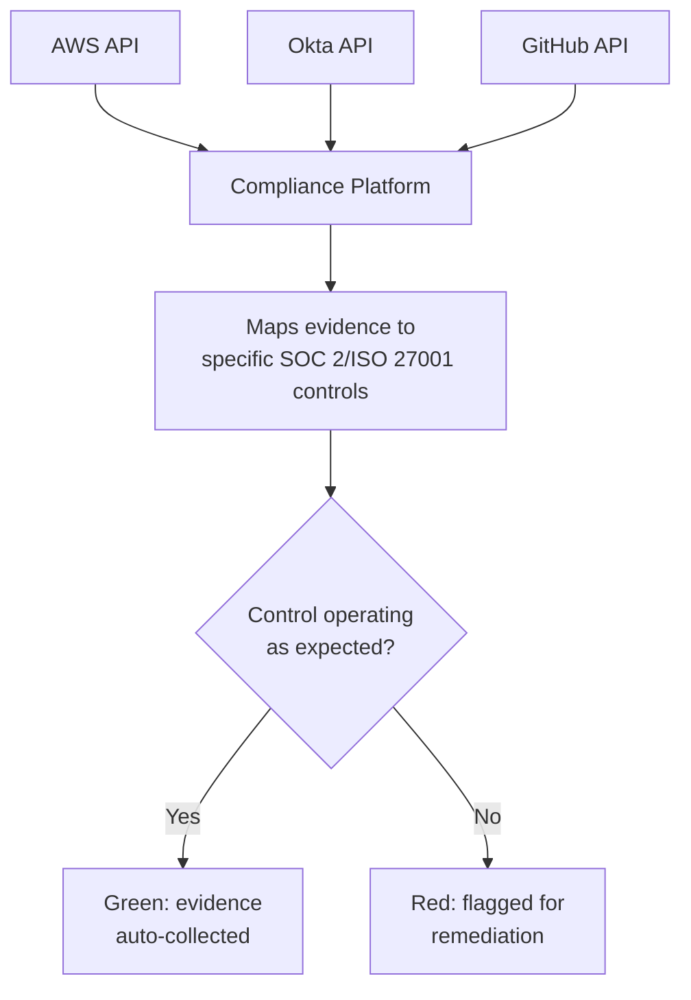

# GRC Automation Platforms, Deep Dive

The GRC tools and careers lesson mentioned Vanta, Drata, and Secureframe by name as tools worth knowing exist for interviews. This lesson goes deep into how these platforms actually work mechanically, since understanding the real mechanism (not just the product names) is exactly what distinguishes a genuinely strong GRC candidate from one who's only memorized a vendor list.

## The manual process these platforms replaced

Before compliance automation platforms existed, achieving SOC 2 or ISO 27001 certification meant genuinely manual, recurring **evidence collection** — a GRC analyst manually taking screenshots of AWS IAM settings, manually exporting access review reports from Okta, manually checking whether every employee had completed security training, repeated for every control, every audit period. Directly connecting to the previous lesson's grc-career-economics coverage, this manual burden was a genuine barrier keeping smaller companies from pursuing certification at all, since the labor cost was substantial relative to a small team's total capacity.

## How continuous evidence collection actually works

A compliance automation platform integrates directly with an organization's actual production systems — cloud infrastructure (AWS, GCP, Azure), identity providers (Okta, Google Workspace), code repositories (GitHub), and HR systems — via each system's own API, continuously pulling specific data points that serve as **evidence** that a given control is genuinely operating, not just documented as a policy.

## Control mapping — one piece of evidence, many frameworks

Directly connecting to the nist-800-53-control-families lesson's control-mapping coverage: a genuinely valuable capability these platforms provide is mapping a single piece of collected evidence to the corresponding control language across *multiple* frameworks simultaneously — an MFA enforcement setting pulled once from Okta might simultaneously satisfy a SOC 2 access control requirement, an ISO 27001 Annex A control, and a HIPAA Security Rule requirement, without needing to be separately collected and documented three times for three different audits, directly implementing the "build controls once, map to many frameworks" efficiency principle from the other-compliance-frameworks lesson.

## Continuous monitoring versus point-in-time evidence

A genuinely important distinction directly connecting to the isms-documentation-and-internal-audit lesson's "certification is a snapshot" point: because these platforms pull evidence continuously (often daily or even near-real-time) rather than once during an annual audit prep cycle, a control that stops operating correctly — an access review that's now 95 days overdue against a 90-day policy, exactly the example the base lesson's "day in the life" section described — gets flagged automatically and immediately, rather than only being discovered months later during the next audit cycle. This transforms compliance from a periodic scramble into something closer to genuine, ongoing operational monitoring.

## What automation genuinely doesn't replace

:::warning Automation collects evidence; it doesn't make judgment calls
A genuinely important limitation worth understanding clearly: these platforms are excellent at continuously confirming "does this specific technical setting match this specific control's requirement" — but they don't replace the genuinely human judgment work of interpreting ambiguous findings, deciding on appropriate risk treatment (directly connecting to the risk-management-fundamentals lesson's four treatment options), writing policy documents that survive contact with real teams (the policies-and-procedures lesson), or managing the actual relationship with an external auditor. A GRC analyst's role shifts, with automation, away from manual evidence-gathering drudgery and toward exactly this higher-judgment work — which is genuinely a more interesting, more strategically valuable use of a skilled analyst's time, not a threat to the role's relevance.
:::

## Vendor risk management modules — extending automation outward

Directly connecting to the third-party-vendor-risk lesson: many of these platforms have expanded beyond internal control evidence collection into **vendor risk management** modules specifically — automating aspects of the vendor questionnaire and tiering process that lesson described, tracking vendor security certifications and renewal dates, and flagging when a critical vendor's own compliance status changes or lapses.

:::challenge Test yourself
Why does continuous, near-real-time evidence collection represent a meaningfully different compliance posture than traditional annual audit-prep evidence gathering, beyond just being less manual work?
:::

## Key terms

- **Evidence collection** — gathering proof (screenshots, exports, API data) that a specific control is genuinely operating as documented.
- **Continuous monitoring** — automated, ongoing evidence collection that flags control failures near-immediately, rather than only during periodic audit prep.
- **Control mapping (automated)** — a platform automatically applying one piece of collected evidence to satisfy corresponding requirements across multiple compliance frameworks.

## Recap

Compliance automation platforms replaced genuinely manual, labor-intensive evidence collection with continuous, API-driven pulls from an organization's actual production systems. Automated control mapping lets one piece of evidence satisfy corresponding requirements across multiple frameworks simultaneously, and continuous monitoring transforms compliance from a periodic audit-prep scramble into ongoing operational awareness. These platforms don't replace the genuinely human judgment work of risk treatment decisions, policy writing, and auditor relationship management — automation shifts a GRC analyst's time toward that higher-value work, not away from relevance entirely.

???refs
- [Vanta — Trust Management Platform](https://www.vanta.com/)
- [Drata](https://drata.com/)
- [Secureframe](https://secureframe.com/)
???
