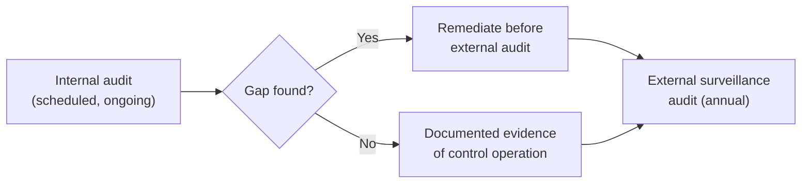

# ISMS Documentation & Internal Audit

The ISO 27001 overview lesson covered the PDCA cycle, Annex A controls, and the external certification process. This lesson goes deep into the day-to-day operational reality of running a certified **Information Security Management System (ISMS)** between audits — the documentation discipline and internal audit practice that actually determines whether certification is genuinely maintained or just achieved once and quietly allowed to decay.

## Why certification is a snapshot, not a permanent state

A genuinely important, easy-to-miss point: passing an ISO 27001 Stage 2 audit (covered in the base lesson) certifies that the ISMS met requirements *at that specific point in time*. Directly connecting to Path 22's vulnerability-management lesson's "not a one-time fix" framing, an ISMS that isn't actively maintained between annual surveillance audits gradually drifts away from what was originally certified — controls documented as operating a certain way stop actually operating that way, and nobody notices until the next external audit finds it, or worse, until an incident exposes the gap directly.

## Document control — the unglamorous discipline that matters enormously

Every ISMS requires **document control**: a formal process for creating, reviewing, approving, versioning, and eventually retiring every policy, procedure, and record the system depends on. This sounds bureaucratic, and genuinely can become so if implemented poorly, but its actual purpose is preventing a genuinely common, damaging failure — an auditor (or worse, an actual incident responder during a real breach) discovering that the "current" incident response procedure on file is actually an outdated version from two years ago, because nobody had a process ensuring updates actually replaced the old copy everywhere it existed.

## The internal audit — rehearsing before the real one

Directly connecting to the base lesson's Stage 2 audit coverage: ISO 27001 explicitly requires **internal audits** — a genuinely independent (internally, meaning the auditor doesn't audit their own work area) review checking whether the ISMS's actual practice matches its documentation, conducted on a defined schedule throughout the year, not just before the external certification audit. A mature internal audit program surfaces exactly the gaps an external auditor would find, but privately and with time to remediate, rather than as a surprise finding during the external audit that becomes part of the formal audit record.

## Corrective actions — closing the loop on findings

When an internal (or external) audit finds a genuine gap, ISO 27001 requires a formal **corrective action** process — not just fixing the immediate issue, but documenting the root cause and taking steps to prevent recurrence, directly connecting to Path 16's DFIR lesson's lessons-learned phase. A corrective action log that shows findings genuinely getting root-caused and closed (not just superficially patched) is itself a meaningful piece of evidence for an external auditor that the ISMS is functioning as a genuine, self-correcting management system rather than a paperwork exercise performed once for initial certification.

## Management review — where leadership actually engages

ISO 27001 also requires periodic **management review** — a formal meeting where organizational leadership reviews the ISMS's overall performance (audit results, risk register changes, incident trends, corrective action status) and makes genuine strategic decisions about resourcing and direction. Directly connecting to the RACI-and-security-committees lesson: this is precisely the kind of forum that fails if it exists only as a status broadcast rather than a venue for real decisions — an auditor specifically looks for evidence that management review actually changed something, not just that a meeting occurred and minutes were filed.

:::challenge Test yourself
Why does an internal audit finding a genuine gap represent a better outcome for an organization than the same gap being discovered during the external certification audit instead?
:::

## Key terms

- **Document control** — the formal process for creating, versioning, approving, and retiring every ISMS document, preventing outdated versions from remaining in active use.
- **Internal audit** — an independent, scheduled review checking whether ISMS practice matches documentation, conducted before the external audit.
- **Corrective action** — a formal process root-causing and remediating an audit finding, distinct from a superficial one-time fix.

## Recap

ISO 27001 certification represents a snapshot in time, not a permanent state, and an ISMS not actively maintained between audits gradually drifts away from what was originally certified. Document control prevents outdated policies and procedures from silently remaining in active use. Internal audits let an organization find and remediate gaps privately before the external audit, and a functioning corrective action process demonstrates genuine self-correction rather than a one-time paperwork exercise. Management review is where leadership genuinely engages with the ISMS's performance, and needs real decision-making substance to satisfy an auditor's scrutiny.

???refs
- [ISO 27001 — Internal Audit Requirements](https://www.iso.org/standard/27001)
- [ISACA — Document Control Best Practices](https://www.isaca.org/resources)
???
