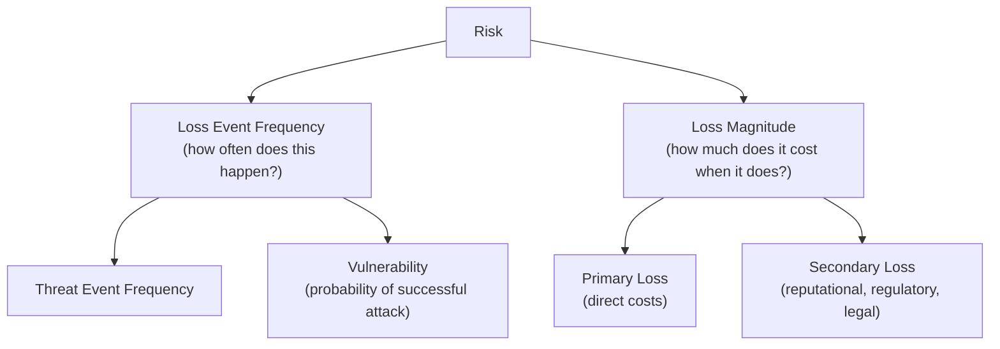

# Quantitative Risk Analysis & FAIR

The risk-management-fundamentals lesson introduced FAIR briefly as the leading quantitative risk methodology, reserved for big-ticket decisions. This lesson goes deep into how FAIR actually works mechanically, since understanding the real methodology (not just knowing the acronym) is exactly what distinguishes a genuinely strong GRC candidate in an interview from someone who only knows the term exists.

## Why quantitative analysis exists alongside qualitative scoring

Directly connecting to the risk-management-fundamentals lesson's qualitative-vs-quantitative distinction: a qualitative risk register (High/Medium/Low ratings) is fast and genuinely sufficient for the bulk of routine risk-register entries, but it has a real limitation for high-stakes decisions — "High" and "Medium" don't translate into a dollar figure a CFO or board can directly weigh against a specific proposed investment's cost. **FAIR (Factor Analysis of Information Risk)** exists specifically to bridge that gap, expressing risk in genuine financial terms.

## FAIR's core structure — breaking risk into measurable factors

FAIR decomposes risk into two primary branches, each further broken into measurable sub-factors:

Rather than asking "how risky is this, generally?" (the qualitative approach), FAIR forces the analyst to separately estimate how *often* a specific loss event might occur, and how *much* it would cost when it does — a genuinely more disciplined decomposition that surfaces exactly which assumption is actually driving the final risk estimate.

## Working with ranges, not false-precision point estimates

A genuinely important methodological detail: FAIR analysis uses **ranges and probability distributions** (a minimum, most-likely, and maximum estimate for each factor) rather than a single, falsely-precise point number — directly connecting to the honest-uncertainty-acknowledgment principle Path 18's ai-safety-evaluation-benchmarking lesson emphasized for a completely different domain, since claiming false precision ("this risk costs exactly $47,000 per year") misrepresents genuine uncertainty just as much in financial risk estimation as in any other measurement context.

## A simplified worked example

A company is evaluating whether to invest $150,000 in a new data loss prevention tool, versus accepting the current risk of a specific sensitive-data-exposure scenario:

- **Threat Event Frequency**: estimated 2–5 attempts per year (based on similar organizations' reported incident data)
- **Vulnerability**: estimated 10–20% chance any given attempt succeeds given current controls
- **Primary Loss**: estimated $200,000–$500,000 in direct incident response and remediation costs per successful event
- **Secondary Loss**: estimated $300,000–$1,000,000 in reputational/regulatory costs per successful event

Running these ranges through a **Monte Carlo simulation** (repeatedly sampling from each range's distribution to generate a distribution of overall possible annual loss outcomes, rather than a single number) produces an estimated annualized loss expectancy — directly comparable, in the same dollar units, against the tool's $150,000 cost, giving the board a genuinely apples-to-apples investment decision rather than a vague "this seems important" appeal.

## Why FAIR remains reserved for high-stakes decisions specifically

Directly connecting to the base lesson's framing: FAIR analysis genuinely requires meaningful time and data-gathering effort to do credibly — estimating each factor's range well requires either solid internal incident data (often limited, especially for lower-frequency events) or careful research into industry benchmarks. This effort is genuinely worth investing for a major, expensive decision (a large security tool purchase, cyber insurance policy sizing, a significant architecture change) but would be wasteful overhead applied to every routine entry in a risk register containing hundreds of items.

:::challenge Test yourself
Why does FAIR analysis use ranges and probability distributions for each risk factor rather than single point estimates, and what would be lost by using false-precision point numbers instead?
:::

## Key terms

- **FAIR (Factor Analysis of Information Risk)** — a quantitative risk methodology decomposing risk into loss event frequency and loss magnitude, expressed in financial terms.
- **Monte Carlo simulation** — repeatedly sampling from probability distributions to generate a realistic range of possible outcomes rather than a single estimate.
- **Annualized loss expectancy** — the estimated financial loss a risk represents per year, directly comparable against a proposed control's cost.

## Recap

FAIR bridges the gap qualitative risk scoring leaves for high-stakes decisions, expressing risk in genuine, comparable dollar terms rather than High/Medium/Low labels. It decomposes risk into loss event frequency and loss magnitude, using ranges and Monte Carlo simulation rather than false-precision point estimates, to produce an annualized loss expectancy directly comparable against a proposed investment's cost. The methodology's real effort requirement is exactly why it stays reserved for major decisions rather than routine risk-register entries.

???refs
- [FAIR Institute](https://www.fairinstitute.org/) — the definitive resource for the FAIR methodology.
- [Open FAIR Body of Knowledge](https://www.opengroup.org/certifications/openfair) — The Open Group's formal FAIR standard.
???
